# Jarkom Modul 5 - Operation Geofront - K-68

Laporan pengerjaan Praktikum Komunikasi Data dan Jaringan Komputer Modul 5.

| | |
|---|---|
| Kelompok | K-68 |
| Anggota | Ryan Adya Purwanto (5027231046), Made Gde Krisna Wangsa |
| Prefix kelompok | `192.245.0.0/16` |
| Controller | Group C, `http://10.4.89.250/` (wajib jaringan atau VPN ITS) |
| Image router | `ardhptr21/debinet:latest` |
| Image host | `ardhptr21/alpinet:latest` |

Pembagian: Ryan mengerjakan Babak 1 dan 2 (soal 1 sampai 12),
Made mengerjakan Babak 3 dan Babak Final (soal 13 sampai 20).

Laporan ini mencakup **Babak 1, soal 1 sampai 8**.

---

## Daftar isi

- [Topologi](#topologi)
- [Soal 1: Pembagian IP dengan VLSM](#soal-1-pembagian-ip-dengan-vlsm)
- [Soal 2: Membangun topologi dan memberi IP router](#soal-2-membangun-topologi-dan-memberi-ip-router)
- [Soal 3: Routing statis](#soal-3-routing-statis)
- [Soal 4: NAT dan DNS](#soal-4-nat-dan-dns)
- [Soal 5: Firewall Gendou](#soal-5-firewall-gendou)
- [Soal 6: IP statis node](#soal-6-ip-statis-node)
- [Soal 7: Listener MAGI](#soal-7-listener-magi)
- [Soal 8: Listener Pen-Pen dan Tokyo3-Core](#soal-8-listener-pen-pen-dan-tokyo3-core)
- [Asumsi yang diambil](#asumsi-yang-diambil)
- [Catatan teknis](#catatan-teknis)
- [Struktur repository](#struktur-repository)

---

## Topologi

17 router, 17 switch, 25 container, dan 1 NAT. Total 60 node dan 59 kabel.

```
NAT1
 └─ Gendou .......... Switch-Cmd (Tokyo3-Core)
    ├─ Yui .......... Switch-Hangar (Hangar-Crew)
    │  ├─ Rei ....... Switch-Quarters (Quarters)
    │  ├─ Mari ...... Switch-Dock (Dock-Crew)
    │  └─ Shinji .... Switch-Garden (Garden-Staff)
    ├─ Hikari ....... Switch-Comm (Comm-Net)
    │  └─ Kaworu .... Switch-Relay (Relay-Node)
    ├─ Asuka ........ Switch-Archive (Archive-Vault)
    │  ├─ Kensuke ... Switch-Bunker (Sachiel)
    │  └─ Ritsuko ... Switch-Lab (Entry-Plug, Dummy-Plug)
    ├─ Kaji ......... Switch-Intel (Spy)
    ├─ Misato ....... Switch-Cage (Unit-01, Unit-02, Unit-00)
    ├─ Shigeru ...... Switch-Monolith (Zeruel, Armisael)
    │  └─ Makoto .... Switch-Radar (Radar-Array)
    └─ Fuyutsuki .... Switch-Terminal (Magi-Casper, Magi-Balthasar, Magi-Melchior)
       ├─ Maya ...... Switch-Medic (Medic-Bay, Pen-Pen)
       └─ Toji ...... Switch-Dogma (Lilith, Adam)
```

Jumlah link antar router 16, sesuai yang disebut soal.

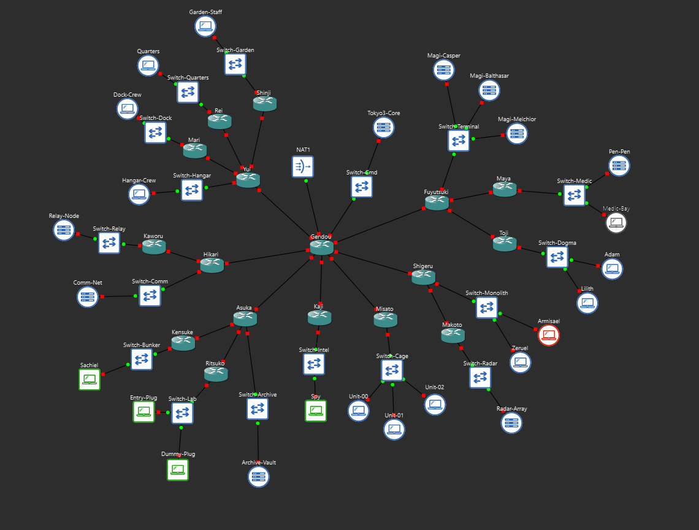

---

## Soal 1: Pembagian IP dengan VLSM

### Yang diminta

Membagi prefix kelompok dengan VLSM untuk 17 LAN dan 16 link antar router,
tiap subnet memakai prefix terkecil yang muat, urut dari kebutuhan terbesar.
Menampilkan tabel berisi network, prefix, gateway, broadcast, IP terpakai, dan sisa,
ditambah gambar pohon IP dengan subnet jalur Dummy-Plug ke Armisael dilingkari,
serta penjelasan hitungan satu subnet.

### Aturan yang dipakai

**1. Kebutuhan IP = jumlah host + 1 untuk gateway.**

Dasarnya glosarium: "gateway adalah IP usable pertama subnet", jadi gateway memakai
satu alamat usable. Bukti bahwa ini bacaan yang benar ada di dalam soal sendiri.
Tanpa menghitung gateway, Switch-Dogma dan Switch-Monolith yang berisi 2 host akan
jatuh ke `/30` yang hanya punya 2 alamat usable, sehingga tidak tersisa alamat untuk
Toji maupun Shigeru. Subnet seperti itu mustahil dipakai.

**2. Prefix tiap subnet adalah yang terkecil yang masih muat**, sesuai perintah soal
"tiap subnet memakai prefix terkecil yang muat".

**3. Alokasi urut dari kebutuhan terbesar ke terkecil.** Tie-break sesuai soal:
ukuran sama maka LAN dulu daripada link, lalu urutan tabel.

**4. Alamat awal tiap blok wajib kelipatan ukuran bloknya.**

### Menentukan prefix akar

Yang dijumlahkan adalah kapasitas yang dialokasikan, bukan yang dibutuhkan.

```
/23  x1   = 512
/24  x1   = 256
/25  x1   = 128
/26  x1   = 64
/27  x3   = 96
/28  x1   = 16
/29  x6   = 48
/30  x19  = 76      (3 LAN + 16 link)
            ----
            1196
```

Pangkat dua terkecil yang menampung 1196 adalah 2048, jadi akarnya `/21`.

Blok yang dipakai **`192.245.0.0/21`**, yaitu `192.245.0.0` sampai `192.245.7.255`.
Terpakai sampai `192.245.4.171`, sisa 852 alamat di ekor blok.

### Contoh hitungan satu subnet

Switch-Bunker, berisi container Sachiel yang mewakili 55 host.

1. Kebutuhan = 55 host + 1 gateway = **56 alamat usable**
2. Cari prefix terkecil yang muat.
   `/27` memberi 32 alamat, usable 30, tidak cukup.
   `/26` memberi 64 alamat, usable 62, cukup. Jadi dipakai **`/26`**
3. Giliran alokasi. Switch-Bunker adalah blok terbesar keempat, setelah
   Quarters `/23`, Comm `/24`, dan Hangar `/25`. Alamat bebas berikutnya
   adalah `192.245.3.128`
4. Cek alignment. `/26` berisi 64 alamat, jadi alamat awal harus kelipatan 64.
   Oktet keempat 128 adalah kelipatan 64, jadi sah
5. Hasilnya:

| | |
|---|---|
| Network | `192.245.3.128/26` |
| Netmask | `255.255.255.192` |
| Gateway | `192.245.3.129` milik Kensuke |
| Sachiel | `192.245.3.130` |
| Broadcast | `192.245.3.191` |
| Terpakai | 56 |
| Sisa | 6 |

### Gambar pohon IP

Akar `192.245.0.0/21` di kiri, dibelah dua terus ke kanan. Kotak biru adalah blok
yang masih dipecah, kotak hijau adalah subnet yang sudah dialokasikan, kotak abu-abu
putus-putus adalah blok yang tidak terpakai.

**Lima kotak kuning berbingkai merah** adalah subnet di jalur Dummy-Plug ke Armisael,
sesuai yang diminta soal.

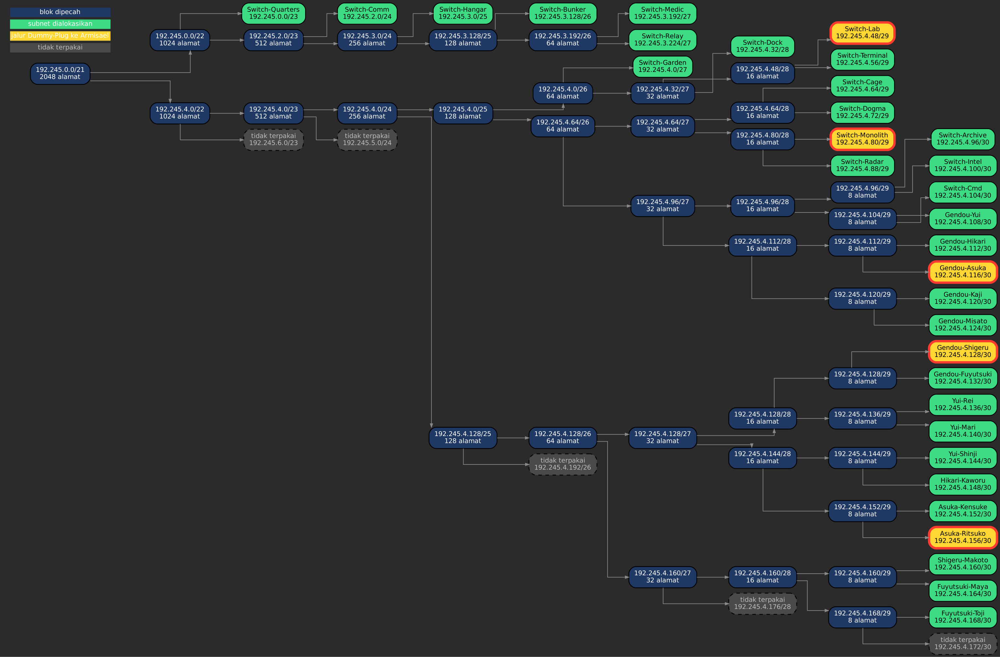

Jalur Dummy-Plug ke Armisael melewati 5 subnet:

```
Dummy-Plug -> Switch-Lab -> Ritsuko -> Asuka -> Gendou -> Shigeru -> Switch-Monolith -> Armisael
```

| Subnet | Network |
|---|---|
| Switch-Lab | `192.245.4.48/29` |
| Asuka-Ritsuko | `192.245.4.156/30` |
| Gendou-Asuka | `192.245.4.116/30` |
| Gendou-Shigeru | `192.245.4.128/30` |
| Switch-Monolith | `192.245.4.80/29` |

### Tabel lengkap 33 subnet

| No | Subnet | Isi | Butuh | Network | Prefix | Netmask | Gateway | Broadcast | Terpakai | Sisa |
|---|---|---|---|---|---|---|---|---|---|---|
| 1 | Switch-Quarters | Quarters 500 | 501 | 192.245.0.0 | /23 | 255.255.254.0 | 192.245.0.1 | 192.245.1.255 | 501 | 9 |
| 2 | Switch-Comm | Comm-Net 200 | 201 | 192.245.2.0 | /24 | 255.255.255.0 | 192.245.2.1 | 192.245.2.255 | 201 | 53 |
| 3 | Switch-Hangar | Hangar-Crew 100 | 101 | 192.245.3.0 | /25 | 255.255.255.128 | 192.245.3.1 | 192.245.3.127 | 101 | 25 |
| 4 | Switch-Bunker | Sachiel 55 | 56 | 192.245.3.128 | /26 | 255.255.255.192 | 192.245.3.129 | 192.245.3.191 | 56 | 6 |
| 5 | Switch-Medic | Pen-Pen 1, Medic-Bay 25 | 27 | 192.245.3.192 | /27 | 255.255.255.224 | 192.245.3.193 | 192.245.3.223 | 27 | 3 |
| 6 | Switch-Relay | Relay-Node 25 | 26 | 192.245.3.224 | /27 | 255.255.255.224 | 192.245.3.225 | 192.245.3.255 | 26 | 4 |
| 7 | Switch-Garden | Garden-Staff 14 | 15 | 192.245.4.0 | /27 | 255.255.255.224 | 192.245.4.1 | 192.245.4.31 | 15 | 15 |
| 8 | Switch-Dock | Dock-Crew 12 | 13 | 192.245.4.32 | /28 | 255.255.255.240 | 192.245.4.33 | 192.245.4.47 | 13 | 1 |
| 9 | Switch-Lab | Entry-Plug 3, Dummy-Plug 2 | 6 | 192.245.4.48 | /29 | 255.255.255.248 | 192.245.4.49 | 192.245.4.55 | 6 | 0 |
| 10 | Switch-Terminal | Magi-Casper 1, Magi-Balthasar 1, Magi-Melchior 1 | 4 | 192.245.4.56 | /29 | 255.255.255.248 | 192.245.4.57 | 192.245.4.63 | 4 | 2 |
| 11 | Switch-Cage | Unit-01 1, Unit-02 1, Unit-00 1 | 4 | 192.245.4.64 | /29 | 255.255.255.248 | 192.245.4.65 | 192.245.4.71 | 4 | 2 |
| 12 | Switch-Dogma | Lilith 1, Adam 1 | 3 | 192.245.4.72 | /29 | 255.255.255.248 | 192.245.4.73 | 192.245.4.79 | 3 | 3 |
| 13 | Switch-Monolith | Zeruel 1, Armisael 1 | 3 | 192.245.4.80 | /29 | 255.255.255.248 | 192.245.4.81 | 192.245.4.87 | 3 | 3 |
| 14 | Switch-Radar | Radar-Array 4 | 5 | 192.245.4.88 | /29 | 255.255.255.248 | 192.245.4.89 | 192.245.4.95 | 5 | 1 |
| 15 | Switch-Archive | Archive-Vault 1 | 2 | 192.245.4.96 | /30 | 255.255.255.252 | 192.245.4.97 | 192.245.4.99 | 2 | 0 |
| 16 | Switch-Intel | Spy 1 | 2 | 192.245.4.100 | /30 | 255.255.255.252 | 192.245.4.101 | 192.245.4.103 | 2 | 0 |
| 17 | Switch-Cmd | Tokyo3-Core 1 | 2 | 192.245.4.104 | /30 | 255.255.255.252 | 192.245.4.105 | 192.245.4.107 | 2 | 0 |
| 18 | Gendou-Yui | 2 interface router | 2 | 192.245.4.108 | /30 | 255.255.255.252 | 192.245.4.109 | 192.245.4.111 | 2 | 0 |
| 19 | Gendou-Hikari | 2 interface router | 2 | 192.245.4.112 | /30 | 255.255.255.252 | 192.245.4.113 | 192.245.4.115 | 2 | 0 |
| 20 | Gendou-Asuka | 2 interface router | 2 | 192.245.4.116 | /30 | 255.255.255.252 | 192.245.4.117 | 192.245.4.119 | 2 | 0 |
| 21 | Gendou-Kaji | 2 interface router | 2 | 192.245.4.120 | /30 | 255.255.255.252 | 192.245.4.121 | 192.245.4.123 | 2 | 0 |
| 22 | Gendou-Misato | 2 interface router | 2 | 192.245.4.124 | /30 | 255.255.255.252 | 192.245.4.125 | 192.245.4.127 | 2 | 0 |
| 23 | Gendou-Shigeru | 2 interface router | 2 | 192.245.4.128 | /30 | 255.255.255.252 | 192.245.4.129 | 192.245.4.131 | 2 | 0 |
| 24 | Gendou-Fuyutsuki | 2 interface router | 2 | 192.245.4.132 | /30 | 255.255.255.252 | 192.245.4.133 | 192.245.4.135 | 2 | 0 |
| 25 | Yui-Rei | 2 interface router | 2 | 192.245.4.136 | /30 | 255.255.255.252 | 192.245.4.137 | 192.245.4.139 | 2 | 0 |
| 26 | Yui-Mari | 2 interface router | 2 | 192.245.4.140 | /30 | 255.255.255.252 | 192.245.4.141 | 192.245.4.143 | 2 | 0 |
| 27 | Yui-Shinji | 2 interface router | 2 | 192.245.4.144 | /30 | 255.255.255.252 | 192.245.4.145 | 192.245.4.147 | 2 | 0 |
| 28 | Hikari-Kaworu | 2 interface router | 2 | 192.245.4.148 | /30 | 255.255.255.252 | 192.245.4.149 | 192.245.4.151 | 2 | 0 |
| 29 | Asuka-Kensuke | 2 interface router | 2 | 192.245.4.152 | /30 | 255.255.255.252 | 192.245.4.153 | 192.245.4.155 | 2 | 0 |
| 30 | Asuka-Ritsuko | 2 interface router | 2 | 192.245.4.156 | /30 | 255.255.255.252 | 192.245.4.157 | 192.245.4.159 | 2 | 0 |
| 31 | Shigeru-Makoto | 2 interface router | 2 | 192.245.4.160 | /30 | 255.255.255.252 | 192.245.4.161 | 192.245.4.163 | 2 | 0 |
| 32 | Fuyutsuki-Maya | 2 interface router | 2 | 192.245.4.164 | /30 | 255.255.255.252 | 192.245.4.165 | 192.245.4.167 | 2 | 0 |
| 33 | Fuyutsuki-Toji | 2 interface router | 2 | 192.245.4.168 | /30 | 255.255.255.252 | 192.245.4.169 | 192.245.4.171 | 2 | 0 |

Tabel yang sama tersedia juga dalam bentuk spreadsheet di `K-68_Modul_5.xlsx`,
sheet **Rute** dan **Pembagian IP - VLSM**.

Kolom Sisa bernilai 0 pada Switch-Lab, Switch-Archive, Switch-Intel, Switch-Cmd,
dan seluruh 16 link. Itu bukan kesalahan, justru berarti alokasinya pas tanpa
pemborosan sama sekali.

---

## Soal 2: Membangun topologi dan memberi IP router

### Yang diminta

Memasang semua node sesuai topologi, memberi IP ke tiap interface router sesuai
soal 1, mengaktifkan IP forwarding di semua router. Hanya Gendou yang terhubung
ke NAT1 dan mendapat alamat lewat DHCP. Bukti berupa `ip -br` di tiap router dan
ping dua ujung tiap link router ke router.

### Langkah 1: memasang node

60 node dipasang lebih dulu dan diberi nama, baru kabelnya ditarik. Memasang node
dan menarik kabel jangan dicampur, karena kabel yang terlewat baru ketahuan waktu
routing dan mencarinya jauh lebih lama.

Jumlah adapter tiap router diatur **per node** lewat klik kanan, Configure, Network,
Adapters. Tidak lewat Edit lalu Preferences, karena controller dipakai bersama
seluruh kelompok.

| Router | Adapter | Tersambung ke |
|---|---|---|
| Gendou | 9 | NAT1, Switch-Cmd, Yui, Hikari, Asuka, Kaji, Misato, Shigeru, Fuyutsuki |
| Yui | 5 | Gendou, Switch-Hangar, Rei, Mari, Shinji |
| Asuka | 4 | Gendou, Switch-Archive, Kensuke, Ritsuko |
| Fuyutsuki | 4 | Gendou, Switch-Terminal, Maya, Toji |
| Hikari | 3 | Gendou, Switch-Comm, Kaworu |
| Shigeru | 3 | Gendou, Switch-Monolith, Makoto |
| 11 router sisanya | 2 | induk dan switch masing-masing |

Total interface router 50. Container memakai adapter bawaan.

### Langkah 2: menarik 59 kabel

Aturan yang dipegang: **eth0 setiap router selalu menghadap ke atas**, ke arah Gendou.
Gendou eth0 menghadap NAT1.

Ini bukan sekadar kerapian. Soal 18 meminta Shigeru menolak berdasarkan arah datangnya
paket, yaitu sisi yang menghadap Gendou, dan melarang menulis subnet luar satu per satu.
Dengan eth0 konsisten, aturan itu cukup ditulis `-i eth0`.

Kabel dibagi tiga tahap: 17 kabel antar router dan NAT1, 17 kabel router ke switch,
lalu 25 kabel switch ke container.

Cara memeriksa setelah selesai: jumlah adapter tiap router sudah pas dengan jumlah
kabelnya, tidak dilebihkan. Jadi setelah 59 kabel terpasang, tidak boleh ada satu pun
router yang masih punya interface kosong.

### Langkah 3: memberi alamat tiap interface

Aturan alokasi pada link antar router: **router induk mendapat usable pertama**,
router anak mendapat usable kedua. Contoh pada link Gendou ke Yui `192.245.4.108/30`,
Gendou memakai `.109` dan Yui memakai `.110`.

Pada LAN, router gateway mendapat usable pertama.

Gendou eth0 memakai `dhcp`, bukan alamat statis, karena alamatnya datang dari NAT1.

Contoh isi `/etc/network/interfaces` di Gendou:

```
auto lo
iface lo inet loopback

auto eth0
iface eth0 inet dhcp

auto eth1
iface eth1 inet static
	address 192.245.4.105
	netmask 255.255.255.252

auto eth2
iface eth2 inet static
	address 192.245.4.109
	netmask 255.255.255.252
```

Daftar lengkap 50 interface ada di `soal2-interface.md`.

### Langkah 4: mengaktifkan IP forwarding

Di setiap router, lewat `/root/<nama>.sh`:

```bash
cat > /root/gendou.sh <<'EOF'
#!/bin/bash

sysctl -w net.ipv4.ip_forward=1
EOF
chmod +x /root/gendou.sh && /root/gendou.sh
```

File yang sama nanti ditambahi rute di soal 3, lalu NAT dan firewall di soal 4 dan 5
khusus Gendou. Lokasi `/root` dipilih karena hanya `/root` dan `/etc/network/interfaces`
yang bertahan saat node Docker direstart.

### Bukti: alamat tiap router

Gendou, dengan eth0 mendapat `192.168.122.62/24` dari DHCP NAT1:

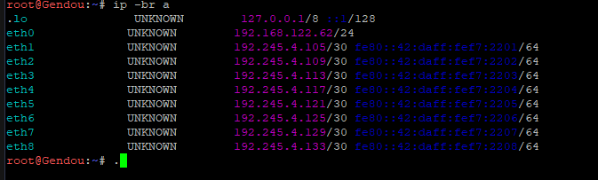

<details>
<summary>16 router lainnya, klik untuk membuka</summary>


**Yui**


**Rei**

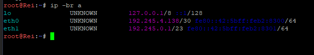


**Mari**

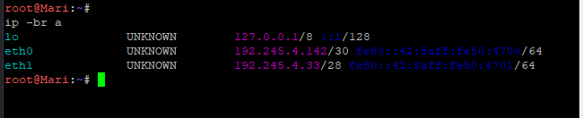


**Shinji**


**Hikari**

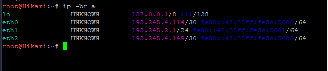


**Kaworu**


**Asuka**

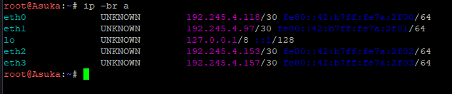


**Kensuke**

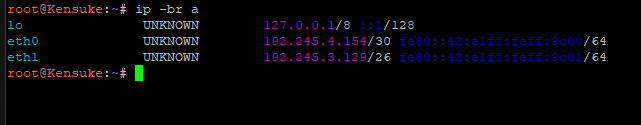


**Ritsuko**


**Kaji**

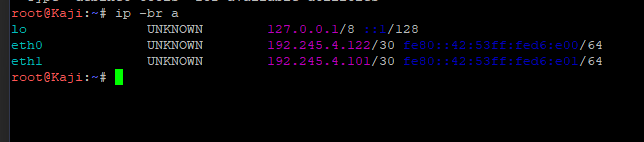


**Misato**


**Shigeru**


**Makoto**


**Fuyutsuki**

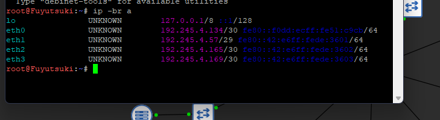


**Maya**


**Toji**

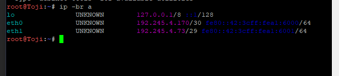


</details>

### Bukti: ping dua ujung tiap link

Pengujian dilakukan dari sisi induk, karena satu ping yang berhasil sudah membuktikan
kedua ujung hidup, balasannya datang dari ujung seberang. Enam console mencakup
seluruh 16 link.

Dari Gendou, 7 link:

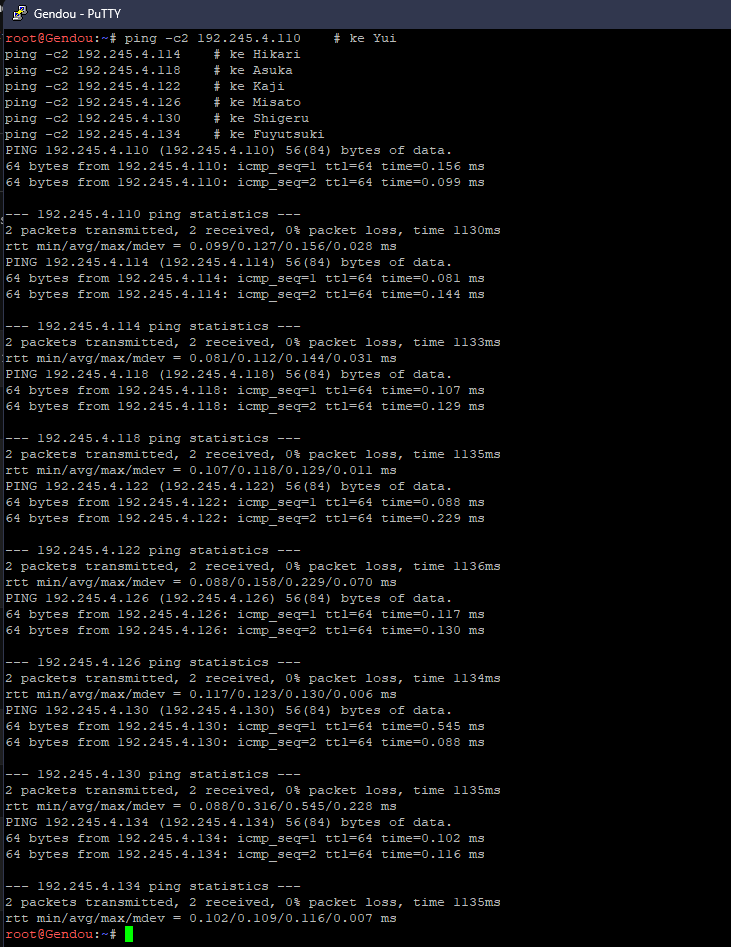

Dari Yui, 3 link:


<details>
<summary>Hikari, Asuka, Shigeru, Fuyutsuki, klik untuk membuka</summary>


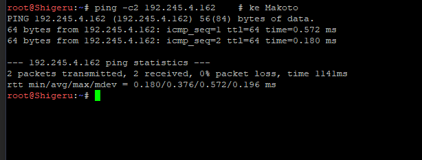

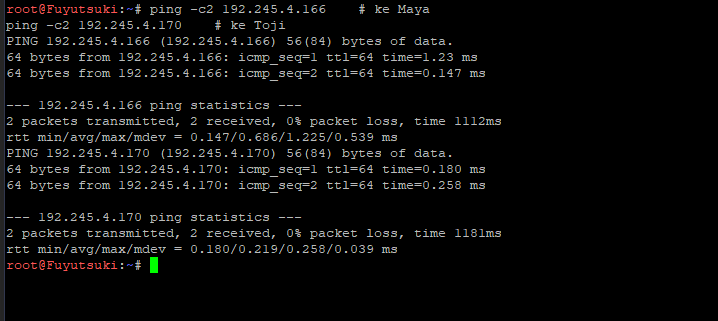

</details>

Seluruh 16 link 0% packet loss.

---

## Soal 3: Routing statis

### Yang diminta

Menghubungkan semua subnet dengan routing statis dan jumlah rute sesedikit mungkin.
Router selain Gendou cukup punya satu default route ke atas dan rute untuk subnet di
bawahnya. Gendou memakai default route ke NAT1. Subnet satu cabang yang bisa digabung
tepat menjadi satu CIDR harus diringkas. Bukti berupa Armisael bisa ping ke Lilith,
Sachiel, dan Comm-Net.

### Hasil

Total **31 rute statis**, tersebar seperti ini:

| Router | Rute statis |
|---|---|
| Gendou | 22 |
| Yui | 3 |
| Asuka, Fuyutsuki | 2 |
| Hikari, Shigeru | 1 |
| 11 router daun | 0, cukup default route |

Sebelas router daun, yaitu Rei, Mari, Shinji, Kaworu, Kensuke, Ritsuko, Kaji, Misato,
Makoto, Maya, dan Toji, tidak punya rute statis sama sekali karena tidak ada apa pun
di bawahnya.

### Ringkasan CIDR

Soal meminta subnet satu cabang yang bisa digabung **tepat** menjadi satu CIDR diringkas.
Yang memenuhi syarat itu hanya tiga:

| Ringkasan | Menggantikan |
|---|---|
| `192.245.4.136/29` | link Yui-Rei dan Yui-Mari |
| `192.245.4.152/29` | link Asuka-Kensuke dan Asuka-Ritsuko |
| `192.245.4.80/28` | Switch-Monolith dan Switch-Radar |

Sedikitnya jumlah ringkasan ini adalah konsekuensi logis dari VLSM. VLSM mengurutkan
alokasi dari kebutuhan terbesar secara global, sehingga subnet milik satu cabang
tersebar jauh di ruang alamat dan jarang membentuk blok utuh. Itu sebabnya soal
menulis "yang bisa digabung tepat", bukan "harus digabung".

Ketiga blok ringkasan sudah diverifikasi tidak memuat satu pun subnet milik cabang lain.

### Gendou: default route tidak ditulis manual

Default route Gendou ke NAT1 datang otomatis dari DHCP di eth0. Sengaja tidak ditulis
manual, karena menulisnya berarti memasukkan `192.168.122.1` secara hardcoded, dan itu
langsung melanggar syarat soal 4 yang melarang konfigurasi perlu diubah saat alamat
NAT1 berganti.

### Langkah

Dipakai `ip route replace`, bukan `ip route add`. Bedanya, `add` gagal dengan pesan
"File exists" kalau rutenya sudah ada, sedangkan `replace` aman dijalankan berkali-kali.
Ini juga yang membuat script memenuhi syarat idempotency di soal 20.

Contoh di Asuka:

```bash
cat > /root/asuka.sh <<'EOF'
#!/bin/bash

sysctl -w net.ipv4.ip_forward=1
echo "nameserver 8.8.8.8" > /etc/resolv.conf

# default ke Gendou
ip route replace default via 192.245.4.117

# Kensuke
ip route replace 192.245.3.128/26 via 192.245.4.154

# Ritsuko
ip route replace 192.245.4.48/29 via 192.245.4.158
EOF
chmod +x /root/asuka.sh && /root/asuka.sh
```

Isi lengkap 17 router ada di `soal04-nat-dns.md`.

Peta next hop di Gendou:

| Next hop | Router |
|---|---|
| `192.245.4.110` | Yui |
| `192.245.4.114` | Hikari |
| `192.245.4.118` | Asuka |
| `192.245.4.122` | Kaji |
| `192.245.4.126` | Misato |
| `192.245.4.130` | Shigeru |
| `192.245.4.134` | Fuyutsuki |

### Bukti

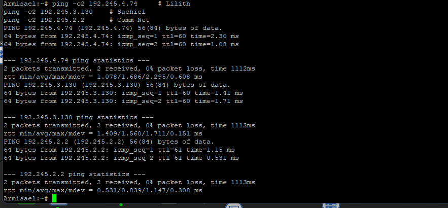

Ketiganya 0% packet loss. Nilai TTL ikut membuktikan jalurnya benar, bukan kebetulan.
Linux mengirim dengan TTL 64 dan tiap router mengurangi satu:

| Tujuan | TTL | Hop | Jalur |
|---|---|---|---|
| Lilith | 60 | 4 | Shigeru, Gendou, Fuyutsuki, Toji |
| Sachiel | 60 | 4 | Shigeru, Gendou, Asuka, Kensuke |
| Comm-Net | 61 | 3 | Shigeru, Gendou, Hikari |

Cocok persis dengan topologi.

---

## Soal 4: NAT dan DNS

### Yang diminta

Memberi seluruh jaringan akses internet lewat Gendou, dengan konfigurasi yang tidak
perlu diubah saat IP NAT1 berganti. Hanya traffic dari prefix internal yang keluar
lewat NAT1 yang boleh diterjemahkan alamatnya, sedangkan traffic antar-LAN harus tetap
membawa alamat asli pengirimnya. Node juga harus bisa me-resolve nama domain.

### Aturan NAT

```bash
iptables -t nat -C POSTROUTING -s 192.245.0.0/21 -o eth0 -j MASQUERADE 2>/dev/null || \
  iptables -t nat -A POSTROUTING -s 192.245.0.0/21 -o eth0 -j MASQUERADE
```

Empat keputusan dalam satu baris, masing-masing menjawab satu syarat soal.

**`MASQUERADE`, bukan `SNAT --to-source`.** MASQUERADE mengambil alamat sumber otomatis
dari eth0 setiap kali paket lewat, jadi kalau IP NAT1 berganti tidak ada yang perlu
diubah. `SNAT --to-source 192.168.122.62` akan hardcoded dan melanggar syarat soal.

**`-s 192.245.0.0/21`** membatasi hanya prefix internal yang diterjemahkan.

**`-o eth0`** membatasi hanya traffic yang keluar lewat NAT1. Traffic antar-LAN tidak
pernah melewati eth0, jadi tidak pernah tersentuh rule ini.

**`-C ... || -A`** artinya cek dulu, baru tambah kalau belum ada. Aman dijalankan
berkali-kali, sehingga rule tidak menumpuk setiap script dipanggil ulang.

### DNS

Tiap node diberi `nameserver 8.8.8.8`, dan barisnya ditaruh **di dalam** `/root/<nama>.sh`,
bukan diketik langsung ke `/etc/resolv.conf`. Alasannya `/etc/resolv.conf` tidak bertahan
setelah node restart, sedangkan `/root` bertahan.

```bash
echo "nameserver 8.8.8.8" > /etc/resolv.conf
```

### Bukti: akses internet dan resolusi nama

Dari Armisael:

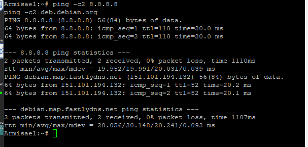

Dari Lilith:

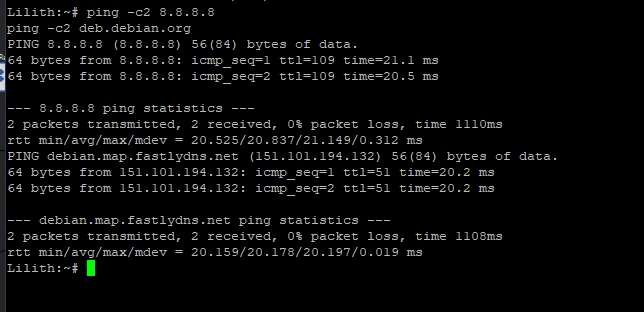

Keduanya berhasil ping `8.8.8.8` dan `deb.debian.org`, yang resolve ke
`debian.map.fastlydns.net` pada `151.101.194.132`. Jadi NAT dan DNS dua-duanya bekerja.

### Bukti: counter rule NAT

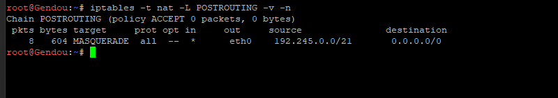

Counter menunjukkan `8 pkts, 604 bytes`. Angka itu bisa diverifikasi:
empat paket ICMP pertama dari dua node, 84 byte masing-masing, totalnya 336,
ditambah empat query DNS sekitar 67 byte, totalnya 268. Jumlahnya tepat 604.

### Bukti: traffic antar-LAN tidak di-NAT

Soal menyebut syarat ini eksplisit, jadi dibuktikan dengan membandingkan counter
sebelum dan sesudah.

Counter dinolkan terlebih dahulu:

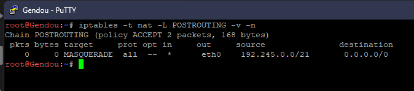

Lalu ping antar-LAN dari Armisael ke Comm-Net, 5 paket:


Lalu ping ke internet, 2 paket:


Counter setelah keduanya:

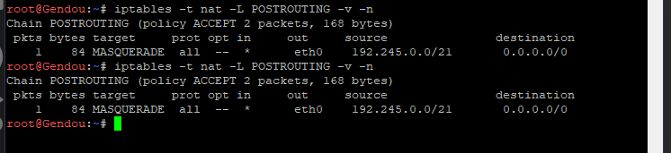

Hasilnya `1 pkts, 84 bytes`. Satu paket ICMP echo dengan 56 byte data tepat 84 byte
di level IP. Kalau 5 paket antar-LAN ikut di-NAT, angkanya akan 6 paket dan 504 byte.
Jadi traffic antar-LAN terbukti tidak tersentuh sama sekali.

Counter menunjukkan 1 dan bukan 2 karena tabel `nat` hanya dilewati **paket pertama
setiap koneksi**. Paket berikutnya ditangani conntrack tanpa menyentuh chain NAT lagi.

---

## Soal 5: Firewall Gendou

### Yang diminta

Mengubah policy INPUT dan FORWARD di Gendou menjadi DROP, lalu mengizinkan empat hal:
balasan koneksi yang sudah ada, traffic dari jaringan internal ke internet, traffic
antar-LAN, dan traffic dari jaringan internal ke Gendou sendiri. Loopback dan DHCP dari
NAT1 harus tetap jalan. Koneksi baru dari sisi NAT1 tidak boleh masuk, dan soal 2
sampai 4 harus tetap jalan.

### Aturan yang dipasang

| Rule | Menjawab |
|---|---|
| `-P INPUT DROP`, `-P FORWARD DROP` | policy yang diminta |
| `INPUT -i lo -j ACCEPT` | loopback tetap jalan |
| `INPUT -m conntrack --ctstate ESTABLISHED,RELATED -j ACCEPT` | (a) balasan koneksi yang sudah ada |
| `INPUT -i eth0 -p udp --sport 67 --dport 68 -j ACCEPT` | DHCP dari NAT1 |
| `INPUT ! -i eth0 -s 192.245.0.0/21 -j ACCEPT` | (d) internal ke Gendou sendiri |
| `FORWARD -m conntrack --ctstate ESTABLISHED,RELATED -j ACCEPT` | (a) balasan yang diteruskan |
| `FORWARD -s 192.245.0.0/21 -o eth0 -j ACCEPT` | (b) internal ke internet |
| `FORWARD ! -i eth0 ! -o eth0 -s 192.245.0.0/21 -d 192.245.0.0/21 -j ACCEPT` | (c) antar-LAN |

### Tiga keputusan yang perlu dijelaskan

**DHCP butuh rule sendiri walaupun sudah ada ESTABLISHED.** Gendou adalah klien DHCP.
Permintaannya dikirim dari `0.0.0.0` ke alamat broadcast sebelum dia punya alamat,
sehingga conntrack belum punya state untuk dicocokkan waktu balasannya datang. Tanpa
rule eksplisit `udp 67 ke 68`, eth0 akan kehilangan alamat saat lease diperbarui, dan
itu terjadi diam-diam beberapa jam kemudian sehingga sulit dilacak.

**`! -i eth0` ditambahkan pada rule internal.** Soal meminta izin untuk traffic dari
jaringan internal. Tanpa syarat interface, siapa pun dari sisi NAT1 bisa memalsukan
alamat sumber `192.245.x.x` dan langsung diterima. Dengan `! -i eth0`, paket yang
mengaku internal tapi datang dari luar tetap ditolak.

**Koneksi baru dari NAT1 tidak perlu rule DROP khusus.** Policy-nya sudah DROP dan
tidak ada satu pun rule ACCEPT yang cocok untuk paket baru yang masuk lewat eth0,
jadi otomatis jatuh ke policy.

### Bukti: daftar aturan

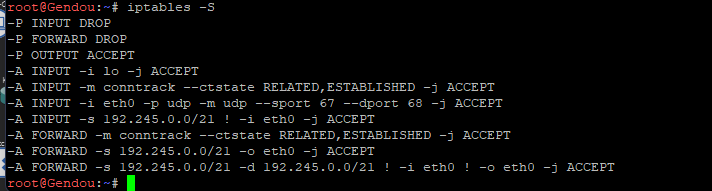

Catatan: `iptables -S` tanpa argumen hanya menampilkan tabel **filter**. Rule MASQUERADE
dari soal 4 berada di tabel **nat** dan dilihat dengan `iptables -t nat -S`.

### Bukti: soal 2 sampai 4 tidak rusak

Soal menyebut syarat ini eksplisit, jadi diuji satu per satu.

Soal 4, internet dari Armisael masih jalan:


Soal 2, Gendou masih bisa ping tetangganya:

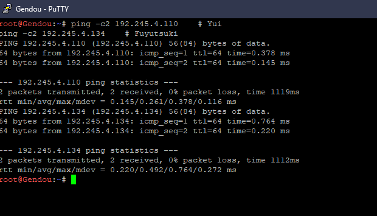

Soal 2 arah sebaliknya, Yui masih bisa ping Gendou, membuktikan rule INPUT internal
bekerja:


Soal 3, antar-LAN lewat Gendou masih jalan:

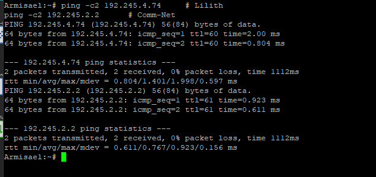

DHCP eth0 tidak putus:


---

## Soal 6: IP statis node

### Yang diminta

Memberi IP statis dan gateway ke semua node non-router sesuai aturan alamat di
glosarium, disimpan agar bertahan setelah restart. Bukti berupa `ip -br` dan ping ke
gateway di Unit-01.

### Aturan alamat

Dari glosarium: gateway memakai IP usable pertama, node berikutnya mengambil alamat
usable berikutnya **urut kiri ke kanan sesuai gambar soal**.

### Tabel 25 node

| Node | Switch | Alamat | Gateway |
|---|---|---|---|
| Quarters | Switch-Quarters | `192.245.0.2/23` | `192.245.0.1` |
| Comm-Net | Switch-Comm | `192.245.2.2/24` | `192.245.2.1` |
| Hangar-Crew | Switch-Hangar | `192.245.3.2/25` | `192.245.3.1` |
| Sachiel | Switch-Bunker | `192.245.3.130/26` | `192.245.3.129` |
| Medic-Bay | Switch-Medic | `192.245.3.194/27` | `192.245.3.193` |
| Pen-Pen | Switch-Medic | `192.245.3.195/27` | `192.245.3.193` |
| Relay-Node | Switch-Relay | `192.245.3.226/27` | `192.245.3.225` |
| Garden-Staff | Switch-Garden | `192.245.4.2/27` | `192.245.4.1` |
| Dock-Crew | Switch-Dock | `192.245.4.34/28` | `192.245.4.33` |
| Entry-Plug | Switch-Lab | `192.245.4.50/29` | `192.245.4.49` |
| Dummy-Plug | Switch-Lab | `192.245.4.51/29` | `192.245.4.49` |
| Magi-Casper | Switch-Terminal | `192.245.4.58/29` | `192.245.4.57` |
| Magi-Balthasar | Switch-Terminal | `192.245.4.59/29` | `192.245.4.57` |
| Magi-Melchior | Switch-Terminal | `192.245.4.60/29` | `192.245.4.57` |
| Unit-01 | Switch-Cage | `192.245.4.66/29` | `192.245.4.65` |
| Unit-02 | Switch-Cage | `192.245.4.67/29` | `192.245.4.65` |
| Unit-00 | Switch-Cage | `192.245.4.68/29` | `192.245.4.65` |
| Lilith | Switch-Dogma | `192.245.4.74/29` | `192.245.4.73` |
| Adam | Switch-Dogma | `192.245.4.75/29` | `192.245.4.73` |
| Zeruel | Switch-Monolith | `192.245.4.82/29` | `192.245.4.81` |
| Armisael | Switch-Monolith | `192.245.4.83/29` | `192.245.4.81` |
| Radar-Array | Switch-Radar | `192.245.4.90/29` | `192.245.4.89` |
| Archive-Vault | Switch-Archive | `192.245.4.98/30` | `192.245.4.97` |
| Spy | Switch-Intel | `192.245.4.102/30` | `192.245.4.101` |
| Tokyo3-Core | Switch-Cmd | `192.245.4.106/30` | `192.245.4.105` |

### Cara menyimpannya agar bertahan

Alamat ditulis ke `/etc/network/interfaces`, bukan dengan `ip addr add`. Hanya `/root`
dan `/etc/network/interfaces` yang bertahan saat node Docker direstart, dan file
interfaces dibaca otomatis saat node menyala.

Contoh di Unit-01:

```bash
cat > /etc/network/interfaces <<'EOF'
auto lo
iface lo inet loopback

auto eth0
iface eth0 inet static
	address 192.245.4.66
	netmask 255.255.255.248
	gateway 192.245.4.65
	post-up echo "nameserver 8.8.8.8" > /etc/resolv.conf
EOF
echo "nameserver 8.8.8.8" > /etc/resolv.conf
ip addr replace 192.245.4.66/29 dev eth0
ip route replace default via 192.245.4.65
```

Dua baris `ip` di akhir menerapkan alamatnya saat itu juga tanpa restart. Sengaja tidak
memakai `ifup`, karena perintah itu tidak ada di image debinet. Yang ada hanya di
alpinet, dari busybox.

### Bukti

Screenshot di bawah diambil pada node yang **baru saja dinyalakan ulang**, belum diketik
perintah apa pun. Alamat `192.245.4.66/29` muncul sendiri dan ping ke gateway berhasil,
jadi sekaligus membuktikan syarat bertahan setelah restart.


---

## Soal 7: Listener MAGI

### Yang diminta

Memasang `iptables` dan `netcat-traditional` lewat `/root/<nama>.sh` di Magi-Casper,
Magi-Balthasar, dan Magi-Melchior, lalu menyalakan listener sesuai port di glosarium.
Dari Lilith mengirim pesan ke ketiganya dan ke port 5001 Balthasar, lalu menampilkan
pesan yang diterima di tiap node.

### Port sesuai glosarium

| Node | Port |
|---|---|
| Magi-Casper | 5000 |
| Magi-Balthasar | 5000 dan 5001 |
| Magi-Melchior | 5000 |

### Script

Contoh di Magi-Balthasar:

```bash
cat > /root/magi-balthasar.sh <<'EOF'
#!/bin/bash

echo "nameserver 8.8.8.8" > /etc/resolv.conf

for i in $(seq 1 30); do ping -c1 -W1 8.8.8.8 >/dev/null 2>&1 && break; sleep 2; done

apt-get update -qq
apt-get install -y -qq iptables netcat-traditional

pkill -f 'nc -l -p 5000'
(while true; do nc -l -p 5000 >> /root/log-5000.txt; done) &
pkill -f 'nc -l -p 5001'
(while true; do nc -l -p 5001 >> /root/log-5001.txt; done) &
EOF
chmod +x /root/magi-balthasar.sh && /root/magi-balthasar.sh
```

Tiga keputusan di dalamnya:

**Paket dipasang di dalam script, bukan diketik langsung.** Paket hilang setiap node
restart, jadi `apt-get install` harus ikut dipanggil ulang.

**Script menunggu internet siap sebelum `apt-get`.** Saat seluruh node menyala bersamaan,
router mungkin belum selesai memasang rute. Tanpa penantian ini, instalasi gagal diam-diam.

**Listener dibungkus `while true`.** `nc -l` versi traditional berhenti setelah satu
koneksi ditutup. Tanpa loop, listener mati setelah uji pertama.

### Mengirim pesan dari Lilith

```bash
echo "halo Magi-Casper port 5000 dari Lilith" | nc -w 1 192.245.4.58 5000
echo "halo Magi-Balthasar port 5000 dari Lilith" | nc -w 1 192.245.4.59 5000
echo "halo Magi-Balthasar port 5001 dari Lilith" | nc -w 1 192.245.4.59 5001
echo "halo Magi-Melchior port 5000 dari Lilith" | nc -w 1 192.245.4.60 5000
```

Opsi `-w 1` wajib. Tanpa itu, `nc` versi BusyBox di alpinet tidak menutup koneksi setelah
mengirim dan terlihat seperti menggantung, padahal pesannya sudah sampai. Glosarium soal
sudah memperingatkan hal ini dengan menyebut "gunakan exit code, durasi koneksi, dan log
penerima sebagai bukti".

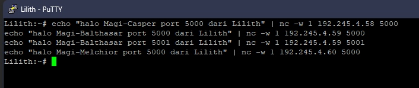

### Bukti: pesan yang diterima

Magi-Casper:

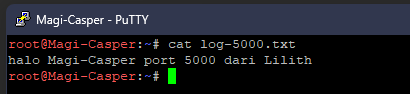

Magi-Balthasar, dua port:


Magi-Melchior:


### Bukti: paket terpasang


Fakta bahwa `nc -l -p 5000` bekerja juga membuktikan netcat-traditional memang yang
terpasang, karena versi OpenBSD tidak menerima sintaks `-p` untuk listener.

---

## Soal 8: Listener Pen-Pen dan Tokyo3-Core

### Yang diminta

Koneksi ke port 80 dijawab `Welcome to {hostname}`. Koneksi ke port 8080 di Tokyo3-Core
dijawab `syifa imutz`. Menunjukkan `nc` dari Lilith ke ketiga port itu, serta menunjukkan
bahwa port yang tidak dilayani, misalnya 22, langsung gagal dan bukan menggantung.

### Script

Pola berubah dari soal 7. Di soal 7 server hanya menerima, di soal 8 server harus
menjawab dengan banner.

Di Tokyo3-Core:

```bash
cat > /root/tokyo3-core.sh <<'EOF'
#!/bin/bash

echo "nameserver 8.8.8.8" > /etc/resolv.conf

for i in $(seq 1 30); do ping -c1 -W1 8.8.8.8 >/dev/null 2>&1 && break; sleep 2; done

apt-get update -qq
apt-get install -y -qq iptables netcat-traditional

pkill -f 'nc -l -p 80'
(while true; do echo "Welcome to $(hostname)" | nc -l -p 80; done) &
pkill -f 'nc -l -p 8080'
(while true; do echo "syifa imutz" | nc -l -p 8080; done) &
EOF
chmod +x /root/tokyo3-core.sh && /root/tokyo3-core.sh
```

### Bukti


| Uji | Hasil |
|---|---|
| Pen-Pen port 80 | `Welcome to Pen-Pen` |
| Tokyo3-Core port 80 | `Welcome to Tokyo3-Core` |
| Tokyo3-Core port 8080 | `syifa imutz` |
| Port 22 | gagal dalam 0,003 detik, exit code 1 |

Port 22 gagal seketika tanpa konfigurasi tambahan, karena tidak ada yang mendengarkan
di port itu dan tidak ada rule DROP, sehingga kernel langsung membalas TCP RST.

Dari Lilith yang memakai `nc` versi BusyBox, pesan `Connection refused` tidak dicetak.
Karena itu buktinya memakai kombinasi durasi dan exit code, sesuai saran glosarium.

---

## Asumsi yang diambil

Tiga tempat di mana soal tidak menyebut aturannya secara eksplisit, atau dua sumber di
dalam soal saling bertentangan.

**1. Gateway ikut dihitung dalam kebutuhan IP.** Soal tidak menyebutkannya, tapi
glosarium menulis "gateway adalah IP usable pertama subnet". Tanpa menghitung gateway,
Switch-Dogma dan Switch-Monolith akan jatuh ke `/30` yang tidak menyisakan alamat untuk
gateway, sehingga subnetnya mustahil dipakai.

**2. Urutan node di Switch-Medic mengikuti gambar, bukan tabel host.** Glosarium menulis
urutan alamat mengikuti "urutan penulisan nama node pada switch di gambar (kiri ke kanan)".
Di `topo_5.png`, Medic-Bay berada di kiri dan Pen-Pen di kanan, sedangkan tabel host di
soal menomori Pen-Pen lebih dulu. Dipakai urutan gambar, sehingga Medic-Bay mendapat
`192.245.3.194` dan Pen-Pen `192.245.3.195`. Ini satu-satunya titik di mana dua sumber
di dalam soal berbeda.

**3. Urutan 16 link antar router mengikuti urutan pohon dari Gendou ke bawah.** Soal
memberi aturan tie-break "lalu urutan tabel", tapi link tidak dinomori di tabel host.
Karena seluruh link berukuran `/30` yang sama, urutannya hanya menentukan blok mana yang
didapat masing-masing, tidak mengubah struktur maupun jumlah alamat yang dipakai.

**4. Nama file script mengikuti nama node.** Soal 5 menulis `gendo.sh` sedangkan node
bernama Gendou, dan soal 7 menulis `/root/<nama>.sh`. Dipakai `gendou.sh` mengikuti nama
node yang sebenarnya.

---

## Catatan teknis

Hal-hal yang ditemukan saat pengerjaan dan berguna untuk diulang.

**Hanya `/root` dan `/etc/network/interfaces` yang bertahan saat node Docker direstart.**
Isi `/etc` lain dan seluruh paket yang di-install hilang. Semua konfigurasi karena itu
ditulis lewat script di `/root`, dan script yang butuh paket memuat `apt-get install`
di dalamnya.

**Editor "Edit network configuration" di GNS3 membuang baris yang mengandung tanda `>`.**
Semua heredoc `cat >` dan redirect karena itu diketik lewat console node, bukan lewat
editor tersebut.

**Jumlah adapter diubah per node, bukan lewat Edit lalu Preferences.** Controller lab
dipakai bersama seluruh kelompok, dan mengubah template akan berdampak ke kelompok lain.

**`ifup` tidak ada di image debinet.** Yang ada hanya di alpinet lewat busybox. Untuk
menerapkan alamat pada node debinet dipakai `ip addr replace` dan `ip route replace`.

**Link di GNS3 bisa nyangkut setelah node direstart.** Gejalanya konfigurasi benar di
kedua ujung tapi traffic tidak lewat, dan ARP hanya berhasil satu arah. Terjadi pada
Switch-Cage saat soal 6. Perbaikannya mematikan dan menyalakan node, atau menghapus dan
memasang ulang kabelnya.

**Cara membaca pesan error ping:**

| Pesan | Artinya |
|---|---|
| `Network is unreachable` | router tidak punya rute, masalah routing |
| `Destination Host Unreachable` | rute ada, tujuannya yang tidak menjawab ARP |
| Timeout tanpa pesan | paket dibuang diam-diam, biasanya firewall |

Alamat pengirim pesan error menunjukkan sampai mana paket berhasil menempuh jalur.

**Tabel `nat` hanya dilewati paket pertama setiap koneksi.** Paket berikutnya ditangani
conntrack, sehingga `ping -c2` menambah counter 1, bukan 2.

---

## Struktur repository

```
.
├── README.md
├── K-68_Modul_5.xlsx            tabel Rute dan Pembagian IP
├── pohon-ip-vlsm.png            gambar pohon IP
├── pohon-ip-vlsm.svg
├── K-68_Modul5.gns3project      ekspor project GNS3
├── screenshot/                  bukti pengerjaan
├── script/                      script sabotase dari asisten
└── soal/                        gambar topologi dari asisten
```
