# Jarkom Modul 5 - Operation Geofront - K-68

Laporan pengerjaan Praktikum Komunikasi Data dan Jaringan Komputer Modul 5.

| | |
|---|---|
| Kelompok | K-68 |
| Anggota | Ryan Adya Purwanto (5027231046), Made Gde Krisna Wangsa (5027201047)|
| Prefix kelompok | `192.245.0.0/16` |
| Controller | Group C, `http://10.4.89.250/` (wajib jaringan atau VPN ITS) |
| Image router | `ardhptr21/debinet:latest` |
| Image host | `ardhptr21/alpinet:latest` |

Pembagian: Ryan mengerjakan Babak 1 dan 2 (soal 1 sampai 12),
Made mengerjakan Babak 3 dan Babak Final (soal 13 sampai 20).

Laporan ini mencakup **Babak 1 dan Babak 2, soal 1 sampai 12**, yaitu bagian Ryan.

---

## Daftar isi

- [Topologi](#topologi)
- [Babak 1: Membangun Geofront](#babak-1-membangun-geofront)
- [Soal 1: Pembagian IP dengan VLSM](#soal-1-pembagian-ip-dengan-vlsm)
- [Soal 2: Membangun topologi dan memberi IP router](#soal-2-membangun-topologi-dan-memberi-ip-router)
- [Soal 3: Routing statis](#soal-3-routing-statis)
- [Soal 4: NAT dan DNS](#soal-4-nat-dan-dns)
- [Soal 5: Firewall Gendou](#soal-5-firewall-gendou)
- [Soal 6: IP statis node](#soal-6-ip-statis-node)
- [Soal 7: Listener MAGI](#soal-7-listener-magi)
- [Soal 8: Listener Pen-Pen dan Tokyo3-Core](#soal-8-listener-pen-pen-dan-tokyo3-core)
- [Babak 2: Sabotase dan Hantu MAGI](#babak-2-sabotase-dan-hantu-magi)
- [Soal 9: Jalur belakang diutak-atik](#soal-9-jalur-belakang-diutak-atik)
- [Soal 10: Para pilot terkunci di dalam](#soal-10-para-pilot-terkunci-di-dalam)
- [Soal 11: Casper harus jadi hantu](#soal-11-casper-harus-jadi-hantu)
- [Soal 12: Teknisi yang kelewat semangat](#soal-12-teknisi-yang-kelewat-semangat)
- [Babak 3: Mengamankan MAGI dan Zona Sensitif](#babak-3-mengamankan-magi-dan-zona-sensitif)
- [Soal 13: Brankas Balthasar](#soal-13-brankas-balthasar)
- [Soal 14: Jam kunjungan sang pinguin](#soal-14-jam-kunjungan-sang-pinguin)
- [Soal 15 & 16: Banjir Ping dan Pencuri di Tokyo3-Core](#soal-15--16-banjir-ping-dan-pencuri-di-tokyo3-core)
- [Soal 17: Sihir hitam di jalur paket (DNAT)](#soal-17-sihir-hitam-di-jalur-paket-dnat)
- [Soal 18: Gerbang Monolith dan Radar](#soal-18-gerbang-monolith-dan-radar)
- [Soal 19: Hukuman untuk sang pengkhianat](#soal-19-hukuman-untuk-sang-pengkhianat)
- [Babak Final: Siap Dihancurkan, Siap Dibangun Lagi](#babak-final-siap-dihancurkan-siap-dibangun-lagi)
- [Soal 20: Uji kebakaran Geofront](#soal-20-uji-kebakaran-geofront)
- [Asumsi yang diambil](#asumsi-yang-diambil)
- [Catatan teknis](#catatan-teknis)
- [Struktur repository](#struktur-repository)

---

## Topologi

17 router, 17 switch, 25 container, dan 1 NAT. Total 60 node dan 59 kabel.

```
NAT1
 └─ Gendou .......... Switch-Cmd (Tokyo3-Core)
    ├─ Yui .......... Switch-Hangar (Hangar-Crew)
    │  ├─ Rei ....... Switch-Quarters (Quarters)
    │  ├─ Mari ...... Switch-Dock (Dock-Crew)
    │  └─ Shinji .... Switch-Garden (Garden-Staff)
    ├─ Hikari ....... Switch-Comm (Comm-Net)
    │  └─ Kaworu .... Switch-Relay (Relay-Node)
    ├─ Asuka ........ Switch-Archive (Archive-Vault)
    │  ├─ Kensuke ... Switch-Bunker (Sachiel)
    │  └─ Ritsuko ... Switch-Lab (Entry-Plug, Dummy-Plug)
    ├─ Kaji ......... Switch-Intel (Spy)
    ├─ Misato ....... Switch-Cage (Unit-01, Unit-02, Unit-00)
    ├─ Shigeru ...... Switch-Monolith (Zeruel, Armisael)
    │  └─ Makoto .... Switch-Radar (Radar-Array)
    └─ Fuyutsuki .... Switch-Terminal (Magi-Casper, Magi-Balthasar, Magi-Melchior)
       ├─ Maya ...... Switch-Medic (Medic-Bay, Pen-Pen)
       └─ Toji ...... Switch-Dogma (Lilith, Adam)
```

Jumlah link antar router 16, sesuai yang disebut soal.


---

## Babak 1: Membangun Geofront

Soal 1 sampai 8. Membangun topologi dari nol, membagi alamat, menyambungkan seluruh subnet,
membuka akses internet, mengunci pintu depan, lalu menyalakan layanan.

---

## Soal 1: Pembagian IP dengan VLSM

### Yang diminta

Membagi prefix kelompok dengan VLSM untuk 17 LAN dan 16 link antar router,
tiap subnet memakai prefix terkecil yang muat, urut dari kebutuhan terbesar.
Menampilkan tabel berisi network, prefix, gateway, broadcast, IP terpakai, dan sisa,
ditambah gambar pohon IP dengan subnet jalur Dummy-Plug ke Armisael dilingkari,
serta penjelasan hitungan satu subnet.

### Aturan yang dipakai

**1. Kebutuhan IP = jumlah host + 1 untuk gateway.**

Dasarnya glosarium: "gateway adalah IP usable pertama subnet", jadi gateway memakai
satu alamat usable. Bukti bahwa ini bacaan yang benar ada di dalam soal sendiri.
Tanpa menghitung gateway, Switch-Dogma dan Switch-Monolith yang berisi 2 host akan
jatuh ke `/30` yang hanya punya 2 alamat usable, sehingga tidak tersisa alamat untuk
Toji maupun Shigeru. Subnet seperti itu mustahil dipakai.

**2. Prefix tiap subnet adalah yang terkecil yang masih muat**, sesuai perintah soal
"tiap subnet memakai prefix terkecil yang muat".

**3. Alokasi urut dari kebutuhan terbesar ke terkecil.** Tie-break sesuai soal:
ukuran sama maka LAN dulu daripada link, lalu urutan tabel.

**4. Alamat awal tiap blok wajib kelipatan ukuran bloknya.**

### Menentukan prefix akar

Yang dijumlahkan adalah kapasitas yang dialokasikan, bukan yang dibutuhkan.

```
/23  x1   = 512
/24  x1   = 256
/25  x1   = 128
/26  x1   = 64
/27  x3   = 96
/28  x1   = 16
/29  x6   = 48
/30  x19  = 76      (3 LAN + 16 link)
            ----
            1196
```

Pangkat dua terkecil yang menampung 1196 adalah 2048, jadi akarnya `/21`.

Blok yang dipakai **`192.245.0.0/21`**, yaitu `192.245.0.0` sampai `192.245.7.255`.
Terpakai sampai `192.245.4.171`, sisa 852 alamat di ekor blok.

### Contoh hitungan satu subnet

Switch-Bunker, berisi container Sachiel yang mewakili 55 host.

1. Kebutuhan = 55 host + 1 gateway = **56 alamat usable**
2. Cari prefix terkecil yang muat.
   `/27` memberi 32 alamat, usable 30, tidak cukup.
   `/26` memberi 64 alamat, usable 62, cukup. Jadi dipakai **`/26`**
3. Giliran alokasi. Switch-Bunker adalah blok terbesar keempat, setelah
   Quarters `/23`, Comm `/24`, dan Hangar `/25`. Alamat bebas berikutnya
   adalah `192.245.3.128`
4. Cek alignment. `/26` berisi 64 alamat, jadi alamat awal harus kelipatan 64.
   Oktet keempat 128 adalah kelipatan 64, jadi sah
5. Hasilnya:

| | |
|---|---|
| Network | `192.245.3.128/26` |
| Netmask | `255.255.255.192` |
| Gateway | `192.245.3.129` milik Kensuke |
| Sachiel | `192.245.3.130` |
| Broadcast | `192.245.3.191` |
| Terpakai | 56 |
| Sisa | 6 |

### Gambar pohon IP

Akar `192.245.0.0/21` di kiri, dibelah dua terus ke kanan. Kotak biru adalah blok
yang masih dipecah, kotak hijau adalah subnet yang sudah dialokasikan, kotak abu-abu
putus-putus adalah blok yang tidak terpakai.

**Lima kotak kuning berbingkai merah** adalah subnet di jalur Dummy-Plug ke Armisael,
sesuai yang diminta soal.


Jalur Dummy-Plug ke Armisael melewati 5 subnet:

```
Dummy-Plug -> Switch-Lab -> Ritsuko -> Asuka -> Gendou -> Shigeru -> Switch-Monolith -> Armisael
```

| Subnet | Network |
|---|---|
| Switch-Lab | `192.245.4.48/29` |
| Asuka-Ritsuko | `192.245.4.156/30` |
| Gendou-Asuka | `192.245.4.116/30` |
| Gendou-Shigeru | `192.245.4.128/30` |
| Switch-Monolith | `192.245.4.80/29` |

### Tabel lengkap 33 subnet

| No | Subnet | Isi | Butuh | Network | Prefix | Netmask | Gateway | Broadcast | Terpakai | Sisa |
|---|---|---|---|---|---|---|---|---|---|---|
| 1 | Switch-Quarters | Quarters 500 | 501 | 192.245.0.0 | /23 | 255.255.254.0 | 192.245.0.1 | 192.245.1.255 | 501 | 9 |
| 2 | Switch-Comm | Comm-Net 200 | 201 | 192.245.2.0 | /24 | 255.255.255.0 | 192.245.2.1 | 192.245.2.255 | 201 | 53 |
| 3 | Switch-Hangar | Hangar-Crew 100 | 101 | 192.245.3.0 | /25 | 255.255.255.128 | 192.245.3.1 | 192.245.3.127 | 101 | 25 |
| 4 | Switch-Bunker | Sachiel 55 | 56 | 192.245.3.128 | /26 | 255.255.255.192 | 192.245.3.129 | 192.245.3.191 | 56 | 6 |
| 5 | Switch-Medic | Pen-Pen 1, Medic-Bay 25 | 27 | 192.245.3.192 | /27 | 255.255.255.224 | 192.245.3.193 | 192.245.3.223 | 27 | 3 |
| 6 | Switch-Relay | Relay-Node 25 | 26 | 192.245.3.224 | /27 | 255.255.255.224 | 192.245.3.225 | 192.245.3.255 | 26 | 4 |
| 7 | Switch-Garden | Garden-Staff 14 | 15 | 192.245.4.0 | /27 | 255.255.255.224 | 192.245.4.1 | 192.245.4.31 | 15 | 15 |
| 8 | Switch-Dock | Dock-Crew 12 | 13 | 192.245.4.32 | /28 | 255.255.255.240 | 192.245.4.33 | 192.245.4.47 | 13 | 1 |
| 9 | Switch-Lab | Entry-Plug 3, Dummy-Plug 2 | 6 | 192.245.4.48 | /29 | 255.255.255.248 | 192.245.4.49 | 192.245.4.55 | 6 | 0 |
| 10 | Switch-Terminal | Magi-Casper 1, Magi-Balthasar 1, Magi-Melchior 1 | 4 | 192.245.4.56 | /29 | 255.255.255.248 | 192.245.4.57 | 192.245.4.63 | 4 | 2 |
| 11 | Switch-Cage | Unit-01 1, Unit-02 1, Unit-00 1 | 4 | 192.245.4.64 | /29 | 255.255.255.248 | 192.245.4.65 | 192.245.4.71 | 4 | 2 |
| 12 | Switch-Dogma | Lilith 1, Adam 1 | 3 | 192.245.4.72 | /29 | 255.255.255.248 | 192.245.4.73 | 192.245.4.79 | 3 | 3 |
| 13 | Switch-Monolith | Zeruel 1, Armisael 1 | 3 | 192.245.4.80 | /29 | 255.255.255.248 | 192.245.4.81 | 192.245.4.87 | 3 | 3 |
| 14 | Switch-Radar | Radar-Array 4 | 5 | 192.245.4.88 | /29 | 255.255.255.248 | 192.245.4.89 | 192.245.4.95 | 5 | 1 |
| 15 | Switch-Archive | Archive-Vault 1 | 2 | 192.245.4.96 | /30 | 255.255.255.252 | 192.245.4.97 | 192.245.4.99 | 2 | 0 |
| 16 | Switch-Intel | Spy 1 | 2 | 192.245.4.100 | /30 | 255.255.255.252 | 192.245.4.101 | 192.245.4.103 | 2 | 0 |
| 17 | Switch-Cmd | Tokyo3-Core 1 | 2 | 192.245.4.104 | /30 | 255.255.255.252 | 192.245.4.105 | 192.245.4.107 | 2 | 0 |
| 18 | Gendou-Yui | 2 interface router | 2 | 192.245.4.108 | /30 | 255.255.255.252 | 192.245.4.109 | 192.245.4.111 | 2 | 0 |
| 19 | Gendou-Hikari | 2 interface router | 2 | 192.245.4.112 | /30 | 255.255.255.252 | 192.245.4.113 | 192.245.4.115 | 2 | 0 |
| 20 | Gendou-Asuka | 2 interface router | 2 | 192.245.4.116 | /30 | 255.255.255.252 | 192.245.4.117 | 192.245.4.119 | 2 | 0 |
| 21 | Gendou-Kaji | 2 interface router | 2 | 192.245.4.120 | /30 | 255.255.255.252 | 192.245.4.121 | 192.245.4.123 | 2 | 0 |
| 22 | Gendou-Misato | 2 interface router | 2 | 192.245.4.124 | /30 | 255.255.255.252 | 192.245.4.125 | 192.245.4.127 | 2 | 0 |
| 23 | Gendou-Shigeru | 2 interface router | 2 | 192.245.4.128 | /30 | 255.255.255.252 | 192.245.4.129 | 192.245.4.131 | 2 | 0 |
| 24 | Gendou-Fuyutsuki | 2 interface router | 2 | 192.245.4.132 | /30 | 255.255.255.252 | 192.245.4.133 | 192.245.4.135 | 2 | 0 |
| 25 | Yui-Rei | 2 interface router | 2 | 192.245.4.136 | /30 | 255.255.255.252 | 192.245.4.137 | 192.245.4.139 | 2 | 0 |
| 26 | Yui-Mari | 2 interface router | 2 | 192.245.4.140 | /30 | 255.255.255.252 | 192.245.4.141 | 192.245.4.143 | 2 | 0 |
| 27 | Yui-Shinji | 2 interface router | 2 | 192.245.4.144 | /30 | 255.255.255.252 | 192.245.4.145 | 192.245.4.147 | 2 | 0 |
| 28 | Hikari-Kaworu | 2 interface router | 2 | 192.245.4.148 | /30 | 255.255.255.252 | 192.245.4.149 | 192.245.4.151 | 2 | 0 |
| 29 | Asuka-Kensuke | 2 interface router | 2 | 192.245.4.152 | /30 | 255.255.255.252 | 192.245.4.153 | 192.245.4.155 | 2 | 0 |
| 30 | Asuka-Ritsuko | 2 interface router | 2 | 192.245.4.156 | /30 | 255.255.255.252 | 192.245.4.157 | 192.245.4.159 | 2 | 0 |
| 31 | Shigeru-Makoto | 2 interface router | 2 | 192.245.4.160 | /30 | 255.255.255.252 | 192.245.4.161 | 192.245.4.163 | 2 | 0 |
| 32 | Fuyutsuki-Maya | 2 interface router | 2 | 192.245.4.164 | /30 | 255.255.255.252 | 192.245.4.165 | 192.245.4.167 | 2 | 0 |
| 33 | Fuyutsuki-Toji | 2 interface router | 2 | 192.245.4.168 | /30 | 255.255.255.252 | 192.245.4.169 | 192.245.4.171 | 2 | 0 |

Tabel yang sama tersedia juga dalam bentuk spreadsheet di `K-68_Modul_5.xlsx`,
sheet **Rute** dan **Pembagian IP - VLSM**.

Kolom Sisa bernilai 0 pada Switch-Lab, Switch-Archive, Switch-Intel, Switch-Cmd,
dan seluruh 16 link. Itu bukan kesalahan, justru berarti alokasinya pas tanpa
pemborosan sama sekali.

---

## Soal 2: Membangun topologi dan memberi IP router

### Yang diminta

Memasang semua node sesuai topologi, memberi IP ke tiap interface router sesuai
soal 1, mengaktifkan IP forwarding di semua router. Hanya Gendou yang terhubung
ke NAT1 dan mendapat alamat lewat DHCP. Bukti berupa `ip -br` di tiap router dan
ping dua ujung tiap link router ke router.

### Langkah 1: memasang node

60 node dipasang lebih dulu dan diberi nama, baru kabelnya ditarik. Memasang node
dan menarik kabel jangan dicampur, karena kabel yang terlewat baru ketahuan waktu
routing dan mencarinya jauh lebih lama.

Jumlah adapter tiap router diatur **per node** lewat klik kanan, Configure, Network,
Adapters. Tidak lewat Edit lalu Preferences, karena controller dipakai bersama
seluruh kelompok.

| Router | Adapter | Tersambung ke |
|---|---|---|
| Gendou | 9 | NAT1, Switch-Cmd, Yui, Hikari, Asuka, Kaji, Misato, Shigeru, Fuyutsuki |
| Yui | 5 | Gendou, Switch-Hangar, Rei, Mari, Shinji |
| Asuka | 4 | Gendou, Switch-Archive, Kensuke, Ritsuko |
| Fuyutsuki | 4 | Gendou, Switch-Terminal, Maya, Toji |
| Hikari | 3 | Gendou, Switch-Comm, Kaworu |
| Shigeru | 3 | Gendou, Switch-Monolith, Makoto |
| 11 router sisanya | 2 | induk dan switch masing-masing |

Total interface router 50. Container memakai adapter bawaan.

#### Pemilihan image tiap node

Aturan: node yang harus menjalankan iptables atau apt-get memakai debinet.
alpinet berbasis Alpine, jadi apk bukan apt, dan iptables belum tentu lengkap.

**debinet (22 node):**
- 17 router: Gendou, Yui, Rei, Mari, Shinji, Hikari, Kaworu, Asuka, Kensuke,
  Ritsuko, Kaji, Misato, Shigeru, Makoto, Toji, Fuyutsuki, Maya
- Magi-Casper, apt soal 7 dan 12, iptables soal 11 dan 12
- Magi-Balthasar, apt soal 7, iptables soal 13
- Magi-Melchior, apt soal 7
- Pen-Pen, iptables dengan match time soal 14
- Tokyo3-Core, iptables soal 15 dan 16

**alpinet (20 node):**
Quarters, Comm-Net, Hangar-Crew, Sachiel, Medic-Bay, Relay-Node, Garden-Staff,
Dock-Crew, Entry-Plug, Dummy-Plug, Unit-01, Unit-02, Unit-00, Lilith, Adam,
Zeruel, Armisael, Radar-Array, Archive-Vault, Spy

Total 60 node: 22 debinet, 20 alpinet, 17 switch, 1 NAT1.

#### Urutan memasang

1. Pasang 17 router dulu, beri nama, atur adapter satu per satu
2. Pasang 17 switch, beri nama
3. Pasang 25 container plus NAT1, beri nama
4. Baru tarik kabel, urut nomor 1 sampai 59
5. Nyalakan semua node, pastikan tidak ada yang gagal start

Jangan campur memasang node dengan menarik kabel. Kalau dicampur, yang terlewat
baru ketahuan waktu routing, dan mencarinya jauh lebih lama.

### Langkah 2: menarik 59 kabel

Aturan yang dipegang: **eth0 setiap router selalu menghadap ke atas**, ke arah Gendou.
Gendou eth0 menghadap NAT1.

Ini bukan sekadar kerapian. Soal 18 meminta Shigeru menolak berdasarkan arah datangnya
paket, yaitu sisi yang menghadap Gendou, dan melarang menulis subnet luar satu per satu.
Dengan eth0 konsisten, aturan itu cukup ditulis `-i eth0`.

Kabel dibagi tiga tahap: 17 kabel antar router dan NAT1, 17 kabel router ke switch,
lalu 25 kabel switch ke container. Daftar lengkapnya di bawah, nomor urut di tabel
adalah urutan pemasangan yang dipakai.

#### Tahap 1: kabel antar router dan NAT1, 17 kabel

| No | Node A | Interface A | Node B | Interface B |
|---|---|---|---|---|
| 1 | Gendou | eth0 | NAT1 | - |
| 2 | Gendou | eth2 | Yui | eth0 |
| 3 | Gendou | eth3 | Hikari | eth0 |
| 4 | Gendou | eth4 | Asuka | eth0 |
| 5 | Gendou | eth5 | Kaji | eth0 |
| 6 | Gendou | eth6 | Misato | eth0 |
| 7 | Gendou | eth7 | Shigeru | eth0 |
| 8 | Gendou | eth8 | Fuyutsuki | eth0 |
| 9 | Yui | eth2 | Rei | eth0 |
| 10 | Yui | eth3 | Mari | eth0 |
| 11 | Yui | eth4 | Shinji | eth0 |
| 12 | Hikari | eth2 | Kaworu | eth0 |
| 13 | Asuka | eth2 | Kensuke | eth0 |
| 14 | Asuka | eth3 | Ritsuko | eth0 |
| 15 | Shigeru | eth2 | Makoto | eth0 |
| 16 | Fuyutsuki | eth2 | Maya | eth0 |
| 17 | Fuyutsuki | eth3 | Toji | eth0 |

Catatan: Gendou eth1 sengaja dilewati, itu jatah Switch-Cmd di tahap 2.

#### Tahap 2: router ke switch, 17 kabel

| No | Router | Interface | Switch |
|---|---|---|---|
| 18 | Gendou | eth1 | Switch-Cmd |
| 19 | Yui | eth1 | Switch-Hangar |
| 20 | Rei | eth1 | Switch-Quarters |
| 21 | Mari | eth1 | Switch-Dock |
| 22 | Shinji | eth1 | Switch-Garden |
| 23 | Hikari | eth1 | Switch-Comm |
| 24 | Kaworu | eth1 | Switch-Relay |
| 25 | Asuka | eth1 | Switch-Archive |
| 26 | Kensuke | eth1 | Switch-Bunker |
| 27 | Ritsuko | eth1 | Switch-Lab |
| 28 | Kaji | eth1 | Switch-Intel |
| 29 | Misato | eth1 | Switch-Cage |
| 30 | Shigeru | eth1 | Switch-Monolith |
| 31 | Makoto | eth1 | Switch-Radar |
| 32 | Toji | eth1 | Switch-Dogma |
| 33 | Fuyutsuki | eth1 | Switch-Terminal |
| 34 | Maya | eth1 | Switch-Medic |

#### Tahap 3: switch ke container, 25 kabel

Urutan colok menentukan urutan IP di soal 6, jadi ikuti urutan ini persis.
Untuk switch berisi lebih dari satu node, urutannya kiri ke kanan sesuai gambar soal.

| No | Switch | Container |
|---|---|---|
| 35 | Switch-Cmd | Tokyo3-Core |
| 36 | Switch-Hangar | Hangar-Crew |
| 37 | Switch-Quarters | Quarters |
| 38 | Switch-Dock | Dock-Crew |
| 39 | Switch-Garden | Garden-Staff |
| 40 | Switch-Comm | Comm-Net |
| 41 | Switch-Relay | Relay-Node |
| 42 | Switch-Archive | Archive-Vault |
| 43 | Switch-Bunker | Sachiel |
| 44 | Switch-Lab | Entry-Plug |
| 45 | Switch-Lab | Dummy-Plug |
| 46 | Switch-Intel | Spy |
| 47 | Switch-Cage | Unit-01 |
| 48 | Switch-Cage | Unit-02 |
| 49 | Switch-Cage | Unit-00 |
| 50 | Switch-Monolith | Zeruel |
| 51 | Switch-Monolith | Armisael |
| 52 | Switch-Radar | Radar-Array |
| 53 | Switch-Dogma | Lilith |
| 54 | Switch-Dogma | Adam |
| 55 | Switch-Terminal | Magi-Casper |
| 56 | Switch-Terminal | Magi-Balthasar |
| 57 | Switch-Terminal | Magi-Melchior |
| 58 | Switch-Medic | Medic-Bay |
| 59 | Switch-Medic | Pen-Pen |

Catatan Switch-Medic: urutan ikut gambar, jadi Medic-Bay dulu baru Pen-Pen.
Tabel host di soal menomori sebaliknya. Glosarium bilang ikut gambar, jadi
gambar yang dipakai. Tulis asumsi ini di laporan.

Cara memeriksa setelah selesai: jumlah adapter tiap router sudah pas dengan jumlah
kabelnya, tidak dilebihkan. Jadi setelah 59 kabel terpasang, tidak boleh ada satu pun
router yang masih punya interface kosong.

### Langkah 3: memberi alamat tiap interface

Aturan alokasi pada link antar router: **router induk mendapat usable pertama**,
router anak mendapat usable kedua. Contoh pada link Gendou ke Yui `192.245.4.108/30`,
Gendou memakai `.109` dan Yui memakai `.110`.

Pada LAN, router gateway mendapat usable pertama.

Gendou eth0 memakai `dhcp`, bukan alamat statis, karena alamatnya datang dari NAT1.

Blok di bawah ini menimpa seluruh isi `/etc/network/interfaces`, jadi cukup tempel satu
blok per router. Diketik lewat **console node**, bukan lewat menu "Edit network
configuration", karena editor itu membuang baris yang mengandung tanda `>` dan di sini ada
`cat >`.

Baris `up bash /root/<nama>.sh` pada interface terakhir tiap router mengacu ke file yang
baru dibuat di Langkah 4. Urutan itu tidak masalah, karena baris `up` hanya dijalankan saat
interface dinyalakan, yaitu pada restart node berikutnya. Alasan lengkapnya di Langkah 5.

Cara membaca tiap blok, dari atas ke bawah:

| Bagian | Fungsinya |
|---|---|
| `auto lo` dan `iface lo inet loopback` | Loopback, wajib ada di semua node |
| `auto ethN` | Interface dinyalakan otomatis saat node booting |
| `iface eth0 inet dhcp` | Hanya di Gendou, karena alamatnya datang dari NAT1 |
| `address` dan `netmask` | Alamat statis sesuai hasil VLSM soal 1 |
| `up bash /root/<nama>.sh` | Pemanggil script, hanya di interface terakhir |

Yang perlu diingat saat demo: `eth0` selalu menghadap ke atas ke arah Gendou, dan nomor
interface naik mengikuti urutan anak di pohon. Jadi nomor interface bisa dibaca mundur jadi
posisi router itu di topologi.

#### Gendou

```bash
cat > /etc/network/interfaces <<'EOF'
auto lo
iface lo inet loopback

auto eth0
iface eth0 inet dhcp

auto eth1
iface eth1 inet static
	address 192.245.4.105
	netmask 255.255.255.252

auto eth2
iface eth2 inet static
	address 192.245.4.109
	netmask 255.255.255.252

auto eth3
iface eth3 inet static
	address 192.245.4.113
	netmask 255.255.255.252

auto eth4
iface eth4 inet static
	address 192.245.4.117
	netmask 255.255.255.252

auto eth5
iface eth5 inet static
	address 192.245.4.121
	netmask 255.255.255.252

auto eth6
iface eth6 inet static
	address 192.245.4.125
	netmask 255.255.255.252

auto eth7
iface eth7 inet static
	address 192.245.4.129
	netmask 255.255.255.252

auto eth8
iface eth8 inet static
	address 192.245.4.133
	netmask 255.255.255.252
	up bash /root/gendou.sh
EOF
```

#### Yui

```bash
cat > /etc/network/interfaces <<'EOF'
auto lo
iface lo inet loopback

auto eth0
iface eth0 inet static
	address 192.245.4.110
	netmask 255.255.255.252

auto eth1
iface eth1 inet static
	address 192.245.3.1
	netmask 255.255.255.128

auto eth2
iface eth2 inet static
	address 192.245.4.137
	netmask 255.255.255.252

auto eth3
iface eth3 inet static
	address 192.245.4.141
	netmask 255.255.255.252

auto eth4
iface eth4 inet static
	address 192.245.4.145
	netmask 255.255.255.252
	up bash /root/yui.sh
EOF
```

#### Rei

```bash
cat > /etc/network/interfaces <<'EOF'
auto lo
iface lo inet loopback

auto eth0
iface eth0 inet static
	address 192.245.4.138
	netmask 255.255.255.252

auto eth1
iface eth1 inet static
	address 192.245.0.1
	netmask 255.255.254.0
	up bash /root/rei.sh
EOF
```

#### Mari

```bash
cat > /etc/network/interfaces <<'EOF'
auto lo
iface lo inet loopback

auto eth0
iface eth0 inet static
	address 192.245.4.142
	netmask 255.255.255.252

auto eth1
iface eth1 inet static
	address 192.245.4.33
	netmask 255.255.255.240
	up bash /root/mari.sh
EOF
```

#### Shinji

```bash
cat > /etc/network/interfaces <<'EOF'
auto lo
iface lo inet loopback

auto eth0
iface eth0 inet static
	address 192.245.4.146
	netmask 255.255.255.252

auto eth1
iface eth1 inet static
	address 192.245.4.1
	netmask 255.255.255.224
	up bash /root/shinji.sh
EOF
```

#### Hikari

```bash
cat > /etc/network/interfaces <<'EOF'
auto lo
iface lo inet loopback

auto eth0
iface eth0 inet static
	address 192.245.4.114
	netmask 255.255.255.252

auto eth1
iface eth1 inet static
	address 192.245.2.1
	netmask 255.255.255.0

auto eth2
iface eth2 inet static
	address 192.245.4.149
	netmask 255.255.255.252
	up bash /root/hikari.sh
EOF
```

#### Kaworu

```bash
cat > /etc/network/interfaces <<'EOF'
auto lo
iface lo inet loopback

auto eth0
iface eth0 inet static
	address 192.245.4.150
	netmask 255.255.255.252

auto eth1
iface eth1 inet static
	address 192.245.3.225
	netmask 255.255.255.224
	up bash /root/kaworu.sh
EOF
```

#### Asuka

```bash
cat > /etc/network/interfaces <<'EOF'
auto lo
iface lo inet loopback

auto eth0
iface eth0 inet static
	address 192.245.4.118
	netmask 255.255.255.252

auto eth1
iface eth1 inet static
	address 192.245.4.97
	netmask 255.255.255.252

auto eth2
iface eth2 inet static
	address 192.245.4.153
	netmask 255.255.255.252

auto eth3
iface eth3 inet static
	address 192.245.4.157
	netmask 255.255.255.252
	up bash /root/asuka.sh
EOF
```

#### Kensuke

```bash
cat > /etc/network/interfaces <<'EOF'
auto lo
iface lo inet loopback

auto eth0
iface eth0 inet static
	address 192.245.4.154
	netmask 255.255.255.252

auto eth1
iface eth1 inet static
	address 192.245.3.129
	netmask 255.255.255.192
	up bash /root/kensuke.sh
EOF
```

#### Ritsuko

```bash
cat > /etc/network/interfaces <<'EOF'
auto lo
iface lo inet loopback

auto eth0
iface eth0 inet static
	address 192.245.4.158
	netmask 255.255.255.252

auto eth1
iface eth1 inet static
	address 192.245.4.49
	netmask 255.255.255.248
	up bash /root/ritsuko.sh
EOF
```

#### Kaji

```bash
cat > /etc/network/interfaces <<'EOF'
auto lo
iface lo inet loopback

auto eth0
iface eth0 inet static
	address 192.245.4.122
	netmask 255.255.255.252

auto eth1
iface eth1 inet static
	address 192.245.4.101
	netmask 255.255.255.252
	up bash /root/kaji.sh
EOF
```

#### Misato

```bash
cat > /etc/network/interfaces <<'EOF'
auto lo
iface lo inet loopback

auto eth0
iface eth0 inet static
	address 192.245.4.126
	netmask 255.255.255.252

auto eth1
iface eth1 inet static
	address 192.245.4.65
	netmask 255.255.255.248
	up bash /root/misato.sh
EOF
```

#### Shigeru

```bash
cat > /etc/network/interfaces <<'EOF'
auto lo
iface lo inet loopback

auto eth0
iface eth0 inet static
	address 192.245.4.130
	netmask 255.255.255.252

auto eth1
iface eth1 inet static
	address 192.245.4.81
	netmask 255.255.255.248

auto eth2
iface eth2 inet static
	address 192.245.4.161
	netmask 255.255.255.252
	up bash /root/shigeru.sh
EOF
```

#### Makoto

```bash
cat > /etc/network/interfaces <<'EOF'
auto lo
iface lo inet loopback

auto eth0
iface eth0 inet static
	address 192.245.4.162
	netmask 255.255.255.252

auto eth1
iface eth1 inet static
	address 192.245.4.89
	netmask 255.255.255.248
	up bash /root/makoto.sh
EOF
```

#### Fuyutsuki

```bash
cat > /etc/network/interfaces <<'EOF'
auto lo
iface lo inet loopback

auto eth0
iface eth0 inet static
	address 192.245.4.134
	netmask 255.255.255.252

auto eth1
iface eth1 inet static
	address 192.245.4.57
	netmask 255.255.255.248

auto eth2
iface eth2 inet static
	address 192.245.4.165
	netmask 255.255.255.252

auto eth3
iface eth3 inet static
	address 192.245.4.169
	netmask 255.255.255.252
	up bash /root/fuyutsuki.sh
EOF
```

#### Maya

```bash
cat > /etc/network/interfaces <<'EOF'
auto lo
iface lo inet loopback

auto eth0
iface eth0 inet static
	address 192.245.4.166
	netmask 255.255.255.252

auto eth1
iface eth1 inet static
	address 192.245.3.193
	netmask 255.255.255.224
	up bash /root/maya.sh
EOF
```

---

#### Toji

```bash
cat > /etc/network/interfaces <<'EOF'
auto lo
iface lo inet loopback

auto eth0
iface eth0 inet static
	address 192.245.4.170
	netmask 255.255.255.252

auto eth1
iface eth1 inet static
	address 192.245.4.73
	netmask 255.255.255.248
	up bash /root/toji.sh
EOF
```

### Langkah 4: mengaktifkan IP forwarding

Tiap router mendapat satu file `/root/<nama>.sh`. Pada tahap ini isinya baru satu baris,
dan file yang sama nanti ditambahi rute di soal 3, lalu NAT dan firewall di soal 4 dan 5
khusus Gendou.

Image debinet sebenarnya sudah menyalakan `ip_forward` secara bawaan. Barisnya tetap
ditulis supaya nilainya tidak bergantung pada bawaan image, dan supaya file ini sudah ada
sejak awal sebagai tempat menampung rute di soal berikutnya.

#### Gendou

```bash
cat > /root/gendou.sh <<'EOF'
#!/bin/bash
sysctl -w net.ipv4.ip_forward=1
EOF
chmod +x /root/gendou.sh && /root/gendou.sh
```

#### Yui

```bash
cat > /root/yui.sh <<'EOF'
#!/bin/bash
sysctl -w net.ipv4.ip_forward=1
EOF
chmod +x /root/yui.sh && /root/yui.sh
```

#### Rei

```bash
cat > /root/rei.sh <<'EOF'
#!/bin/bash
sysctl -w net.ipv4.ip_forward=1
EOF
chmod +x /root/rei.sh && /root/rei.sh
```

#### Mari

```bash
cat > /root/mari.sh <<'EOF'
#!/bin/bash
sysctl -w net.ipv4.ip_forward=1
EOF
chmod +x /root/mari.sh && /root/mari.sh
```

#### Shinji

```bash
cat > /root/shinji.sh <<'EOF'
#!/bin/bash
sysctl -w net.ipv4.ip_forward=1
EOF
chmod +x /root/shinji.sh && /root/shinji.sh
```

#### Hikari

```bash
cat > /root/hikari.sh <<'EOF'
#!/bin/bash
sysctl -w net.ipv4.ip_forward=1
EOF
chmod +x /root/hikari.sh && /root/hikari.sh
```

#### Kaworu

```bash
cat > /root/kaworu.sh <<'EOF'
#!/bin/bash
sysctl -w net.ipv4.ip_forward=1
EOF
chmod +x /root/kaworu.sh && /root/kaworu.sh
```

#### Asuka

```bash
cat > /root/asuka.sh <<'EOF'
#!/bin/bash
sysctl -w net.ipv4.ip_forward=1
EOF
chmod +x /root/asuka.sh && /root/asuka.sh
```

#### Kensuke

```bash
cat > /root/kensuke.sh <<'EOF'
#!/bin/bash
sysctl -w net.ipv4.ip_forward=1
EOF
chmod +x /root/kensuke.sh && /root/kensuke.sh
```

#### Ritsuko

```bash
cat > /root/ritsuko.sh <<'EOF'
#!/bin/bash
sysctl -w net.ipv4.ip_forward=1
EOF
chmod +x /root/ritsuko.sh && /root/ritsuko.sh
```

#### Kaji

```bash
cat > /root/kaji.sh <<'EOF'
#!/bin/bash
sysctl -w net.ipv4.ip_forward=1
EOF
chmod +x /root/kaji.sh && /root/kaji.sh
```

#### Misato

```bash
cat > /root/misato.sh <<'EOF'
#!/bin/bash
sysctl -w net.ipv4.ip_forward=1
EOF
chmod +x /root/misato.sh && /root/misato.sh
```

#### Shigeru

```bash
cat > /root/shigeru.sh <<'EOF'
#!/bin/bash
sysctl -w net.ipv4.ip_forward=1
EOF
chmod +x /root/shigeru.sh && /root/shigeru.sh
```

#### Makoto

```bash
cat > /root/makoto.sh <<'EOF'
#!/bin/bash
sysctl -w net.ipv4.ip_forward=1
EOF
chmod +x /root/makoto.sh && /root/makoto.sh
```

#### Fuyutsuki

```bash
cat > /root/fuyutsuki.sh <<'EOF'
#!/bin/bash
sysctl -w net.ipv4.ip_forward=1
EOF
chmod +x /root/fuyutsuki.sh && /root/fuyutsuki.sh
```

#### Maya

```bash
cat > /root/maya.sh <<'EOF'
#!/bin/bash
sysctl -w net.ipv4.ip_forward=1
EOF
chmod +x /root/maya.sh && /root/maya.sh
```

#### Toji

```bash
cat > /root/toji.sh <<'EOF'
#!/bin/bash
sysctl -w net.ipv4.ip_forward=1
EOF
chmod +x /root/toji.sh && /root/toji.sh
```

Keluarannya harus `net.ipv4.ip_forward = 1`.

Cek ulang kapan saja dengan `sysctl net.ipv4.ip_forward`.

---

Lokasi `/root` dipilih karena hanya `/root` dan `/etc/network/interfaces`
yang bertahan saat node Docker direstart.

### Langkah 5: memanggil script itu otomatis setelah restart

Meletakkan script di `/root` hanya menjamin filenya tidak ikut hilang. Filenya sendiri
tidak akan berjalan saat node menyala. Pemanggilnya ditambahkan sebagai satu baris `up`
di dalam blok interface terakhir pada `/etc/network/interfaces`, supaya script dijalankan
setelah semua interface hidup.

Baris itu sudah ikut tertulis di seluruh 17 blok pada Langkah 3, masing-masing di
interface terakhir router yang bersangkutan. Interface terakhir tiap router:

| Router | Interface terakhir | Baris pemanggil |
|---|---|---|
| Gendou | eth8 | `up bash /root/gendou.sh` |
| Yui | eth4 | `up bash /root/yui.sh` |
| Rei | eth1 | `up bash /root/rei.sh` |
| Mari | eth1 | `up bash /root/mari.sh` |
| Shinji | eth1 | `up bash /root/shinji.sh` |
| Hikari | eth2 | `up bash /root/hikari.sh` |
| Kaworu | eth1 | `up bash /root/kaworu.sh` |
| Asuka | eth3 | `up bash /root/asuka.sh` |
| Kensuke | eth1 | `up bash /root/kensuke.sh` |
| Ritsuko | eth1 | `up bash /root/ritsuko.sh` |
| Kaji | eth1 | `up bash /root/kaji.sh` |
| Misato | eth1 | `up bash /root/misato.sh` |
| Shigeru | eth2 | `up bash /root/shigeru.sh` |
| Makoto | eth1 | `up bash /root/makoto.sh` |
| Fuyutsuki | eth3 | `up bash /root/fuyutsuki.sh` |
| Maya | eth1 | `up bash /root/maya.sh` |
| Toji | eth1 | `up bash /root/toji.sh` |

Lima node layanan di soal 7 dan 8 memakai pola yang sama, bloknya ada di soal tersebut.

Dua hal yang menentukan berhasil tidaknya hook ini:

**Baris pemanggil diletakkan di interface terakhir, bukan yang pertama.** Kalau ditaruh di
`eth0`, script berjalan saat interface lain belum punya alamat, sehingga
`ip route replace` ke gateway yang belum hidup akan gagal.

**Pengeditan dilakukan lewat console node dengan `cat`, bukan lewat menu "Edit network
configuration" di GNS3.** Editor tersebut membuang baris yang mengandung tanda `>`, dan
beberapa script memuat redirect. Kalau terpaksa lewat menu itu, node harus dalam keadaan
mati saat diedit.

Pola `up bash /root/<nama>.sh` ini bukan hal baru, sudah dipakai dan teruji di Modul 2
pada 13 node debinet, lalu dipakai lagi di Modul 3.

### Bukti: alamat tiap router

Gendou, dengan eth0 mendapat `192.168.122.62/24` dari DHCP NAT1:


<details>
<summary>16 router lainnya, klik untuk membuka</summary>


**Yui**

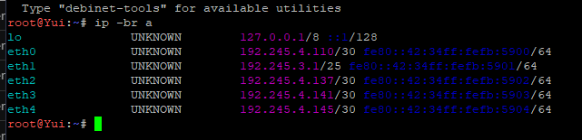


**Rei**


**Mari**


**Shinji**

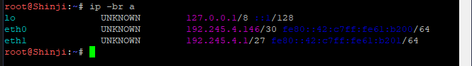


**Hikari**


**Kaworu**

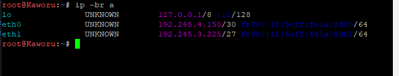


**Asuka**


**Kensuke**


**Ritsuko**

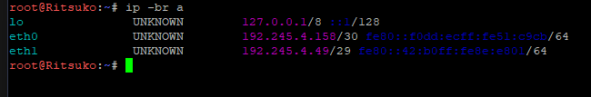


**Kaji**


**Misato**

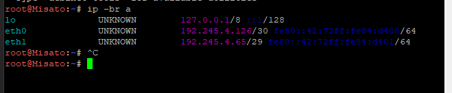


**Shigeru**

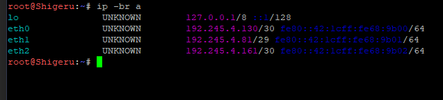


**Makoto**

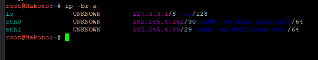


**Fuyutsuki**


**Maya**

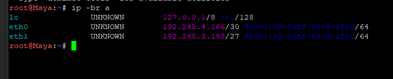


**Toji**


</details>

### Bukti: ping dua ujung tiap link

Pengujian dilakukan dari sisi induk, karena satu ping yang berhasil sudah membuktikan
kedua ujung hidup, balasannya datang dari ujung seberang. Enam console mencakup
seluruh 16 link.

Dari Gendou, 7 link:


Dari Yui, 3 link:

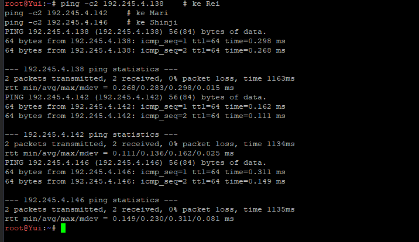

<details>
<summary>Hikari, Asuka, Shigeru, Fuyutsuki, klik untuk membuka</summary>

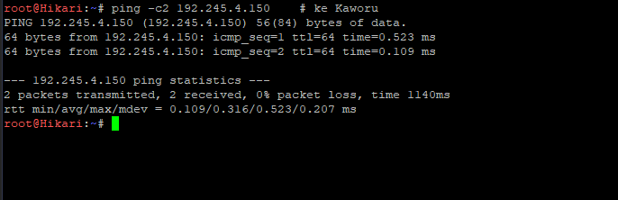

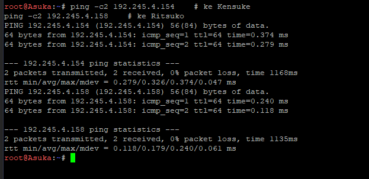


</details>

Seluruh 16 link 0% packet loss.

---

## Soal 3: Routing statis

### Yang diminta

Menghubungkan semua subnet dengan routing statis dan jumlah rute sesedikit mungkin.
Router selain Gendou cukup punya satu default route ke atas dan rute untuk subnet di
bawahnya. Gendou memakai default route ke NAT1. Subnet satu cabang yang bisa digabung
tepat menjadi satu CIDR harus diringkas. Bukti berupa Armisael bisa ping ke Lilith,
Sachiel, dan Comm-Net.

### Hasil

Total **31 rute statis**, tersebar seperti ini:

| Router | Rute statis |
|---|---|
| Gendou | 22 |
| Yui | 3 |
| Asuka, Fuyutsuki | 2 |
| Hikari, Shigeru | 1 |
| 11 router daun | 0, cukup default route |

Sebelas router daun, yaitu Rei, Mari, Shinji, Kaworu, Kensuke, Ritsuko, Kaji, Misato,
Makoto, Maya, dan Toji, tidak punya rute statis sama sekali karena tidak ada apa pun
di bawahnya.

### Ringkasan CIDR

Soal meminta subnet satu cabang yang bisa digabung **tepat** menjadi satu CIDR diringkas.
Yang memenuhi syarat itu hanya tiga:

| Ringkasan | Menggantikan |
|---|---|
| `192.245.4.136/29` | link Yui-Rei dan Yui-Mari |
| `192.245.4.152/29` | link Asuka-Kensuke dan Asuka-Ritsuko |
| `192.245.4.80/28` | Switch-Monolith dan Switch-Radar |

Sedikitnya jumlah ringkasan ini adalah konsekuensi logis dari VLSM. VLSM mengurutkan
alokasi dari kebutuhan terbesar secara global, sehingga subnet milik satu cabang
tersebar jauh di ruang alamat dan jarang membentuk blok utuh. Itu sebabnya soal
menulis "yang bisa digabung tepat", bukan "harus digabung".

Ketiga blok ringkasan sudah diverifikasi tidak memuat satu pun subnet milik cabang lain.

### Gendou: default route tidak ditulis manual

Default route Gendou ke NAT1 datang otomatis dari DHCP di eth0. Sengaja tidak ditulis
manual, karena menulisnya berarti memasukkan `192.168.122.1` secara hardcoded, dan itu
langsung melanggar syarat soal 4 yang melarang konfigurasi perlu diubah saat alamat
NAT1 berganti.

### Langkah

Dipakai `ip route replace`, bukan `ip route add`. Bedanya, `add` gagal dengan pesan
"File exists" kalau rutenya sudah ada, sedangkan `replace` aman dijalankan berkali-kali.
Ini juga yang membuat script memenuhi syarat idempotency di soal 20.

Blok lengkap `/root/<nama>.sh` untuk ke-17 router tidak ditulis di sini melainkan di
[Soal 4](#soal-4-nat-dan-dns), karena isi file itu kumulatif: rute soal 3, DNS soal 4, dan
NAT soal 4 menumpuk di file yang sama. Menulis dua versi file yang sama di dua tempat
adalah cara paling mudah membuat orang menempel versi yang salah, jadi yang ditulis hanya
versi final.

Peta next hop di Gendou:

| Next hop | Router |
|---|---|
| `192.245.4.110` | Yui |
| `192.245.4.114` | Hikari |
| `192.245.4.118` | Asuka |
| `192.245.4.122` | Kaji |
| `192.245.4.126` | Misato |
| `192.245.4.130` | Shigeru |
| `192.245.4.134` | Fuyutsuki |

### Memberi alamat sementara pada node uji

Soal minta membuktikan Armisael bisa ping Lilith, Sachiel, dan Comm-Net.
Alamat di bawah ini sudah sesuai aturan soal 6, jadi tidak terbuang.

| Node | Alamat | Gateway |
|---|---|---|
| Armisael | 192.245.4.83/29 | 192.245.4.81 |
| Zeruel | 192.245.4.82/29 | 192.245.4.81 |
| Lilith | 192.245.4.74/29 | 192.245.4.73 |
| Sachiel | 192.245.3.130/26 | 192.245.3.129 |
| Comm-Net | 192.245.2.2/24 | 192.245.2.1 |

Pasang SEMUA lima node di bawah ini, bukan Armisael saja.
Node tujuan juga butuh alamat dan default route, karena balasan ping
harus tahu jalan pulang ke subnet pengirim.

**Armisael** (Switch-Monolith, console Armisael):

```bash
ip addr add 192.245.4.83/29 dev eth0
ip route add default via 192.245.4.81
```

**Zeruel** (Switch-Monolith, console Zeruel):

```bash
ip addr add 192.245.4.82/29 dev eth0
ip route add default via 192.245.4.81
```

**Lilith** (Switch-Dogma, console Lilith):

```bash
ip addr add 192.245.4.74/29 dev eth0
ip route add default via 192.245.4.73
```

**Sachiel** (Switch-Bunker, console Sachiel):

```bash
ip addr add 192.245.3.130/26 dev eth0
ip route add default via 192.245.3.129
```

**Comm-Net** (Switch-Comm, console Comm-Net):

```bash
ip addr add 192.245.2.2/24 dev eth0
ip route add default via 192.245.2.1
```

Cek dulu di tiap node dengan `ip -br a`, alamatnya harus muncul.

Baru setelah kelimanya terpasang, uji dari Armisael:

```bash
ping -c2 192.245.4.74    # Lilith
ping -c2 192.245.3.130    # Sachiel
ping -c2 192.245.2.2    # Comm-Net
```

Ketiganya harus 0% packet loss.

### Bukti


Ketiganya 0% packet loss. Nilai TTL ikut membuktikan jalurnya benar, bukan kebetulan.
Linux mengirim dengan TTL 64 dan tiap router mengurangi satu:

| Tujuan | TTL | Hop | Jalur |
|---|---|---|---|
| Lilith | 60 | 4 | Shigeru, Gendou, Fuyutsuki, Toji |
| Sachiel | 60 | 4 | Shigeru, Gendou, Asuka, Kensuke |
| Comm-Net | 61 | 3 | Shigeru, Gendou, Hikari |

Cocok persis dengan topologi.

---

## Soal 4: NAT dan DNS

### Yang diminta

Memberi seluruh jaringan akses internet lewat Gendou, dengan konfigurasi yang tidak
perlu diubah saat IP NAT1 berganti. Hanya traffic dari prefix internal yang keluar
lewat NAT1 yang boleh diterjemahkan alamatnya, sedangkan traffic antar-LAN harus tetap
membawa alamat asli pengirimnya. Node juga harus bisa me-resolve nama domain.

### Aturan NAT

```bash
iptables -t nat -C POSTROUTING -s 192.245.0.0/21 -o eth0 -j MASQUERADE 2>/dev/null || \
  iptables -t nat -A POSTROUTING -s 192.245.0.0/21 -o eth0 -j MASQUERADE
```

Empat keputusan dalam satu baris, masing-masing menjawab satu syarat soal.

**`MASQUERADE`, bukan `SNAT --to-source`.** MASQUERADE mengambil alamat sumber otomatis
dari eth0 setiap kali paket lewat, jadi kalau IP NAT1 berganti tidak ada yang perlu
diubah. `SNAT --to-source 192.168.122.62` akan hardcoded dan melanggar syarat soal.

**`-s 192.245.0.0/21`** membatasi hanya prefix internal yang diterjemahkan.

**`-o eth0`** membatasi hanya traffic yang keluar lewat NAT1. Traffic antar-LAN tidak
pernah melewati eth0, jadi tidak pernah tersentuh rule ini.

**`-C ... || -A`** artinya cek dulu, baru tambah kalau belum ada. Aman dijalankan
berkali-kali, sehingga rule tidak menumpuk setiap script dipanggil ulang.

### DNS

Tiap node diberi `nameserver 8.8.8.8`, dan barisnya ditaruh **di dalam** `/root/<nama>.sh`,
bukan diketik langsung ke `/etc/resolv.conf`. Alasannya `/etc/resolv.conf` tidak bertahan
setelah node restart, sedangkan `/root` bertahan.

```bash
echo "nameserver 8.8.8.8" > /etc/resolv.conf
```

### Script lengkap 17 router

Tiap blok di bawah menimpa seluruh isi `/root/<nama>.sh`, jadi cukup tempel satu blok per
router dan tidak perlu menggabung dengan versi lama. Isinya sudah final, mencakup
`ip_forward` dari soal 2, rute dari soal 3, DNS dari soal 4, dan MASQUERADE untuk Gendou.

Diketik lewat **console node**, bukan lewat menu "Edit network configuration", karena di
sini ada banyak tanda `>`, yaitu `cat >`, `> /etc/resolv.conf`, dan `2>/dev/null`.

Semua blok memakai susunan yang sama, jadi cukup hafal satu pola untuk membaca ketujuh
belasnya:

| Baris | Asalnya | Fungsinya |
|---|---|---|
| `sysctl -w net.ipv4.ip_forward=1` | soal 2 | Router mau meneruskan paket antar interface |
| `echo "nameserver 8.8.8.8" > /etc/resolv.conf` | soal 4 | Supaya `apt-get` bisa me-resolve nama |
| `ip route replace default via <induk>` | soal 3 | Satu-satunya rute ke atas, ada di semua router kecuali Gendou |
| `ip route replace <subnet> via <anak>` | soal 3 | Satu baris per subnet yang ada di bawahnya |
| `iptables -t nat ... MASQUERADE` | soal 4 | Hanya di Gendou, satu-satunya pintu ke NAT1 |

Komentar satu baris seperti `# Yui` atau `# Kensuke` menandai kelompok rute milik router anak
yang namanya tertulis. Jadi `# Kensuke` berarti baris di bawahnya adalah subnet yang berada
di bawah Kensuke, dan next hop-nya adalah alamat Kensuke pada link ke router ini.

Sebelas router daun tidak punya satu pun rute statis, hanya default route. Itu bukan
kelalaian melainkan hasil yang diminta soal, yaitu jumlah rute sesedikit mungkin.

#### Gendou

```bash
cat > /root/gendou.sh <<'EOF'
#!/bin/bash

sysctl -w net.ipv4.ip_forward=1
echo "nameserver 8.8.8.8" > /etc/resolv.conf

# Yui
ip route replace 192.245.0.0/23 via 192.245.4.110
ip route replace 192.245.3.0/25 via 192.245.4.110
ip route replace 192.245.4.0/27 via 192.245.4.110
ip route replace 192.245.4.32/28 via 192.245.4.110
ip route replace 192.245.4.136/29 via 192.245.4.110
ip route replace 192.245.4.144/30 via 192.245.4.110
# Hikari
ip route replace 192.245.2.0/24 via 192.245.4.114
ip route replace 192.245.3.224/27 via 192.245.4.114
ip route replace 192.245.4.148/30 via 192.245.4.114
# Asuka
ip route replace 192.245.3.128/26 via 192.245.4.118
ip route replace 192.245.4.48/29 via 192.245.4.118
ip route replace 192.245.4.96/30 via 192.245.4.118
ip route replace 192.245.4.152/29 via 192.245.4.118
# Kaji
ip route replace 192.245.4.100/30 via 192.245.4.122
# Misato
ip route replace 192.245.4.64/29 via 192.245.4.126
# Shigeru
ip route replace 192.245.4.80/28 via 192.245.4.130
ip route replace 192.245.4.160/30 via 192.245.4.130
# Fuyutsuki
ip route replace 192.245.3.192/27 via 192.245.4.134
ip route replace 192.245.4.56/29 via 192.245.4.134
ip route replace 192.245.4.72/29 via 192.245.4.134
ip route replace 192.245.4.164/30 via 192.245.4.134
ip route replace 192.245.4.168/30 via 192.245.4.134

iptables -t nat -C POSTROUTING -s 192.245.0.0/21 -o eth0 -j MASQUERADE 2>/dev/null || \
  iptables -t nat -A POSTROUTING -s 192.245.0.0/21 -o eth0 -j MASQUERADE
EOF
chmod +x /root/gendou.sh && /root/gendou.sh
```

#### Yui

```bash
cat > /root/yui.sh <<'EOF'
#!/bin/bash

sysctl -w net.ipv4.ip_forward=1
echo "nameserver 8.8.8.8" > /etc/resolv.conf

ip route replace default via 192.245.4.109
# Rei
ip route replace 192.245.0.0/23 via 192.245.4.138
# Mari
ip route replace 192.245.4.32/28 via 192.245.4.142
# Shinji
ip route replace 192.245.4.0/27 via 192.245.4.146
EOF
chmod +x /root/yui.sh && /root/yui.sh
```

#### Rei

```bash
cat > /root/rei.sh <<'EOF'
#!/bin/bash

sysctl -w net.ipv4.ip_forward=1
echo "nameserver 8.8.8.8" > /etc/resolv.conf

ip route replace default via 192.245.4.137
EOF
chmod +x /root/rei.sh && /root/rei.sh
```

#### Mari

```bash
cat > /root/mari.sh <<'EOF'
#!/bin/bash

sysctl -w net.ipv4.ip_forward=1
echo "nameserver 8.8.8.8" > /etc/resolv.conf

ip route replace default via 192.245.4.141
EOF
chmod +x /root/mari.sh && /root/mari.sh
```

#### Shinji

```bash
cat > /root/shinji.sh <<'EOF'
#!/bin/bash

sysctl -w net.ipv4.ip_forward=1
echo "nameserver 8.8.8.8" > /etc/resolv.conf

ip route replace default via 192.245.4.145
EOF
chmod +x /root/shinji.sh && /root/shinji.sh
```

#### Hikari

```bash
cat > /root/hikari.sh <<'EOF'
#!/bin/bash

sysctl -w net.ipv4.ip_forward=1
echo "nameserver 8.8.8.8" > /etc/resolv.conf

ip route replace default via 192.245.4.113
# Kaworu
ip route replace 192.245.3.224/27 via 192.245.4.150
EOF
chmod +x /root/hikari.sh && /root/hikari.sh
```

#### Kaworu

```bash
cat > /root/kaworu.sh <<'EOF'
#!/bin/bash

sysctl -w net.ipv4.ip_forward=1
echo "nameserver 8.8.8.8" > /etc/resolv.conf

ip route replace default via 192.245.4.149
EOF
chmod +x /root/kaworu.sh && /root/kaworu.sh
```

#### Asuka

```bash
cat > /root/asuka.sh <<'EOF'
#!/bin/bash

sysctl -w net.ipv4.ip_forward=1
echo "nameserver 8.8.8.8" > /etc/resolv.conf

ip route replace default via 192.245.4.117
# Kensuke
ip route replace 192.245.3.128/26 via 192.245.4.154
# Ritsuko
ip route replace 192.245.4.48/29 via 192.245.4.158
EOF
chmod +x /root/asuka.sh && /root/asuka.sh
```

#### Kensuke

```bash
cat > /root/kensuke.sh <<'EOF'
#!/bin/bash

sysctl -w net.ipv4.ip_forward=1
echo "nameserver 8.8.8.8" > /etc/resolv.conf

ip route replace default via 192.245.4.153
EOF
chmod +x /root/kensuke.sh && /root/kensuke.sh
```

#### Ritsuko

```bash
cat > /root/ritsuko.sh <<'EOF'
#!/bin/bash

sysctl -w net.ipv4.ip_forward=1
echo "nameserver 8.8.8.8" > /etc/resolv.conf

ip route replace default via 192.245.4.157
EOF
chmod +x /root/ritsuko.sh && /root/ritsuko.sh
```

#### Kaji

```bash
cat > /root/kaji.sh <<'EOF'
#!/bin/bash

sysctl -w net.ipv4.ip_forward=1
echo "nameserver 8.8.8.8" > /etc/resolv.conf

ip route replace default via 192.245.4.121
EOF
chmod +x /root/kaji.sh && /root/kaji.sh
```

#### Misato

```bash
cat > /root/misato.sh <<'EOF'
#!/bin/bash

sysctl -w net.ipv4.ip_forward=1
echo "nameserver 8.8.8.8" > /etc/resolv.conf

ip route replace default via 192.245.4.125
EOF
chmod +x /root/misato.sh && /root/misato.sh
```

#### Shigeru

```bash
cat > /root/shigeru.sh <<'EOF'
#!/bin/bash

sysctl -w net.ipv4.ip_forward=1
echo "nameserver 8.8.8.8" > /etc/resolv.conf

ip route replace default via 192.245.4.129
# Makoto
ip route replace 192.245.4.88/29 via 192.245.4.162
EOF
chmod +x /root/shigeru.sh && /root/shigeru.sh
```

#### Makoto

```bash
cat > /root/makoto.sh <<'EOF'
#!/bin/bash

sysctl -w net.ipv4.ip_forward=1
echo "nameserver 8.8.8.8" > /etc/resolv.conf

ip route replace default via 192.245.4.161
EOF
chmod +x /root/makoto.sh && /root/makoto.sh
```

#### Fuyutsuki

```bash
cat > /root/fuyutsuki.sh <<'EOF'
#!/bin/bash

sysctl -w net.ipv4.ip_forward=1
echo "nameserver 8.8.8.8" > /etc/resolv.conf

ip route replace default via 192.245.4.133
# Maya
ip route replace 192.245.3.192/27 via 192.245.4.166
# Toji
ip route replace 192.245.4.72/29 via 192.245.4.170
EOF
chmod +x /root/fuyutsuki.sh && /root/fuyutsuki.sh
```

#### Maya

```bash
cat > /root/maya.sh <<'EOF'
#!/bin/bash

sysctl -w net.ipv4.ip_forward=1
echo "nameserver 8.8.8.8" > /etc/resolv.conf

ip route replace default via 192.245.4.165
EOF
chmod +x /root/maya.sh && /root/maya.sh
```

#### Toji

```bash
cat > /root/toji.sh <<'EOF'
#!/bin/bash

sysctl -w net.ipv4.ip_forward=1
echo "nameserver 8.8.8.8" > /etc/resolv.conf

ip route replace default via 192.245.4.169
EOF
chmod +x /root/toji.sh && /root/toji.sh
```

---

### Alamat node uji

Alamat sama seperti soal 3, ditambah DNS supaya bisa resolve nama domain.

#### Armisael

```bash
ip addr replace 192.245.4.83/29 dev eth0
ip route replace default via 192.245.4.81
echo "nameserver 8.8.8.8" > /etc/resolv.conf
```

#### Zeruel

```bash
ip addr replace 192.245.4.82/29 dev eth0
ip route replace default via 192.245.4.81
echo "nameserver 8.8.8.8" > /etc/resolv.conf
```

#### Lilith

```bash
ip addr replace 192.245.4.74/29 dev eth0
ip route replace default via 192.245.4.73
echo "nameserver 8.8.8.8" > /etc/resolv.conf
```

#### Sachiel

```bash
ip addr replace 192.245.3.130/26 dev eth0
ip route replace default via 192.245.3.129
echo "nameserver 8.8.8.8" > /etc/resolv.conf
```

#### Comm-Net

```bash
ip addr replace 192.245.2.2/24 dev eth0
ip route replace default via 192.245.2.1
echo "nameserver 8.8.8.8" > /etc/resolv.conf
```

---

## Bagian C: bukti yang diminta soal 4

#### Dari Armisael

```bash
ping -c2 8.8.8.8
ping -c2 deb.debian.org
```

#### Dari Lilith

```bash
ping -c2 8.8.8.8
ping -c2 deb.debian.org
```

#### Counter rule NAT, di Gendou

```bash
iptables -t nat -L POSTROUTING -v -n
```

Kolom `pkts` dan `bytes` harus lebih dari nol setelah ping di atas dijalankan.
Kalau masih nol, berarti paketnya tidak lewat rule itu.

#### Membuktikan traffic antar-LAN TIDAK di-NAT

Soal minta ini juga, dan paling gampang dibuktikan dengan membandingkan counter.

```bash
iptables -t nat -Z POSTROUTING
```

Lalu dari Armisael, ping sesama LAN internal:

```bash
ping -c5 192.245.2.2    # Comm-Net
```

Cek lagi di Gendou:

```bash
iptables -t nat -L POSTROUTING -v -n
```

Counternya harus tetap NOL, karena traffic antar-LAN tidak keluar lewat eth0.
Lalu ping 8.8.8.8 dari Armisael dan cek sekali lagi, counternya baru naik.
Perbandingan dua kondisi itu bukti paling kuat untuk syarat soal ini.

### Bukti: akses internet dan resolusi nama

Dari Armisael:


Dari Lilith:


Keduanya berhasil ping `8.8.8.8` dan `deb.debian.org`, yang resolve ke
`debian.map.fastlydns.net` pada `151.101.194.132`. Jadi NAT dan DNS dua-duanya bekerja.

### Bukti: counter rule NAT


Counter menunjukkan `8 pkts, 604 bytes`. Angka itu bisa diverifikasi:
empat paket ICMP pertama dari dua node, 84 byte masing-masing, totalnya 336,
ditambah empat query DNS sekitar 67 byte, totalnya 268. Jumlahnya tepat 604.

### Bukti: traffic antar-LAN tidak di-NAT

Soal menyebut syarat ini eksplisit, jadi dibuktikan dengan membandingkan counter
sebelum dan sesudah.

Counter dinolkan terlebih dahulu:


Lalu ping antar-LAN dari Armisael ke Comm-Net, 5 paket:

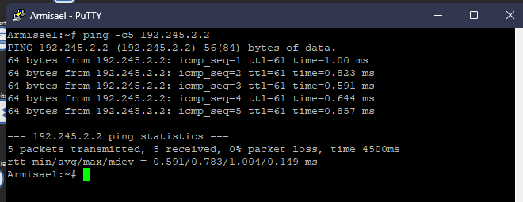

Lalu ping ke internet, 2 paket:

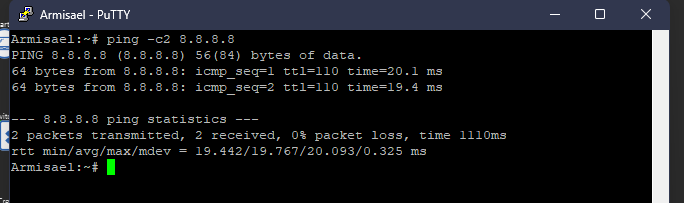

Counter setelah keduanya:


Hasilnya `1 pkts, 84 bytes`. Satu paket ICMP echo dengan 56 byte data tepat 84 byte
di level IP. Kalau 5 paket antar-LAN ikut di-NAT, angkanya akan 6 paket dan 504 byte.
Jadi traffic antar-LAN terbukti tidak tersentuh sama sekali.

Counter menunjukkan 1 dan bukan 2 karena tabel `nat` hanya dilewati **paket pertama
setiap koneksi**. Paket berikutnya ditangani conntrack tanpa menyentuh chain NAT lagi.

---

## Soal 5: Firewall Gendou

### Yang diminta

Mengubah policy INPUT dan FORWARD di Gendou menjadi DROP, lalu mengizinkan empat hal:
balasan koneksi yang sudah ada, traffic dari jaringan internal ke internet, traffic
antar-LAN, dan traffic dari jaringan internal ke Gendou sendiri. Loopback dan DHCP dari
NAT1 harus tetap jalan. Koneksi baru dari sisi NAT1 tidak boleh masuk, dan soal 2
sampai 4 harus tetap jalan.

### Aturan yang dipasang

| Rule | Menjawab |
|---|---|
| `-P INPUT DROP`, `-P FORWARD DROP` | policy yang diminta |
| `INPUT -i lo -j ACCEPT` | loopback tetap jalan |
| `INPUT -m conntrack --ctstate ESTABLISHED,RELATED -j ACCEPT` | (a) balasan koneksi yang sudah ada |
| `INPUT -i eth0 -p udp --sport 67 --dport 68 -j ACCEPT` | DHCP dari NAT1 |
| `INPUT ! -i eth0 -s 192.245.0.0/21 -j ACCEPT` | (d) internal ke Gendou sendiri |
| `FORWARD -m conntrack --ctstate ESTABLISHED,RELATED -j ACCEPT` | (a) balasan yang diteruskan |
| `FORWARD -s 192.245.0.0/21 -o eth0 -j ACCEPT` | (b) internal ke internet |
| `FORWARD ! -i eth0 ! -o eth0 -s 192.245.0.0/21 -d 192.245.0.0/21 -j ACCEPT` | (c) antar-LAN |

### Script lengkap gendo.sh

Seluruh isi file, mencakup soal 2 sampai soal 5 sekaligus. Ini versi final `/root/gendou.sh`
yang menggantikan blok Gendou di soal 4.

File ini punya lima bagian berurutan, dan penanda satu baris di dalamnya menandai batas
antar bagian:

| Penanda | Isi | Dari soal |
|---|---|---|
| tanpa penanda, paling atas | `ip_forward` dan `resolv.conf` | soal 2 dan 4 |
| `# Yui` sampai `# Fuyutsuki` | 21 rute statis, dikelompokkan per router anak | soal 3 |
| `# NAT ke NAT1` | MASQUERADE dengan pola `-C` lalu `-A` | soal 4 |
| `# policy` | INPUT dan FORWARD jadi DROP, OUTPUT tetap ACCEPT | soal 5 |
| `# INPUT` dan `# FORWARD` | Tujuh rule izin | soal 5 |

Pertanyaan yang paling mungkin ditanya saat demo adalah kenapa dipakai pola
`iptables -C ... || iptables -A ...` dan bukan `-A` langsung. Jawabannya: `-A` polos
menambah rule baru tiap kali script dijalankan, sehingga setelah lima kali restart ada lima
rule kembar. `-C` memeriksa dulu apakah rule itu sudah ada, dan `-A` hanya berjalan kalau
belum. Ini pelajaran dari Modul 2 dan sekaligus syarat idempotency di soal 20.

```bash
cat > /root/gendou.sh <<'EOF'
#!/bin/bash

sysctl -w net.ipv4.ip_forward=1
echo "nameserver 8.8.8.8" > /etc/resolv.conf

# Yui
ip route replace 192.245.0.0/23 via 192.245.4.110
ip route replace 192.245.3.0/25 via 192.245.4.110
ip route replace 192.245.4.0/27 via 192.245.4.110
ip route replace 192.245.4.32/28 via 192.245.4.110
ip route replace 192.245.4.136/29 via 192.245.4.110
ip route replace 192.245.4.144/30 via 192.245.4.110

# Hikari
ip route replace 192.245.2.0/24 via 192.245.4.114
ip route replace 192.245.3.224/27 via 192.245.4.114
ip route replace 192.245.4.148/30 via 192.245.4.114

# Asuka
ip route replace 192.245.3.128/26 via 192.245.4.118
ip route replace 192.245.4.48/29 via 192.245.4.118
ip route replace 192.245.4.96/30 via 192.245.4.118
ip route replace 192.245.4.152/29 via 192.245.4.118

# Kaji
ip route replace 192.245.4.100/30 via 192.245.4.122

# Misato
ip route replace 192.245.4.64/29 via 192.245.4.126

# Shigeru
ip route replace 192.245.4.80/28 via 192.245.4.130
ip route replace 192.245.4.160/30 via 192.245.4.130

# Fuyutsuki
ip route replace 192.245.3.192/27 via 192.245.4.134
ip route replace 192.245.4.56/29 via 192.245.4.134
ip route replace 192.245.4.72/29 via 192.245.4.134
ip route replace 192.245.4.164/30 via 192.245.4.134
ip route replace 192.245.4.168/30 via 192.245.4.134

# NAT ke NAT1
iptables -t nat -C POSTROUTING -s 192.245.0.0/21 -o eth0 -j MASQUERADE 2>/dev/null || \
  iptables -t nat -A POSTROUTING -s 192.245.0.0/21 -o eth0 -j MASQUERADE

# policy
iptables -P INPUT DROP
iptables -P FORWARD DROP
iptables -P OUTPUT ACCEPT

# INPUT
iptables -C INPUT -i lo -j ACCEPT 2>/dev/null || \
  iptables -A INPUT -i lo -j ACCEPT
iptables -C INPUT -m conntrack --ctstate ESTABLISHED,RELATED -j ACCEPT 2>/dev/null || \
  iptables -A INPUT -m conntrack --ctstate ESTABLISHED,RELATED -j ACCEPT
iptables -C INPUT -i eth0 -p udp --sport 67 --dport 68 -j ACCEPT 2>/dev/null || \
  iptables -A INPUT -i eth0 -p udp --sport 67 --dport 68 -j ACCEPT
iptables -C INPUT ! -i eth0 -s 192.245.0.0/21 -j ACCEPT 2>/dev/null || \
  iptables -A INPUT ! -i eth0 -s 192.245.0.0/21 -j ACCEPT

# FORWARD
iptables -C FORWARD -m conntrack --ctstate ESTABLISHED,RELATED -j ACCEPT 2>/dev/null || \
  iptables -A FORWARD -m conntrack --ctstate ESTABLISHED,RELATED -j ACCEPT
iptables -C FORWARD -s 192.245.0.0/21 -o eth0 -j ACCEPT 2>/dev/null || \
  iptables -A FORWARD -s 192.245.0.0/21 -o eth0 -j ACCEPT
iptables -C FORWARD ! -i eth0 ! -o eth0 -s 192.245.0.0/21 -d 192.245.0.0/21 -j ACCEPT 2>/dev/null || \
  iptables -A FORWARD ! -i eth0 ! -o eth0 -s 192.245.0.0/21 -d 192.245.0.0/21 -j ACCEPT
EOF
chmod +x /root/gendou.sh && /root/gendou.sh
```

---

### Tiga keputusan yang perlu dijelaskan

**DHCP butuh rule sendiri walaupun sudah ada ESTABLISHED.** Gendou adalah klien DHCP.
Permintaannya dikirim dari `0.0.0.0` ke alamat broadcast sebelum dia punya alamat,
sehingga conntrack belum punya state untuk dicocokkan waktu balasannya datang. Tanpa
rule eksplisit `udp 67 ke 68`, eth0 akan kehilangan alamat saat lease diperbarui, dan
itu terjadi diam-diam beberapa jam kemudian sehingga sulit dilacak.

**`! -i eth0` ditambahkan pada rule internal.** Soal meminta izin untuk traffic dari
jaringan internal. Tanpa syarat interface, siapa pun dari sisi NAT1 bisa memalsukan
alamat sumber `192.245.x.x` dan langsung diterima. Dengan `! -i eth0`, paket yang
mengaku internal tapi datang dari luar tetap ditolak.

**Koneksi baru dari NAT1 tidak perlu rule DROP khusus.** Policy-nya sudah DROP dan
tidak ada satu pun rule ACCEPT yang cocok untuk paket baru yang masuk lewat eth0,
jadi otomatis jatuh ke policy.

### Bukti: daftar aturan


Catatan: `iptables -S` tanpa argumen hanya menampilkan tabel **filter**. Rule MASQUERADE
dari soal 4 berada di tabel **nat** dan dilihat dengan `iptables -t nat -S`.

### Bukti: soal 2 sampai 4 tidak rusak

Soal menyebut syarat ini eksplisit, jadi diuji satu per satu.

Soal 4, internet dari Armisael masih jalan:

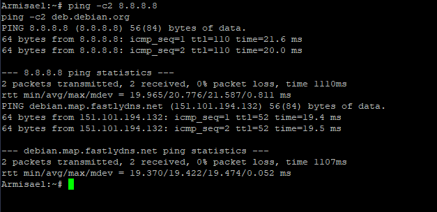

Soal 2, Gendou masih bisa ping tetangganya:


Soal 2 arah sebaliknya, Yui masih bisa ping Gendou, membuktikan rule INPUT internal
bekerja:

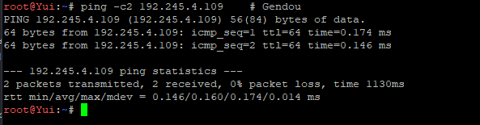

Soal 3, antar-LAN lewat Gendou masih jalan:


DHCP eth0 tidak putus:

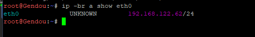

---

## Soal 6: IP statis node

### Yang diminta

Memberi IP statis dan gateway ke semua node non-router sesuai aturan alamat di
glosarium, disimpan agar bertahan setelah restart. Bukti berupa `ip -br` dan ping ke
gateway di Unit-01.

### Aturan alamat

Dari glosarium: gateway memakai IP usable pertama, node berikutnya mengambil alamat
usable berikutnya **urut kiri ke kanan sesuai gambar soal**.

### Tabel 25 node

| Node | Switch | Alamat | Gateway |
|---|---|---|---|
| Quarters | Switch-Quarters | `192.245.0.2/23` | `192.245.0.1` |
| Comm-Net | Switch-Comm | `192.245.2.2/24` | `192.245.2.1` |
| Hangar-Crew | Switch-Hangar | `192.245.3.2/25` | `192.245.3.1` |
| Sachiel | Switch-Bunker | `192.245.3.130/26` | `192.245.3.129` |
| Medic-Bay | Switch-Medic | `192.245.3.194/27` | `192.245.3.193` |
| Pen-Pen | Switch-Medic | `192.245.3.195/27` | `192.245.3.193` |
| Relay-Node | Switch-Relay | `192.245.3.226/27` | `192.245.3.225` |
| Garden-Staff | Switch-Garden | `192.245.4.2/27` | `192.245.4.1` |
| Dock-Crew | Switch-Dock | `192.245.4.34/28` | `192.245.4.33` |
| Entry-Plug | Switch-Lab | `192.245.4.50/29` | `192.245.4.49` |
| Dummy-Plug | Switch-Lab | `192.245.4.51/29` | `192.245.4.49` |
| Magi-Casper | Switch-Terminal | `192.245.4.58/29` | `192.245.4.57` |
| Magi-Balthasar | Switch-Terminal | `192.245.4.59/29` | `192.245.4.57` |
| Magi-Melchior | Switch-Terminal | `192.245.4.60/29` | `192.245.4.57` |
| Unit-01 | Switch-Cage | `192.245.4.66/29` | `192.245.4.65` |
| Unit-02 | Switch-Cage | `192.245.4.67/29` | `192.245.4.65` |
| Unit-00 | Switch-Cage | `192.245.4.68/29` | `192.245.4.65` |
| Lilith | Switch-Dogma | `192.245.4.74/29` | `192.245.4.73` |
| Adam | Switch-Dogma | `192.245.4.75/29` | `192.245.4.73` |
| Zeruel | Switch-Monolith | `192.245.4.82/29` | `192.245.4.81` |
| Armisael | Switch-Monolith | `192.245.4.83/29` | `192.245.4.81` |
| Radar-Array | Switch-Radar | `192.245.4.90/29` | `192.245.4.89` |
| Archive-Vault | Switch-Archive | `192.245.4.98/30` | `192.245.4.97` |
| Spy | Switch-Intel | `192.245.4.102/30` | `192.245.4.101` |
| Tokyo3-Core | Switch-Cmd | `192.245.4.106/30` | `192.245.4.105` |

### Cara menyimpannya agar bertahan

Alamat ditulis ke `/etc/network/interfaces`, bukan dengan `ip addr add`. Hanya `/root`
dan `/etc/network/interfaces` yang bertahan saat node Docker direstart, dan file
interfaces dibaca otomatis saat node menyala.

Contoh di Unit-01:

```bash
cat > /etc/network/interfaces <<'EOF'
auto lo
iface lo inet loopback

auto eth0
iface eth0 inet static
	address 192.245.4.66
	netmask 255.255.255.248
	gateway 192.245.4.65
	post-up echo "nameserver 8.8.8.8" > /etc/resolv.conf
EOF
echo "nameserver 8.8.8.8" > /etc/resolv.conf
ip addr replace 192.245.4.66/29 dev eth0
ip route replace default via 192.245.4.65
```

Dua baris `ip` di akhir menerapkan alamatnya saat itu juga tanpa restart. Sengaja tidak
memakai `ifup`, karena perintah itu tidak ada di image debinet. Yang ada hanya di
alpinet, dari busybox.

### Command per node

Ke-25 node memakai susunan yang sama, hanya alamat dan gateway-nya yang berbeda:

| Bagian | Fungsinya |
|---|---|
| `cat > /etc/network/interfaces` | Alamat permanen, dibaca otomatis saat node menyala |
| `gateway` di dalam blok iface | Default route node, yaitu alamat router gateway subnetnya |
| `post-up echo ... > /etc/resolv.conf` | `/etc/resolv.conf` tidak bertahan setelah restart, jadi ditulis ulang tiap interface naik |
| `echo "nameserver 8.8.8.8" ...` di luar heredoc | Menerapkan DNS saat itu juga tanpa menunggu restart |
| `ip addr replace` dan `ip route replace` | Menerapkan alamat dan rute saat itu juga |

Dua baris `ip` terakhir memakai `replace`, bukan `add`, supaya blok ini aman ditempel
berulang kali. Sengaja tidak memakai `ifup`, karena perintah itu tidak ada di image debinet.

Alamat tiap node mengikuti aturan glosarium: gateway mengambil IP usable pertama, dan node
mengambil usable berikutnya sesuai urutan nama pada switch di gambar topologi, dibaca dari
kiri ke kanan.

#### Quarters

```bash
cat > /etc/network/interfaces <<'EOF'
auto lo
iface lo inet loopback

auto eth0
iface eth0 inet static
	address 192.245.0.2
	netmask 255.255.254.0
	gateway 192.245.0.1
	post-up echo "nameserver 8.8.8.8" > /etc/resolv.conf
EOF
echo "nameserver 8.8.8.8" > /etc/resolv.conf
ip addr replace 192.245.0.2/23 dev eth0
ip route replace default via 192.245.0.1
```

#### Comm-Net

```bash
cat > /etc/network/interfaces <<'EOF'
auto lo
iface lo inet loopback

auto eth0
iface eth0 inet static
	address 192.245.2.2
	netmask 255.255.255.0
	gateway 192.245.2.1
	post-up echo "nameserver 8.8.8.8" > /etc/resolv.conf
EOF
echo "nameserver 8.8.8.8" > /etc/resolv.conf
ip addr replace 192.245.2.2/24 dev eth0
ip route replace default via 192.245.2.1
```

#### Hangar-Crew

```bash
cat > /etc/network/interfaces <<'EOF'
auto lo
iface lo inet loopback

auto eth0
iface eth0 inet static
	address 192.245.3.2
	netmask 255.255.255.128
	gateway 192.245.3.1
	post-up echo "nameserver 8.8.8.8" > /etc/resolv.conf
EOF
echo "nameserver 8.8.8.8" > /etc/resolv.conf
ip addr replace 192.245.3.2/25 dev eth0
ip route replace default via 192.245.3.1
```

#### Sachiel

```bash
cat > /etc/network/interfaces <<'EOF'
auto lo
iface lo inet loopback

auto eth0
iface eth0 inet static
	address 192.245.3.130
	netmask 255.255.255.192
	gateway 192.245.3.129
	post-up echo "nameserver 8.8.8.8" > /etc/resolv.conf
EOF
echo "nameserver 8.8.8.8" > /etc/resolv.conf
ip addr replace 192.245.3.130/26 dev eth0
ip route replace default via 192.245.3.129
```

#### Medic-Bay

```bash
cat > /etc/network/interfaces <<'EOF'
auto lo
iface lo inet loopback

auto eth0
iface eth0 inet static
	address 192.245.3.194
	netmask 255.255.255.224
	gateway 192.245.3.193
	post-up echo "nameserver 8.8.8.8" > /etc/resolv.conf
EOF
echo "nameserver 8.8.8.8" > /etc/resolv.conf
ip addr replace 192.245.3.194/27 dev eth0
ip route replace default via 192.245.3.193
```

#### Pen-Pen

```bash
cat > /etc/network/interfaces <<'EOF'
auto lo
iface lo inet loopback

auto eth0
iface eth0 inet static
	address 192.245.3.195
	netmask 255.255.255.224
	gateway 192.245.3.193
	post-up echo "nameserver 8.8.8.8" > /etc/resolv.conf
EOF
echo "nameserver 8.8.8.8" > /etc/resolv.conf
ip addr replace 192.245.3.195/27 dev eth0
ip route replace default via 192.245.3.193
```

#### Relay-Node

```bash
cat > /etc/network/interfaces <<'EOF'
auto lo
iface lo inet loopback

auto eth0
iface eth0 inet static
	address 192.245.3.226
	netmask 255.255.255.224
	gateway 192.245.3.225
	post-up echo "nameserver 8.8.8.8" > /etc/resolv.conf
EOF
echo "nameserver 8.8.8.8" > /etc/resolv.conf
ip addr replace 192.245.3.226/27 dev eth0
ip route replace default via 192.245.3.225
```

#### Garden-Staff

```bash
cat > /etc/network/interfaces <<'EOF'
auto lo
iface lo inet loopback

auto eth0
iface eth0 inet static
	address 192.245.4.2
	netmask 255.255.255.224
	gateway 192.245.4.1
	post-up echo "nameserver 8.8.8.8" > /etc/resolv.conf
EOF
echo "nameserver 8.8.8.8" > /etc/resolv.conf
ip addr replace 192.245.4.2/27 dev eth0
ip route replace default via 192.245.4.1
```

#### Dock-Crew

```bash
cat > /etc/network/interfaces <<'EOF'
auto lo
iface lo inet loopback

auto eth0
iface eth0 inet static
	address 192.245.4.34
	netmask 255.255.255.240
	gateway 192.245.4.33
	post-up echo "nameserver 8.8.8.8" > /etc/resolv.conf
EOF
echo "nameserver 8.8.8.8" > /etc/resolv.conf
ip addr replace 192.245.4.34/28 dev eth0
ip route replace default via 192.245.4.33
```

#### Entry-Plug

```bash
cat > /etc/network/interfaces <<'EOF'
auto lo
iface lo inet loopback

auto eth0
iface eth0 inet static
	address 192.245.4.50
	netmask 255.255.255.248
	gateway 192.245.4.49
	post-up echo "nameserver 8.8.8.8" > /etc/resolv.conf
EOF
echo "nameserver 8.8.8.8" > /etc/resolv.conf
ip addr replace 192.245.4.50/29 dev eth0
ip route replace default via 192.245.4.49
```

#### Dummy-Plug

```bash
cat > /etc/network/interfaces <<'EOF'
auto lo
iface lo inet loopback

auto eth0
iface eth0 inet static
	address 192.245.4.51
	netmask 255.255.255.248
	gateway 192.245.4.49
	post-up echo "nameserver 8.8.8.8" > /etc/resolv.conf
EOF
echo "nameserver 8.8.8.8" > /etc/resolv.conf
ip addr replace 192.245.4.51/29 dev eth0
ip route replace default via 192.245.4.49
```

#### Magi-Casper

```bash
cat > /etc/network/interfaces <<'EOF'
auto lo
iface lo inet loopback

auto eth0
iface eth0 inet static
	address 192.245.4.58
	netmask 255.255.255.248
	gateway 192.245.4.57
	post-up echo "nameserver 8.8.8.8" > /etc/resolv.conf
EOF
echo "nameserver 8.8.8.8" > /etc/resolv.conf
ip addr replace 192.245.4.58/29 dev eth0
ip route replace default via 192.245.4.57
```

#### Magi-Balthasar

```bash
cat > /etc/network/interfaces <<'EOF'
auto lo
iface lo inet loopback

auto eth0
iface eth0 inet static
	address 192.245.4.59
	netmask 255.255.255.248
	gateway 192.245.4.57
	post-up echo "nameserver 8.8.8.8" > /etc/resolv.conf
EOF
echo "nameserver 8.8.8.8" > /etc/resolv.conf
ip addr replace 192.245.4.59/29 dev eth0
ip route replace default via 192.245.4.57
```

#### Magi-Melchior

```bash
cat > /etc/network/interfaces <<'EOF'
auto lo
iface lo inet loopback

auto eth0
iface eth0 inet static
	address 192.245.4.60
	netmask 255.255.255.248
	gateway 192.245.4.57
	post-up echo "nameserver 8.8.8.8" > /etc/resolv.conf
EOF
echo "nameserver 8.8.8.8" > /etc/resolv.conf
ip addr replace 192.245.4.60/29 dev eth0
ip route replace default via 192.245.4.57
```

#### Unit-01

```bash
cat > /etc/network/interfaces <<'EOF'
auto lo
iface lo inet loopback

auto eth0
iface eth0 inet static
	address 192.245.4.66
	netmask 255.255.255.248
	gateway 192.245.4.65
	post-up echo "nameserver 8.8.8.8" > /etc/resolv.conf
EOF
echo "nameserver 8.8.8.8" > /etc/resolv.conf
ip addr replace 192.245.4.66/29 dev eth0
ip route replace default via 192.245.4.65
```

#### Unit-02

```bash
cat > /etc/network/interfaces <<'EOF'
auto lo
iface lo inet loopback

auto eth0
iface eth0 inet static
	address 192.245.4.67
	netmask 255.255.255.248
	gateway 192.245.4.65
	post-up echo "nameserver 8.8.8.8" > /etc/resolv.conf
EOF
echo "nameserver 8.8.8.8" > /etc/resolv.conf
ip addr replace 192.245.4.67/29 dev eth0
ip route replace default via 192.245.4.65
```

#### Unit-00

```bash
cat > /etc/network/interfaces <<'EOF'
auto lo
iface lo inet loopback

auto eth0
iface eth0 inet static
	address 192.245.4.68
	netmask 255.255.255.248
	gateway 192.245.4.65
	post-up echo "nameserver 8.8.8.8" > /etc/resolv.conf
EOF
echo "nameserver 8.8.8.8" > /etc/resolv.conf
ip addr replace 192.245.4.68/29 dev eth0
ip route replace default via 192.245.4.65
```

#### Lilith

```bash
cat > /etc/network/interfaces <<'EOF'
auto lo
iface lo inet loopback

auto eth0
iface eth0 inet static
	address 192.245.4.74
	netmask 255.255.255.248
	gateway 192.245.4.73
	post-up echo "nameserver 8.8.8.8" > /etc/resolv.conf
EOF
echo "nameserver 8.8.8.8" > /etc/resolv.conf
ip addr replace 192.245.4.74/29 dev eth0
ip route replace default via 192.245.4.73
```

#### Adam

```bash
cat > /etc/network/interfaces <<'EOF'
auto lo
iface lo inet loopback

auto eth0
iface eth0 inet static
	address 192.245.4.75
	netmask 255.255.255.248
	gateway 192.245.4.73
	post-up echo "nameserver 8.8.8.8" > /etc/resolv.conf
EOF
echo "nameserver 8.8.8.8" > /etc/resolv.conf
ip addr replace 192.245.4.75/29 dev eth0
ip route replace default via 192.245.4.73
```

#### Zeruel

```bash
cat > /etc/network/interfaces <<'EOF'
auto lo
iface lo inet loopback

auto eth0
iface eth0 inet static
	address 192.245.4.82
	netmask 255.255.255.248
	gateway 192.245.4.81
	post-up echo "nameserver 8.8.8.8" > /etc/resolv.conf
EOF
echo "nameserver 8.8.8.8" > /etc/resolv.conf
ip addr replace 192.245.4.82/29 dev eth0
ip route replace default via 192.245.4.81
```

#### Armisael

```bash
cat > /etc/network/interfaces <<'EOF'
auto lo
iface lo inet loopback

auto eth0
iface eth0 inet static
	address 192.245.4.83
	netmask 255.255.255.248
	gateway 192.245.4.81
	post-up echo "nameserver 8.8.8.8" > /etc/resolv.conf
EOF
echo "nameserver 8.8.8.8" > /etc/resolv.conf
ip addr replace 192.245.4.83/29 dev eth0
ip route replace default via 192.245.4.81
```

#### Radar-Array

```bash
cat > /etc/network/interfaces <<'EOF'
auto lo
iface lo inet loopback

auto eth0
iface eth0 inet static
	address 192.245.4.90
	netmask 255.255.255.248
	gateway 192.245.4.89
	post-up echo "nameserver 8.8.8.8" > /etc/resolv.conf
EOF
echo "nameserver 8.8.8.8" > /etc/resolv.conf
ip addr replace 192.245.4.90/29 dev eth0
ip route replace default via 192.245.4.89
```

#### Archive-Vault

```bash
cat > /etc/network/interfaces <<'EOF'
auto lo
iface lo inet loopback

auto eth0
iface eth0 inet static
	address 192.245.4.98
	netmask 255.255.255.252
	gateway 192.245.4.97
	post-up echo "nameserver 8.8.8.8" > /etc/resolv.conf
EOF
echo "nameserver 8.8.8.8" > /etc/resolv.conf
ip addr replace 192.245.4.98/30 dev eth0
ip route replace default via 192.245.4.97
```

#### Spy

```bash
cat > /etc/network/interfaces <<'EOF'
auto lo
iface lo inet loopback

auto eth0
iface eth0 inet static
	address 192.245.4.102
	netmask 255.255.255.252
	gateway 192.245.4.101
	post-up echo "nameserver 8.8.8.8" > /etc/resolv.conf
EOF
echo "nameserver 8.8.8.8" > /etc/resolv.conf
ip addr replace 192.245.4.102/30 dev eth0
ip route replace default via 192.245.4.101
```

#### Tokyo3-Core

```bash
cat > /etc/network/interfaces <<'EOF'
auto lo
iface lo inet loopback

auto eth0
iface eth0 inet static
	address 192.245.4.106
	netmask 255.255.255.252
	gateway 192.245.4.105
	post-up echo "nameserver 8.8.8.8" > /etc/resolv.conf
EOF
echo "nameserver 8.8.8.8" > /etc/resolv.conf
ip addr replace 192.245.4.106/30 dev eth0
ip route replace default via 192.245.4.105
```

---

### Uji bertahan setelah restart

Soal minta alamatnya bertahan, jadi sebaiknya dibuktikan.

Stop lalu start node Unit-01 dari GNS3, buka console lagi:

```bash
ip -br a
ping -c2 192.245.4.65
```

Alamatnya harus muncul sendiri tanpa diketik ulang.

### Bukti

Screenshot di bawah diambil pada node yang **baru saja dinyalakan ulang**, belum diketik
perintah apa pun. Alamat `192.245.4.66/29` muncul sendiri dan ping ke gateway berhasil,
jadi sekaligus membuktikan syarat bertahan setelah restart.

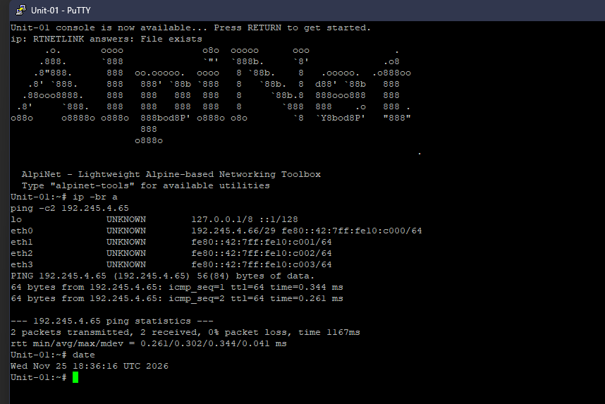

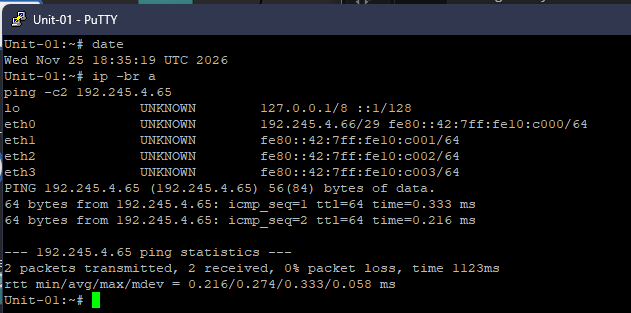

---

## Soal 7: Listener MAGI

### Yang diminta

Memasang `iptables` dan `netcat-traditional` lewat `/root/<nama>.sh` di Magi-Casper,
Magi-Balthasar, dan Magi-Melchior, lalu menyalakan listener sesuai port di glosarium.
Dari Lilith mengirim pesan ke ketiganya dan ke port 5001 Balthasar, lalu menampilkan
pesan yang diterima di tiap node.

### Port sesuai glosarium

| Node | Port |
|---|---|
| Magi-Casper | 5000 |
| Magi-Balthasar | 5000 dan 5001 |
| Magi-Melchior | 5000 |

### Script ketiga node MAGI

Ketiganya memakai susunan yang sama:

| Bagian | Fungsinya |
|---|---|
| `echo "nameserver 8.8.8.8" > /etc/resolv.conf` | DNS, dibutuhkan `apt-get` |
| perulangan `ping` ke 8.8.8.8 | Menunggu jaringan siap sebelum `apt-get` dipanggil |
| `apt-get install iptables netcat-traditional` | Paket hilang tiap restart, jadi ikut dipasang di script |
| `pkill -f 'nc -l -p <port>'` | Membunuh listener lama supaya tidak dobel |
| perulangan `while true` berisi `nc -l` | Listener, dinyalakan ulang otomatis tiap selesai melayani satu koneksi |

Bagian `while true` itu ada alasannya. `nc` versi netcat-traditional berhenti setelah
melayani satu koneksi, jadi tanpa perulangan listener hanya hidup sekali pakai.

Magi-Balthasar punya dua perulangan karena melayani dua port, yaitu 5000 dan 5001.

#### Magi-Casper  (192.245.4.58)

```bash
cat > /root/magi-casper.sh <<'EOF'
#!/bin/bash

echo "nameserver 8.8.8.8" > /etc/resolv.conf

for i in $(seq 1 30); do ping -c1 -W1 8.8.8.8 >/dev/null 2>&1 && break; sleep 2; done

apt-get update -qq
apt-get install -y -qq iptables netcat-traditional

pkill -f 'nc -l -p 5000'
(while true; do nc -l -p 5000 >> /root/log-5000.txt; done) &
EOF
chmod +x /root/magi-casper.sh && /root/magi-casper.sh
```

#### Magi-Balthasar  (192.245.4.59)

```bash
cat > /root/magi-balthasar.sh <<'EOF'
#!/bin/bash

echo "nameserver 8.8.8.8" > /etc/resolv.conf

for i in $(seq 1 30); do ping -c1 -W1 8.8.8.8 >/dev/null 2>&1 && break; sleep 2; done

apt-get update -qq
apt-get install -y -qq iptables netcat-traditional

pkill -f 'nc -l -p 5000'
(while true; do nc -l -p 5000 >> /root/log-5000.txt; done) &
pkill -f 'nc -l -p 5001'
(while true; do nc -l -p 5001 >> /root/log-5001.txt; done) &
EOF
chmod +x /root/magi-balthasar.sh && /root/magi-balthasar.sh
```

#### Magi-Melchior  (192.245.4.60)

```bash
cat > /root/magi-melchior.sh <<'EOF'
#!/bin/bash

echo "nameserver 8.8.8.8" > /etc/resolv.conf

for i in $(seq 1 30); do ping -c1 -W1 8.8.8.8 >/dev/null 2>&1 && break; sleep 2; done

apt-get update -qq
apt-get install -y -qq iptables netcat-traditional

pkill -f 'nc -l -p 5000'
(while true; do nc -l -p 5000 >> /root/log-5000.txt; done) &
EOF
chmod +x /root/magi-melchior.sh && /root/magi-melchior.sh
```

### Mengirim pesan dari Lilith

```bash
echo "halo Magi-Casper port 5000 dari Lilith" | nc -w 1 192.245.4.58 5000
echo "halo Magi-Balthasar port 5000 dari Lilith" | nc -w 1 192.245.4.59 5000
echo "halo Magi-Balthasar port 5001 dari Lilith" | nc -w 1 192.245.4.59 5001
echo "halo Magi-Melchior port 5000 dari Lilith" | nc -w 1 192.245.4.60 5000
```

Opsi `-w 1` wajib. Tanpa itu, `nc` versi BusyBox di alpinet tidak menutup koneksi setelah
mengirim dan terlihat seperti menggantung, padahal pesannya sudah sampai. Glosarium soal
sudah memperingatkan hal ini dengan menyebut "gunakan exit code, durasi koneksi, dan log
penerima sebagai bukti".


### Bukti: pesan yang diterima

Magi-Casper:


Magi-Balthasar, dua port:

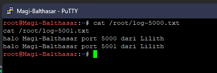

Magi-Melchior:

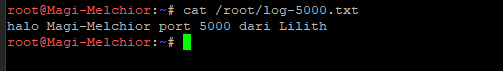

### Bukti: paket terpasang

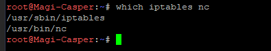

Fakta bahwa `nc -l -p 5000` bekerja juga membuktikan netcat-traditional memang yang
terpasang, karena versi OpenBSD tidak menerima sintaks `-p` untuk listener.

---

## Soal 8: Listener Pen-Pen dan Tokyo3-Core

### Yang diminta

Koneksi ke port 80 dijawab `Welcome to {hostname}`. Koneksi ke port 8080 di Tokyo3-Core
dijawab `syifa imutz`. Menunjukkan `nc` dari Lilith ke ketiga port itu, serta menunjukkan
bahwa port yang tidak dilayani, misalnya 22, langsung gagal dan bukan menggantung.

### Script Pen-Pen dan Tokyo3-Core

Pola berubah dari soal 7. Di soal 7 server hanya menerima, di soal 8 server harus
menjawab dengan banner.

Port 80 menjawab `Welcome to {hostname}`.
Port 8080 di Tokyo3-Core menjawab `syifa imutz`.

#### Pen-Pen  (192.245.3.195)

```bash
cat > /root/pen-pen.sh <<'EOF'
#!/bin/bash

echo "nameserver 8.8.8.8" > /etc/resolv.conf

for i in $(seq 1 30); do ping -c1 -W1 8.8.8.8 >/dev/null 2>&1 && break; sleep 2; done

apt-get update -qq
apt-get install -y -qq iptables netcat-traditional

pkill -f 'nc -l -p 80'
(while true; do echo "Welcome to $(hostname)" | nc -l -p 80; done) &
EOF
chmod +x /root/pen-pen.sh && /root/pen-pen.sh
```

#### Tokyo3-Core  (192.245.4.106)

```bash
cat > /root/tokyo3-core.sh <<'EOF'
#!/bin/bash

echo "nameserver 8.8.8.8" > /etc/resolv.conf

for i in $(seq 1 30); do ping -c1 -W1 8.8.8.8 >/dev/null 2>&1 && break; sleep 2; done

apt-get update -qq
apt-get install -y -qq iptables netcat-traditional

pkill -f 'nc -l -p 80'
(while true; do echo "Welcome to $(hostname)" | nc -l -p 80; done) &
pkill -f 'nc -l -p 8080'
(while true; do echo "syifa imutz" | nc -l -p 8080; done) &
EOF
chmod +x /root/tokyo3-core.sh && /root/tokyo3-core.sh
```

### Bukti

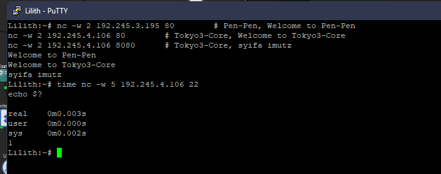

| Uji | Hasil |
|---|---|
| Pen-Pen port 80 | `Welcome to Pen-Pen` |
| Tokyo3-Core port 80 | `Welcome to Tokyo3-Core` |
| Tokyo3-Core port 8080 | `syifa imutz` |
| Port 22 | gagal dalam 0,003 detik, exit code 1 |

Port 22 gagal seketika tanpa konfigurasi tambahan, karena tidak ada yang mendengarkan
di port itu dan tidak ada rule DROP, sehingga kernel langsung membalas TCP RST.

Dari Lilith yang memakai `nc` versi BusyBox, pesan `Connection refused` tidak dicetak.
Karena itu buktinya memakai kombinasi durasi dan exit code, sesuai saran glosarium.

---

## Babak 2: Sabotase dan Hantu MAGI

### Aturan babak ini

Pada soal 9, 10, dan 12, script rusak dari asisten dijalankan **tanpa membaca isinya**.
Penyebabnya bisa lebih dari satu, harus ditemukan semua, diperbaiki, lalu dijelaskan
kenapa gejalanya seperti itu.

### Metode yang dipakai untuk ketiga soal sabotase

Karena isi script tidak boleh dibaca, satu-satunya cara menemukan penyebab adalah
membandingkan kondisi node sebelum dan sesudah. Sebelum setiap script dijalankan, kondisi
node direkam dulu:

```bash
mkdir -p /root/snap
ip route show table all > /root/snap/route-sebelum.txt
ip rule > /root/snap/rule-sebelum.txt
ip -br a > /root/snap/addr-sebelum.txt
iptables-save > /root/snap/iptables-sebelum.txt
sysctl -a 2>/dev/null | grep '^net.ipv4' | sort > /root/snap/sysctl-sebelum.txt
ps -ef > /root/snap/ps-sebelum.txt
```

Sesudah script dijalankan, rekaman yang sama diambil lagi dengan akhiran `-sesudah`, lalu
dibandingkan:

```bash
for f in route rule addr iptables sysctl ps; do
  echo "===== $f ====="
  diff /root/snap/$f-sebelum.txt /root/snap/$f-sesudah.txt
done
```

Enam hal yang direkam itu bukan pilihan sembarangan, masing-masing menutup satu kategori
sabotase:

| Rekaman | Menangkap |
|---|---|
| `ip route show table all` | Rute diubah, dihapus, atau ditambahi blackhole, di semua tabel bukan cuma main |
| `ip rule` | Policy routing yang membelokkan paket ke tabel lain |
| `ip -br a` | Alamat interface diubah atau interface dimatikan |
| `iptables-save` | Policy dan rule firewall serta tabel nat |
| `net.ipv4` sysctl | `ip_forward` dimatikan, `rp_filter` diubah, dan sejenisnya |
| `ps -ef` | Layanan dimatikan, sehingga bisa dibedakan dari sekadar diblokir |

Dua di antaranya ditambahkan setelah soal 9, bukan sejak awal. Rekaman awal hanya memakai
`ip route` tabel main, sehingga penyebab keempat di soal 9 tidak muncul di diff dan baru
ketahuan setelah beberapa putaran pencarian. `ip rule` dan `table all` dimasukkan sejak
soal 10 supaya kesalahan itu tidak terulang. `ps -ef` ditambahkan karena sabotase firewall
bisa berupa layanan dimatikan, bukan paket diblokir, dan dua kemungkinan itu memberi gejala
yang identik dari sisi klien.

---

## Soal 9: Jalur belakang diutak-atik

### Yang diminta

Menjalankan `break_routing.sh` di Shigeru, menemukan semua penyebab, memperbaiki, lalu
membuktikan Lilith bisa ping Armisael kembali. Gejala yang disebut soal: Lilith tidak
mendapat jawaban dari Armisael, padahal Armisael masih bisa ping gateway-nya sendiri.

### Kondisi normal sebelum sabotase

Armisael berada di Switch-Monolith `192.245.4.80/29` dengan alamat `192.245.4.83` dan
gateway `192.245.4.81`, yaitu eth1 Shigeru. Lilith berada di Switch-Dogma
`192.245.4.72/29` dengan alamat `192.245.4.74`.

Sebelum script dijalankan, kondisi Shigeru direkam dan jalur Lilith ke Armisael diuji
lebih dulu:

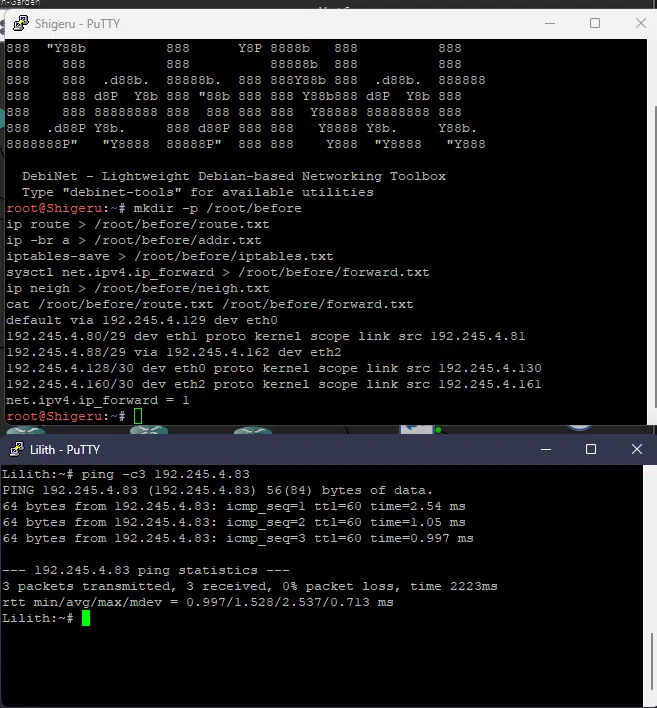

```bash
mkdir -p /root/before
ip route > /root/before/route.txt
ip -br a > /root/before/addr.txt
iptables-save > /root/before/iptables.txt
sysctl net.ipv4.ip_forward > /root/before/forward.txt
ip neigh > /root/before/neigh.txt
cat /root/before/route.txt /root/before/forward.txt
```

Lalu dari Lilith:

```bash
ping -c3 192.245.4.83
```

Gambar itu merekam dua dari empat penyebab dalam keadaan masih sehat, jadi bukan sekadar
bukti bahwa jaringannya jalan. Baris `default via 192.245.4.129 dev eth0` adalah default
route yang benar, yaitu ke arah Gendou, dan `net.ipv4.ip_forward = 1` menunjukkan
forwarding masih menyala. Keduanya yang nanti diubah sabotase.

Ping dari Lilith ke `192.245.4.83` berhasil 3 dari 3 dengan ttl=60, artinya paketnya
melewati empat router, yaitu Toji, Fuyutsuki, Gendou, lalu Shigeru. Jalur inilah yang
putus setelah script dijalankan.

Rekaman ini belum memuat `ip rule` dan `ip route show table all`, dan justru kekurangan
itulah yang membuat penyebab keempat baru ketahuan belakangan. Resep snapshot di awal
Babak 2 adalah versi yang sudah diperbaiki setelah soal ini.

### Menjalankan script

```bash
wget -q -O /root/break_routing.sh "https://drive.usercontent.google.com/download?id=1ub7LjL2BdZdVq6n_AbuqcO416Z8QJGVs&export=download&confirm=t"
chmod +x /root/break_routing.sh
wc -c /root/break_routing.sh
bash /root/break_routing.sh
```

Ukurannya harus 1684 byte. Pemeriksaan itu bukan formalitas, karena link Drive bentuk
`drive.google.com/file/d/...` mengembalikan halaman pemindaian virus bertipe `text/html`,
bukan filenya. Makanya yang dipakai `drive.usercontent.google.com/download` dengan
`confirm=t`.

Gambar saat eksekusinya tidak terekam, karena pada soal 9 pola snapshot sebelum dan sesudah
baru sedang dibentuk dan belum mencakup pendokumentasian langkah unduh.

### Gejala setelah script dijalankan

Dari Lilith ke Armisael gagal:

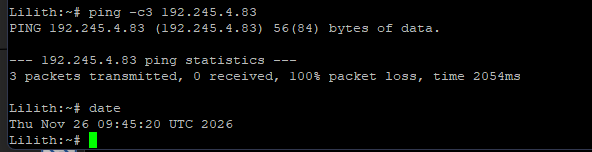

Tapi dari Armisael ke gateway sendiri tetap berhasil:

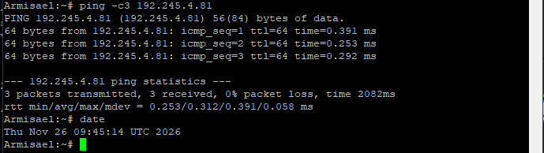

Kombinasi itu sudah menunjuk ke Shigeru, bukan ke Armisael. Kalau Armisael yang rusak, ping
ke gateway juga ikut gagal.

### Penyebab yang ditemukan

Diff menunjukkan empat perubahan, tiga terlihat langsung:

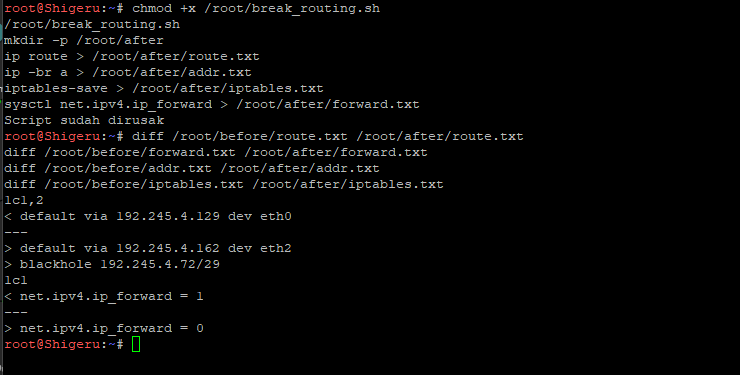

| No | Penyebab | Akibat |
|---|---|---|
| 1 | Default route dibajak dari `192.245.4.129` ke `192.245.4.162` | Paket ke atas dikirim ke Makoto, bukan ke Gendou |
| 2 | Ditambah `blackhole 192.245.4.72/29` | Paket balasan ke subnet Lilith dibuang di Shigeru |
| 3 | `net.ipv4.ip_forward=0` | Shigeru berhenti meneruskan paket sama sekali |
| 4 | `ip rule pref 90: from all iif eth1 lookup 100` dengan `unreachable default` di tabel 100 | Semua paket yang masuk lewat eth1 dicari rutenya di tabel kosong |

Penyebab keempat yang paling lama ditemukan, karena tidak terlihat di `ip route` biasa:

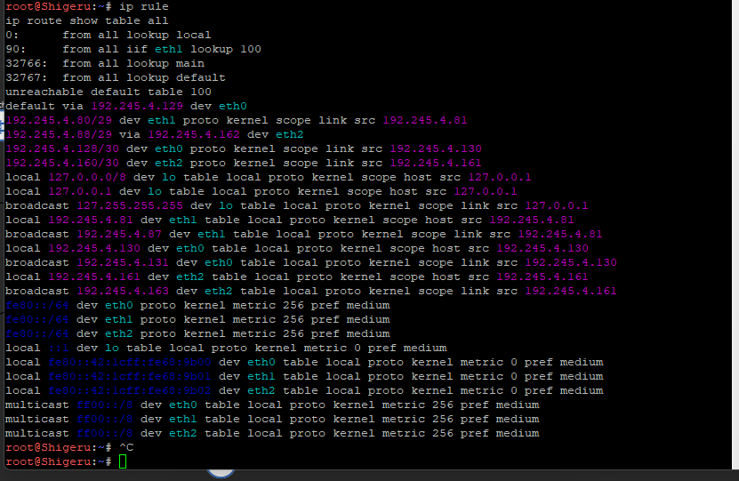

### Kenapa Armisael masih bisa ping gateway padahal eth1 diblokir

Ini bagian yang paling membingungkan di awal, dan jawabannya ada di urutan prioritas
`ip rule`. Tabel `local` selalu berada di prioritas 0, sedangkan rule sabotase dipasang di
prioritas 90. Alamat `192.245.4.81` adalah alamat milik Shigeru sendiri, jadi ia sudah
ketemu di tabel `local` dan tidak pernah sampai ke rule 90.

Paket ke Lilith beda nasibnya. Alamat `192.245.4.74` bukan milik Shigeru, jadi pencarian
berlanjut ke rule 90, masuk ke tabel 100 yang isinya hanya `unreachable default`, dan
paketnya mati di situ.

Jadi gejala "masih bisa ping gateway tapi tidak bisa menembus" bukan kebetulan, melainkan
tanda khas policy routing, bukan tanda masalah rute biasa.

### Perbaikan

```bash
bash /root/shigeru.sh
ip route del blackhole 192.245.4.72/29
ip rule del pref 90
ip route flush table 100
```

Menjalankan ulang `/root/shigeru.sh` sudah memperbaiki penyebab 1 dan 3 sekaligus, karena
file itu memuat `sysctl -w net.ipv4.ip_forward=1` dan `ip route replace default`. Tiga
baris sisanya menangani hal yang tidak ditulis di script, yaitu blackhole dan policy
routing, karena `ip route replace` tidak menghapus entri yang tidak disebut.

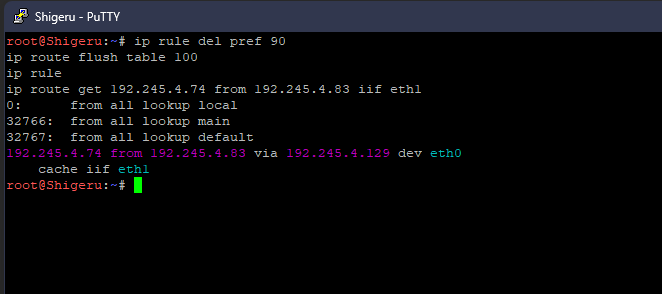

### Bukti

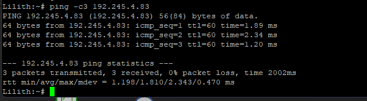

---

## Soal 10: Para pilot terkunci di dalam

### Yang diminta

Menjalankan `break_nat.sh` di Misato dan di Gendou, file yang sama di dua node berbeda.
Menjelaskan kenapa Cage terdampak tapi Intel tidak, membuktikan Unit-01 bisa ping 8.8.8.8
lagi, dan menyebutkan di router mana alamat sumber diterjemahkan.

### Kondisi normal sebelum sabotase

Unit-01 di Switch-Cage `192.245.4.64/29` dengan alamat `192.245.4.66`, dan Spy di
Switch-Intel `192.245.4.100/30` dengan alamat `192.245.4.102`. Keduanya bisa keluar ke
internet:

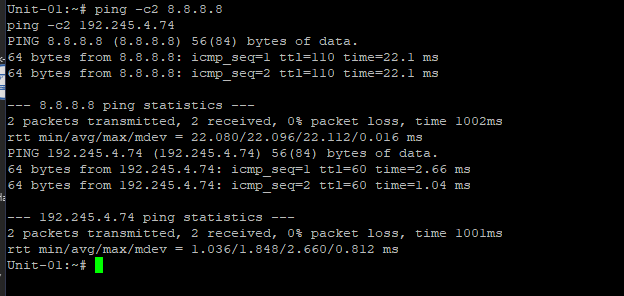

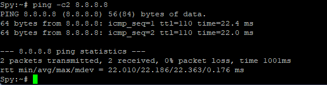

Counter rule NAT di Gendou sebelum sabotase, dipakai sebagai pembanding:

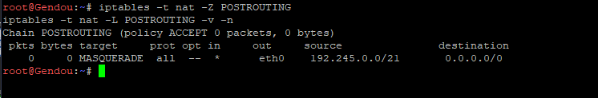

### Menjalankan script

File yang sama dijalankan di dua node, Misato dan Gendou. Di masing-masing node:

```bash
wget -q -O /root/break_nat.sh "https://drive.usercontent.google.com/download?id=1oX7r9BmMPumqrIb71Vbk43Y6CQEOvDRJ&export=download&confirm=t"
chmod +x /root/break_nat.sh
wc -c /root/break_nat.sh
bash /root/break_nat.sh
```

Ukurannya harus 2146 byte. Seperti pada soal 9, gambar saat eksekusinya tidak terekam.

### Gejala setelah script dijalankan

Unit-01 kehilangan internet:

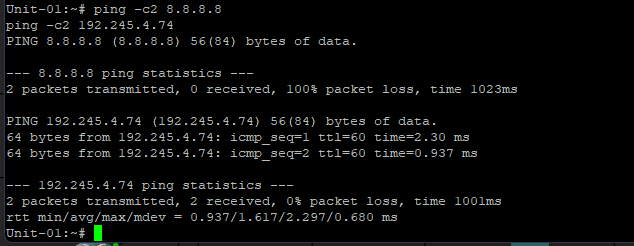

Sedangkan Spy tidak terpengaruh sama sekali:

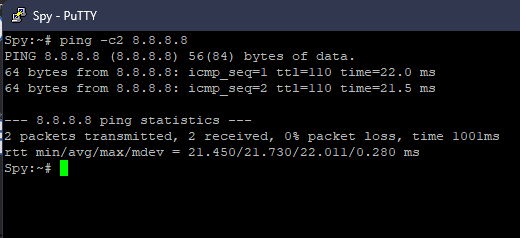

### Penyebab yang ditemukan

Dua node, dua perubahan berbeda.

Di Misato, muncul tabel `*nat` yang sebelumnya tidak ada sama sekali:

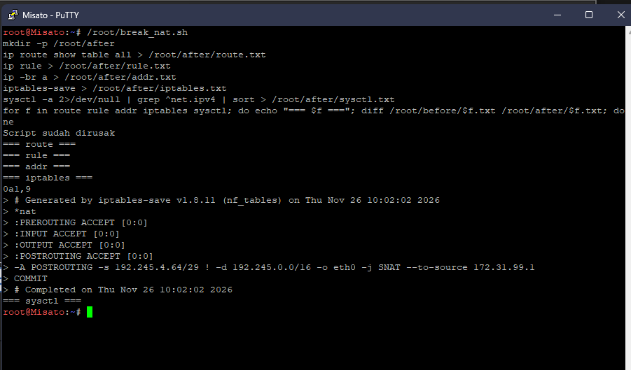

```
-A POSTROUTING -s 192.245.4.64/29 ! -d 192.245.0.0/16 -o eth0 -j SNAT --to-source 172.31.99.1
```

Di Gendou, satu rule disisipkan di atas MASQUERADE:

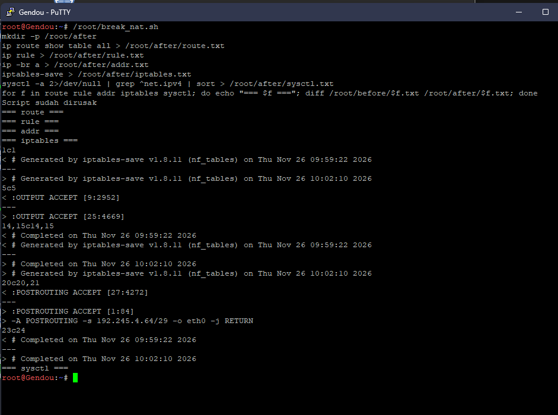

```
-A POSTROUTING -s 192.245.4.64/29 -o eth0 -j RETURN
```

### Kenapa Cage terdampak tapi Intel tidak

Kedua rule sabotase memakai selektor `-s 192.245.4.64/29`, yaitu subnet Switch-Cage saja.
Alamat Spy `192.245.4.102` berada di `192.245.4.100/30` dan tidak cocok dengan selektor
itu, jadi paket Spy tetap melewati MASQUERADE Gendou seperti biasa. Sabotasenya memang
dibuat menyasar satu subnet, bukan menjatuhkan seluruh jaringan.

Ping dari Cage ke Lilith juga tetap normal, dan itu bukan kebetulan. Rule di Misato memuat
`! -d 192.245.0.0/16`, artinya tujuan internal dikecualikan. Hanya trafik yang keluar ke
internet yang kena.

### Kenapa Unit-01 sampai gagal total

Misato menerjemahkan alamat sumber Unit-01 menjadi `172.31.99.1`, alamat yang tidak ada di
jaringan mana pun. Paket itu lalu sampai di Gendou, dan di sanalah ia mati, dibunuh oleh
firewall soal 5 buatan sendiri.

Chain FORWARD Gendou berpolicy DROP dengan tiga rule izin: balasan koneksi lama, lalu
`-s 192.245.0.0/21 -o eth0`, lalu trafik antar-LAN. Paket bersumber `172.31.99.1` tidak
cocok dengan satu pun, jadi dibuang policy. Jadi sabotase ini tidak mematikan NAT,
melainkan memancing firewall sendiri untuk membuang paket pilot.

### Jebakan urutan perbaikan

Counter rule RETURN di Gendou tetap nol meski sabotase sudah berjalan:

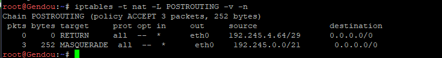

Angka nol itu penting dan mudah disalahartikan sebagai rule yang tidak aktif. Penyebabnya
rule di Misato menyala lebih dulu di jalur paket, sehingga paket Cage tidak pernah lolos
sampai ke POSTROUTING Gendou dalam bentuk aslinya.

Akibatnya, kalau hanya Misato yang diperbaiki, rule RETURN di Gendou justru baru mulai
bekerja dan Unit-01 tetap tidak bisa keluar, dengan gejala yang mirip tapi penyebab
berbeda. Dua-duanya harus diperbaiki, dan urutannya tidak penting selama keduanya
dikerjakan.

### Perbaikan

Di Misato:

```bash
iptables -t nat -F POSTROUTING
iptables -t nat -S
```

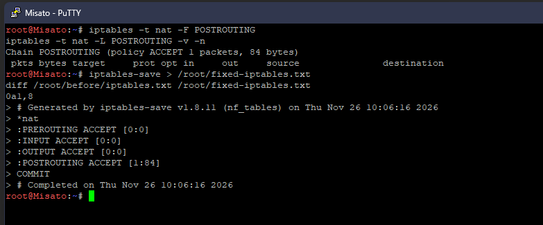

Di Gendou:

```bash
iptables -t nat -D POSTROUTING -s 192.245.4.64/29 -o eth0 -j RETURN
iptables -t nat -S POSTROUTING
```

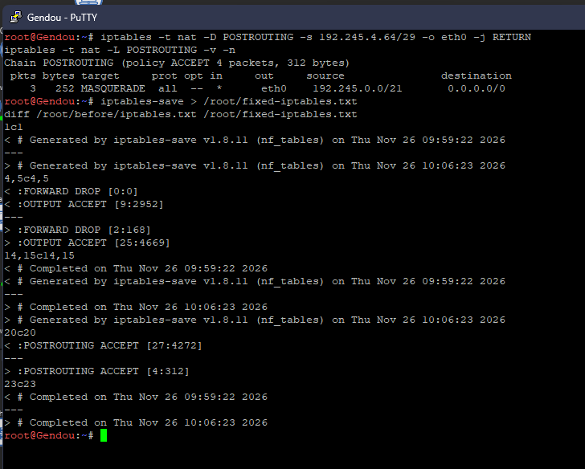

Di Misato dipakai `-F POSTROUTING` karena node itu memang tidak pernah punya rule nat satu
pun sebelumnya, sehingga mengosongkan chain mengembalikannya persis ke kondisi semula. Di
Gendou tidak boleh `-F`, karena chain itu memuat MASQUERADE dari soal 4 yang harus tetap
ada, jadi dipakai `-D` untuk menghapus satu rule saja.

### Bukti

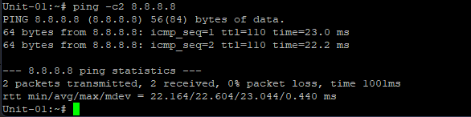

### Jawaban pertanyaan soal

Alamat sumber diterjemahkan di **Gendou**, lewat rule MASQUERADE pada interface `eth0` yang
dipasang di soal 4. Gendou satu-satunya router yang terhubung ke NAT1, jadi hanya di situ
ada batas antara prefix internal dan dunia luar.

---

## Soal 11: Casper harus jadi hantu

### Yang diminta

Tidak ada perangkat lain yang boleh mem-ping Casper, termasuk tetangga satu switch. Casper
sendiri tetap boleh mem-ping siapa saja. Layanan TCP 5000 tetap hidup. Bukti berupa ping
ke Casper dari Balthasar dan Lilith gagal, sedangkan ping dari Casper ke keduanya berhasil.

### Aturan yang dipasang

Satu baris ditambahkan ke `/root/magi-casper.sh`:

```bash
iptables -C INPUT -p icmp --icmp-type echo-request -j DROP 2>/dev/null || \
  iptables -A INPUT -p icmp --icmp-type echo-request -j DROP
```

Aturan ini ditulis ke dalam script, bukan diketik langsung, karena paket yang di-install
hilang saat node restart dan rule iptables ikut hilang bersamanya.

### Kondisi sebelum aturan dipasang

Sebelum soal 11, Casper tidak punya satu pun rule iptables dan policy INPUT-nya masih
ACCEPT, sehingga siapa pun bisa mem-pingnya. Keadaan itu terlihat di sisi kiri diff soal
12, yang merekam `:INPUT ACCEPT` dengan rule soal 11 sebagai satu-satunya isi tabel.

Ping ke Casper yang berhasil sebelum rule dipasang tidak diambil screenshot-nya, dan itu
disebut apa adanya di sini daripada memakai gambar dari waktu lain sebagai gantinya. Bukti
tidak langsungnya ada di soal 7, yaitu Casper menerima pesan dari Lilith, yang berarti
Casper memang terjangkau dari luar subnetnya pada saat itu.

### Tiga keputusan yang perlu dijelaskan

**Hanya `echo-request`, bukan seluruh ICMP.** Kalau semua ICMP diblokir di chain INPUT,
balasan `echo-reply` untuk ping yang dikirim Casper sendiri ikut terbuang, dan syarat
"Casper tetap boleh mem-ping siapa saja" gagal. Ini bukan kemungkinan teoretis, melainkan
persis kesalahan yang muncul di soal 12.

**`DROP`, bukan `REJECT`.** Soal memintanya jadi hantu supaya SEELE tidak tahu ia masih
hidup. REJECT mengirim balasan penolakan, dan balasan itu sendiri sudah membuktikan ada
perangkat hidup di alamat tersebut. DROP tidak menjawab apa pun, sehingga pengirim hanya
melihat timeout tanpa pesan, tidak bisa membedakan Casper ada tapi menolak, dengan Casper
tidak ada sama sekali.

**Hanya `-p icmp`, tidak menyentuh TCP.** Supaya listener port 5000 dari soal 7 tetap
melayani.

### Bukti

Ping dari Balthasar, satu switch dengan Casper:

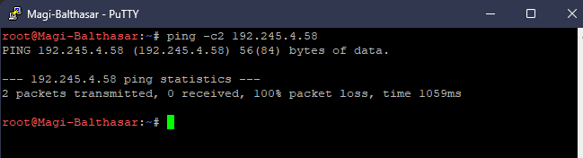

Ping dari Lilith, beda subnet:

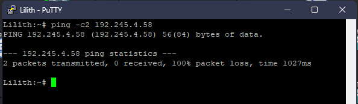

Dua-duanya 100% packet loss dan menggantung sampai timeout tanpa pesan error. Tidak adanya
pesan `Destination Host Unreachable` itu sendiri adalah bukti yang terpasang DROP, bukan
REJECT.

Ping dari Casper ke keduanya:

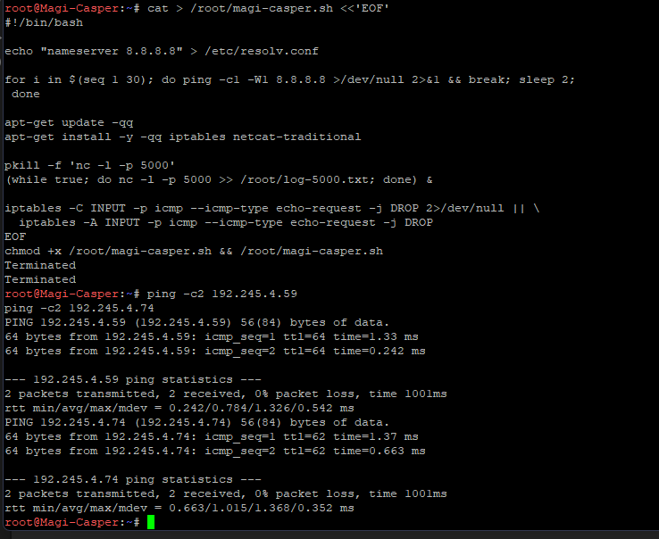

Dua angka TTL di gambar itu sekaligus memverifikasi topologi. Balasan dari Balthasar
`192.245.4.59` datang dengan ttl=64, artinya tidak melewati router sama sekali karena satu
switch. Balasan dari Lilith `192.245.4.74` datang dengan ttl=62, artinya melewati tepat dua
router, yaitu Fuyutsuki lalu Toji, sesuai jalur di topologi.

Layanan TCP 5000 masih hidup, diuji dari Lilith:

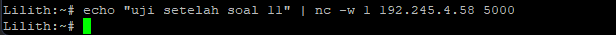


Bukti terakhir itu yang paling sering terlewat, karena orang berhenti setelah pingnya
berhasil gagal dan lupa memeriksa bahwa layanannya tidak ikut mati.

---

## Soal 12: Teknisi yang kelewat semangat

### Yang diminta

Menjalankan `break_fw.sh` di Magi-Casper, lalu memperbaiki tanpa membatalkan tujuan
hardening. Casper tetap menolak semua lalu lintas masuk yang tidak diizinkan, dan policy
INPUT tetap DROP. Bukti berupa nc dari Unit-00 ke port 5000 berhasil dan `apt-get update`
di Casper berhasil. Gejala yang disebut soal: Casper tidak bisa ping 8.8.8.8, tidak bisa
`apt-get update`, dan Unit-00 tidak bisa menyambung ke TCP 5000, sedangkan ping ke Casper
tetap ditolak dan itu memang benar.

Soal ini dikerjakan setelah soal 11, karena kalimat "ping ke Casper tetap ditolak, dan itu
memang benar" hanya bisa dipenuhi kalau aturan soal 11 sudah terpasang lebih dulu.

### Kondisi normal sebelum sabotase

Casper bisa keluar ke internet, bisa ping Lilith, dan log port 5000 berisi pesan dari soal
7 dan soal 11:

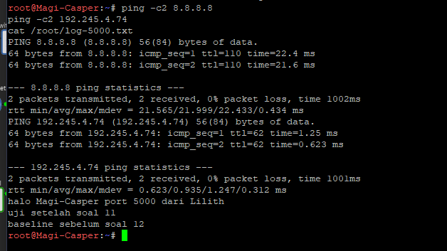

Dari Lilith, port 5000 terlayani:

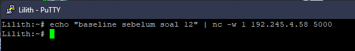

Dari Unit-00 juga, dan ini sengaja diuji lebih dulu:

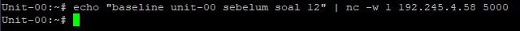

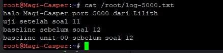

Unit-00 belum pernah diuji ke Casper sebelumnya, baru Lilith di soal 7. Tanpa baseline ini,
kalau nanti Unit-00 gagal setelah perbaikan, tidak akan bisa dibedakan antara firewall yang
masih salah dengan `nc` versi busybox di Unit-00 yang memang berbeda perilakunya.

Ping ke Casper tetap ditolak, hasil soal 11, dan memang harus tetap begitu:

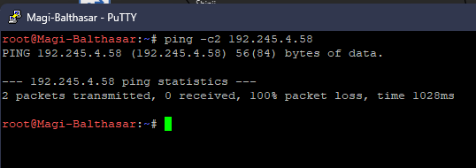

### Menjalankan script

File diunduh langsung di node, bukan dipindahkan dari komputer:

```bash
wget -q -O /root/break_fw.sh "https://drive.usercontent.google.com/download?id=1Yb5kX1NKafOGDTbAE7WMYHZkQgpWLTvZ&export=download&confirm=t"
chmod +x /root/break_fw.sh
wc -c /root/break_fw.sh
md5sum /root/break_fw.sh
bash /root/break_fw.sh
```

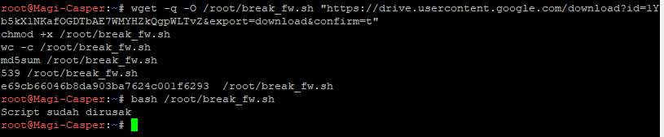

Alamat unduhnya memakai `drive.usercontent.google.com/download` dengan `confirm=t`, bukan
bentuk `drive.google.com/file/d/...`. Bentuk yang kedua mengembalikan halaman pemindaian
virus setinggi 2464 byte bertipe `text/html`, bukan filenya, sehingga `bash` terhadapnya
tidak melakukan apa-apa selain memuntahkan error HTML. Pemeriksaan `wc -c` dipasang justru
untuk menangkap kasus itu.

### Penyebab yang ditemukan


Diff `route`, `rule`, `addr`, dan `sysctl` semuanya kosong, dan listener `nc -l -p 5000`
masih terlihat di `ps`. Jadi sabotasenya murni di tabel filter, bukan routing dan bukan
layanan yang dimatikan. Dua kesimpulan itu langsung mempersempit pencarian.

| No | Penyebab | Akibat |
|---|---|---|
| 1 | `:INPUT ACCEPT` diubah jadi `:INPUT DROP` tanpa satu pun rule ACCEPT pendamping | Semua paket masuk dibuang, termasuk TCP 5000 dan seluruh balasan koneksi keluar |
| 2 | Rule soal 11 `--icmp-type 8 -j DROP` diganti jadi `-p icmp -j DROP` | Bukan cuma echo-request, tapi seluruh ICMP termasuk echo-reply, sehingga ping Casper sendiri tidak pernah terjawab |
| 3 | Ditambah `-A OUTPUT -p udp --dport 53 -j DROP` | Query DNS keluar dibuang |

Satu rule yang ikut ditambahkan justru benar dan dipertahankan di perbaikan, yaitu
`-A INPUT -i lo -j ACCEPT`.

### Gejala dan kenapa bentuknya begitu


**Ping 8.8.8.8 gagal 100% tanpa pesan error.** Echo-request Casper tetap keluar, karena
policy OUTPUT masih ACCEPT dan rule DROP di OUTPUT hanya menyasar UDP 53. Google membalas,
dan balasan itulah yang dibuang `-A INPUT -p icmp -j DROP`. Jadi yang rusak jalan pulangnya,
bukan jalan keluarnya. Ini bedanya dengan soal 9, di mana kerusakan rute memberi pesan
`Network is unreachable`.

**`apt-get` berhenti di tahap resolusi nama, bukan tahap unduh.** Pesannya
`Temporary failure resolving`, bukan `Failed to connect`. Artinya kegagalan terjadi sebelum
ada koneksi TCP sama sekali, dan itu cocok persis dengan rule DROP pada UDP 53. Membedakan
dua pesan itu penting, karena keduanya sama-sama membuat `apt-get` gagal tapi penyebabnya
di tempat berbeda.

**nc dari Unit-00 tidak masuk log padahal listener hidup.** Paket SYN masuk ke chain INPUT,
tidak cocok dengan rule `lo` maupun rule icmp, lalu jatuh ke policy DROP. Listener tidak
pernah tahu ada yang mengetuk.


### Akibat keempat yang belum muncul sebagai gejala

Chain INPUT tidak punya rule `ESTABLISHED,RELATED` sama sekali. Jadi kalaupun rule DNS
dihapus, `apt-get update` tetap akan gagal, hanya pesannya berubah dari
`Temporary failure resolving` menjadi `Failed to connect`, karena balasan HTTP dari server
Debian juga paket masuk dan ikut dibuang policy DROP.

Artinya memperbaiki dengan cara menghapus tiga rule hasil sabotase tidak cukup. Rule
conntrack harus ditambahkan, dan justru rule itulah yang hilang dari script hardening si
teknisi. Itu sebabnya soal menyebut teknisinya "kelewat semangat", bukan jahat: policy DROP
memang benar, yang kurang adalah izin untuk balasan koneksi yang dimulai sendiri.

### Perbaikan

```bash
cat > /root/magi-casper.sh <<'EOF'
#!/bin/bash

echo "nameserver 8.8.8.8" > /etc/resolv.conf

# buka sementara supaya apt bisa jalan
command -v iptables >/dev/null && { iptables -F; iptables -t nat -F; iptables -P INPUT ACCEPT; iptables -P OUTPUT ACCEPT; }

for i in $(seq 1 30); do ping -c1 -W1 8.8.8.8 >/dev/null 2>&1 && break; sleep 2; done

apt-get update -qq
apt-get install -y -qq iptables netcat-traditional

# listener 5000
pkill -f 'nc -l -p 5000'
nohup bash -c 'while true; do nc -l -p 5000 >> /root/log-5000.txt; sleep 1; done' >/dev/null 2>&1 &

# hardening
iptables -P INPUT DROP
iptables -P FORWARD DROP
iptables -P OUTPUT ACCEPT
iptables -A INPUT -i lo -j ACCEPT
iptables -A INPUT -m conntrack --ctstate ESTABLISHED,RELATED -j ACCEPT
iptables -A INPUT -p icmp --icmp-type echo-request -j DROP
iptables -A INPUT -p tcp --dport 5000 -j ACCEPT
EOF
chmod +x /root/magi-casper.sh && bash /root/magi-casper.sh && iptables -S
```

Empat hal dalam script ini yang bukan kebetulan.

**Urutan rule conntrack dan rule ICMP tidak boleh ditukar.** Rule conntrack harus di atas,
supaya echo-reply untuk ping Casper sendiri lolos lebih dulu sebagai ESTABLISHED.
Sedangkan echo-request dari Balthasar berstatus NEW, jadi ia tidak tertangkap rule
conntrack dan jatuh ke rule ICMP di bawahnya lalu dibuang. Itulah yang membuat syarat soal
11 dan syarat soal 12 bisa berlaku bersamaan, padahal sekilas terlihat bertentangan.

**Firewall dibuka sementara di awal, lalu ditutup lagi di akhir.** Urutannya harus begitu
karena `apt-get` butuh jaringan sedangkan policy DROP memblokir balasannya, dan `iptables`
sendiri termasuk paket yang di-install sehingga belum tentu ada saat node baru menyala.
Penjaga `command -v iptables` dipasang supaya baris itu tidak menggagalkan script pada
restart pertama.

**Dipakai `iptables -F` di awal, bukan `-D` satu per satu.** Dengan begitu script ini
menjadi satu-satunya sumber kebenaran isi tabel filter Casper dan aman dijalankan berulang
kali. Ini berbeda dengan Gendou di soal 10, yang tidak boleh di-flush karena chain nat-nya
memuat MASQUERADE dari soal 4. Casper tidak disentuh anggota kelompok yang lain, jadi tidak
ada risiko menimpa pekerjaan orang.

**Pola listener diganti ke bentuk `nohup bash -c`.** Bentuk lama `(while true; do ...) &`
menyisakan masalah: `pkill -f 'nc -l -p 5000'` hanya membunuh proses `nc`, bukan loop
`while` yang membungkusnya, sehingga setiap kali script dijalankan ulang akan bertambah
satu loop. Hal itu benar-benar terjadi dan terlihat di diff `ps`, ada dua loop berjalan
bersamaan dengan parent berbeda. Pada bentuk baru, command line prosesnya memuat string
`nc -l -p 5000`, sehingga `pkill -f` ikut membunuh loop-nya.

### Bukti

Dari Unit-00:


Di Casper, empat hal sekaligus:


| Yang diperiksa | Hasil |
|---|---|
| Pesan Unit-00 masuk log | `uji setelah perbaikan soal 12` muncul di `/root/log-5000.txt` |
| `apt-get update` | `Hit:1` sampai `Hit:3`, tanpa satu pun `Err:` atau `W:` |
| Ping 8.8.8.8 | 2 terkirim, 2 diterima, ttl=110 |
| Policy INPUT | `-P INPUT DROP` jadi baris pertama `iptables -S` |

Ping ke Casper tetap ditolak, jadi hasil soal 11 selamat:


Ping 8.8.8.8 berhasil sekaligus membuktikan bahwa echo-reply bisa masuk lewat rule
conntrack, sedangkan ping dari Balthasar tetap mati di rule ICMP. Dua pemeriksaan terakhir
itu yang paling mudah terlewat, karena setelah semuanya kembali berjalan orang cenderung
lupa memastikan bahwa yang memang harus tetap ditolak masih ditolak, dan bahwa policy DROP
tidak diam-diam dilonggarkan demi membuat tesnya lulus.

---

## Babak 3: Mengamankan MAGI dan Zona Sensitif

Soal 13 sampai 19. Menerapkan kebijakan firewall spesifik pada node dan router, termasuk *rate limiting*, *logging*, *DNAT*, hingga isolasi zona.

---

### Soal 13: Brankas Balthasar

Yang diminta: Hanya Casper dan semua Pilot yang boleh menyambung ke TCP 5000 dan 5001 di Balthasar. Node lain harus langsung ditolak (REJECT). Balthasar tetap harus bisa ping 8.8.8.8.

Implementasi: Konfigurasi diletakkan di dalam node Magi-Balthasar (`/root/soal13.sh`). Kami menggunakan `-m multiport` untuk menangani dua port sekaligus, dan memastikan rule `REJECT` diletakkan di paling bawah agar sisa trafik yang tidak diizinkan langsung dibanting.

```bash
iptables -F INPUT
iptables -A INPUT -i lo -j ACCEPT
iptables -A INPUT -m conntrack --ctstate ESTABLISHED,RELATED -j ACCEPT

# Izinkan Casper dan Pilot
iptables -A INPUT -s 192.245.4.58 -p tcp -m multiport --dports 5000,5001 -j ACCEPT
iptables -A INPUT -s 192.245.4.66 -p tcp -m multiport --dports 5000,5001 -j ACCEPT
iptables -A INPUT -s 192.245.4.67 -p tcp -m multiport --dports 5000,5001 -j ACCEPT
iptables -A INPUT -s 192.245.4.68 -p tcp -m multiport --dports 5000,5001 -j ACCEPT
iptables -A INPUT -s 192.245.3.130 -p tcp -m multiport --dports 5000,5001 -j ACCEPT

# Tolak seketika
iptables -A INPUT -p tcp -m multiport --dports 5000,5001 -j REJECT
```

Bukti:

Unit-01 (Pilot) berhasil menyambung:


Lilith (Staf) langsung ditolak seketika (Connection refused):


---

### Soal 14: Jam kunjungan sang pinguin

Yang diminta: Membatasi ping dan TCP 80 ke Pen-Pen berdasarkan jadwal WIB menggunakan modul `-m time`. Pen-Pen harus menolak Dummy System secara permanen.

Jebakan Logika & Implementasi: Waktu di iptables menggunakan UTC (WIB - 7 jam). Jadwal Pilot (08.00-16.00 WIB) menjadi `01:00 - 09:00 UTC`. Terdapat jebakan pada penggunaan rule `ACCEPT` di paling bawah. Jika jadwal tidak cocok, paket akan jatuh ke rule `ACCEPT` terakhir. Oleh karena itu, setelah rule `ACCEPT` berbasis waktu, wajib ditambahkan rule `REJECT` eksplisit untuk subnet tersebut.

```bash
iptables -F INPUT
iptables -A INPUT -i lo -j ACCEPT
iptables -A INPUT -m conntrack --ctstate ESTABLISHED,RELATED -j ACCEPT

# Pilot (Senin-Jumat, 01:00 - 09:00 UTC)
iptables -A INPUT -s 192.245.4.64/29 -p icmp -m time --timestart 01:00 --timestop 09:00 --weekdays Mon,Tue,Wed,Thu,Fri -j ACCEPT
iptables -A INPUT -s 192.245.4.64/29 -p icmp -j REJECT # Mencegah jatuh ke rule ACCEPT di bawah

# Staf (Setiap hari, 10:00 - 16:00 UTC)
iptables -A INPUT -s 192.245.4.74 -p icmp -m time --timestart 10:00 --timestop 16:00 -j ACCEPT
iptables -A INPUT -s 192.245.4.74 -p icmp -j REJECT

# Dummy System (Selalu ditolak)
iptables -A INPUT -s 192.245.4.102 -j REJECT # Spy
iptables -A INPUT -s 192.245.4.50 -j REJECT  # Entry-Plug
iptables -A INPUT -s 192.245.4.51 -j REJECT  # Dummy-Plug
```

Bukti:

Unit-01 (Pilot) gagal saat di luar jam operasional:


Lilith (Staf) berhasil saat jam kunjungan cocok:


Dummy-Plug selalu ditolak:


---

### Soal 15 & 16: Banjir Ping dan Pencuri di Tokyo3-Core

Yang diminta (Soal 15): Membatasi ping ke Tokyo3-Core maksimal 5 per detik, membuang kelebihannya.
Yang diminta (Soal 16): Mencatat setiap koneksi dari Dummy-Plug ke port 22, 23, dan 3306 dengan prefix SCAN-NERV: dan menolaknya seketika.

Implementasi (Urutan Sangat Penting!): Rule `limit` ping wajib diletakkan di paling atas sebelum rule `ESTABLISHED,RELATED`. Jika diletakkan di bawah, paket ping selanjutnya akan dianggap sebagai koneksi aktif (ESTABLISHED) oleh conntrack dan langsung lolos tanpa terkena limit.

```bash
iptables -F INPUT

# Soal 15: Rate Limit (Taruh paling atas)
iptables -A INPUT -p icmp --icmp-type echo-request -m limit --limit 5/second -j ACCEPT
iptables -A INPUT -p icmp --icmp-type echo-request -j DROP

# Rule standar
iptables -A INPUT -i lo -j ACCEPT
iptables -A INPUT -m conntrack --ctstate ESTABLISHED,RELATED -j ACCEPT

# Soal 16: Log & Tolak Dummy-Plug
iptables -A INPUT -s 192.245.4.51 -p tcp -m multiport --dports 22,23,3306 -j LOG --log-prefix "SCAN-NERV: "
iptables -A INPUT -s 192.245.4.51 -p tcp -m multiport --dports 22,23,3306 -j REJECT
```

Bukti:

Ping spam dari Lilith memicu rule DROP (counter naik) dan koneksi Dummy-Plug ditolak seketika:


Ping dari Lilith terlihat loss parah:


Dummy-Plug ditolak seketika:


---

### Soal 17: Sihir hitam di jalur paket (DNAT)

Yang diminta: Di router Fuyutsuki, mengalihkan koneksi TCP port 9000 dari Casper ke Zeruel agar sampai ke Pen-Pen, tanpa Casper sadar.

Implementasi: Kami menggunakan DNAT pada tabel nat PREROUTING untuk mengubah tujuan paket, dan MASQUERADE (SNAT) pada POSTROUTING agar balasan dari Pen-Pen dikira datang dari Zeruel oleh Casper.

```bash
# 1. Alihkan Tujuan (DNAT)
iptables -t nat -A PREROUTING -s 192.245.4.58 -d 192.245.4.82 -p tcp --dport 9000 -j DNAT --to-destination 192.245.3.195:9000

# 2. Ubah Sumber (SNAT) agar seolah dari Zeruel
iptables -t nat -A POSTROUTING -d 192.245.3.195 -p tcp --dport 9000 -j MASQUERADE
```

Bukti:

Pesan dikirim dari Casper:


Pesan diterima oleh Pen-Pen:


Zeruel tidak menerima apa pun:


Tabel conntrack membuktikan alih rute dari Casper ke Pen-Pen:


---

### Soal 18: Gerbang Monolith dan Radar

Yang diminta: Di router Shigeru, node luar tidak boleh memulai koneksi ke dalam zona. Pengecualian: ping dari subnet Terminal. Dilarang menulis subnet luar satu per satu (harus berbasis arah interface).

Implementasi: Karena interface `eth0` Shigeru selalu menghadap Gendou (sisi luar), kami memblokir semua koneksi `NEW` yang masuk lewat `eth0`, kecuali yang berasal dari Subnet Terminal (`192.245.4.56/29`).
(Catatan: Karena terdapat NAT dari router sebelumnya, kami juga menambahkan IP Gendou sebagai pengecualian agar ping Casper bisa lolos).

```bash
iptables -A FORWARD -m conntrack --ctstate ESTABLISHED,RELATED -j ACCEPT
iptables -A FORWARD -i eth0 -p icmp -s 192.245.4.56/29 -j ACCEPT
# Pengecualian IP Gendou jika Casper ter-NAT
iptables -A FORWARD -i eth0 -p icmp -s 192.245.4.129 -j ACCEPT
# Blokir koneksi baru dari luar
iptables -A FORWARD -i eth0 -m conntrack --ctstate NEW -j DROP
```

Bukti:

Casper (Terminal) berhasil ping ke Zeruel:


Lilith (Luar zona) gagal ping ke Zeruel:


---

### Soal 19: Hukuman untuk sang pengkhianat

Yang diminta: Isolasi Armisael dari semua lalu lintas, namun Zeruel tidak boleh terhukum. Isolasi tidak boleh dilakukan di dalam Armisael.

Analisis & Implementasi: Kami menerapkan rule `DROP` di chain FORWARD Router Shigeru untuk IP Armisael. 
Temuan Penting: Rule di Shigeru tidak cukup untuk memblokir ping dari Armisael ke Zeruel, karena keduanya berada di satu switch (Layer 2). Paket tidak melewati router. Oleh karena itu, kami memblokir sisa trafik L2 tersebut dari dalam node Zeruel.

```bash
# Di Router Shigeru (Isolasi L3)
iptables -I FORWARD -s 192.245.4.83 -j DROP
iptables -I FORWARD -d 192.245.4.83 -j DROP

# Di Node Zeruel (Isolasi L2 agar tidak bisa saling ping)
iptables -A INPUT -s 192.245.4.83 -j DROP
```

Bukti:

Armisael 100% loss ke Zeruel, Lilith, dan Internet:


Zeruel aman dan masih bisa ping ke luar:


---

## Babak Final: Siap Dihancurkan, Siap Dibangun Lagi

### Soal 20: Uji kebakaran Geofront

Yang diminta: Memilih 3 node (minimal 1 router), menyimpan rule ke `/root/<nama>.rules`, menghancurkan, lalu me-restore 2x berturut-turut. Membuktikan tidak ada duplikasi rule.

Implementasi & Otomatisasi: Kami memilih Gendou (Router), Shigeru (Router), dan Magi-Balthasar (Host). 
Khusus router, pembuatan script backup rute diotomatiskan menggunakan `sed` agar tidak perlu mengetik manual:

```bash
# Backup Firewall (Semua Node)
iptables-save > /root/backup.rules

# Backup Rute Otomatis (Khusus Router)
ip route | grep -v "proto kernel" | grep -v "default" | sed 's/^/ip route add /' > /root/rute_backup.sh
```

Simulasi Bencana: Semua rule dihapus (`iptables -F`, `iptables -t nat -F`) dan rute dihapus.

Pemulihan & Idempotensi: Restore dilakukan 2x:

```bash
iptables-restore < /root/backup.rules
bash /root/rute_backup.sh
```

Analisis `RTNETLINK answers: File exists`: Saat restore rute dijalankan, muncul pesan error `RTNETLINK answers: File exists`. Ini adalah bukti keberhasilan. Pesan ini muncul karena sistem menolak menambahkan rute yang sudah ada (tidak menduplikasi). Ini membuktikan script bersifat idempoten.

Bukti (Jumlah Baris Sama Persis):

Gendou: Baseline (10 & 5) -> Restore 1 (10 & 5) -> Restore 2 (10 & 5).


Shigeru: Baseline (8 & 4) -> Restore 1 (8 & 4) -> Restore 2 (8 & 4).


Balthasar: Baseline (11 & 4) -> Restore (11 & 4).


Bukti Node Berfungsi Kembali:

Gendou bisa ping internet:


Shigeru bisa ping Zeruel:


Casper bisa ping Balthasar:


Armisael tetap terisolasi (rule firewall berfungsi):


---

## Asumsi yang diambil

Tiga tempat di mana soal tidak menyebut aturannya secara eksplisit, atau dua sumber di
dalam soal saling bertentangan.

**1. Gateway ikut dihitung dalam kebutuhan IP.** Soal tidak menyebutkannya, tapi
glosarium menulis "gateway adalah IP usable pertama subnet". Tanpa menghitung gateway,
Switch-Dogma dan Switch-Monolith akan jatuh ke `/30` yang tidak menyisakan alamat untuk
gateway, sehingga subnetnya mustahil dipakai.

**2. Urutan node di Switch-Medic mengikuti gambar, bukan tabel host.** Glosarium menulis
urutan alamat mengikuti "urutan penulisan nama node pada switch di gambar (kiri ke kanan)".
Di `topo_5.png`, Medic-Bay berada di kiri dan Pen-Pen di kanan, sedangkan tabel host di
soal menomori Pen-Pen lebih dulu. Dipakai urutan gambar, sehingga Medic-Bay mendapat
`192.245.3.194` dan Pen-Pen `192.245.3.195`. Ini satu-satunya titik di mana dua sumber
di dalam soal berbeda.

**3. Urutan 16 link antar router mengikuti urutan pohon dari Gendou ke bawah.** Soal
memberi aturan tie-break "lalu urutan tabel", tapi link tidak dinomori di tabel host.
Karena seluruh link berukuran `/30` yang sama, urutannya hanya menentukan blok mana yang
didapat masing-masing, tidak mengubah struktur maupun jumlah alamat yang dipakai.

**4. Nama file script mengikuti nama node.** Soal 5 menulis `gendo.sh` sedangkan node
bernama Gendou, dan soal 7 menulis `/root/<nama>.sh`. Dipakai `gendou.sh` mengikuti nama
node yang sebenarnya.

---

## Catatan teknis

Hal-hal yang ditemukan saat pengerjaan dan berguna untuk diulang.

**Hanya `/root` dan `/etc/network/interfaces` yang bertahan saat node Docker direstart.**
Isi `/etc` lain dan seluruh paket yang di-install hilang. Semua konfigurasi karena itu
ditulis lewat script di `/root`, dan script yang butuh paket memuat `apt-get install`
di dalamnya.

**Editor "Edit network configuration" di GNS3 membuang baris yang mengandung tanda `>`.**
Semua heredoc `cat >` dan redirect karena itu diketik lewat console node, bukan lewat
editor tersebut.

**Jumlah adapter diubah per node, bukan lewat Edit lalu Preferences.** Controller lab
dipakai bersama seluruh kelompok, dan mengubah template akan berdampak ke kelompok lain.

**`ifup` tidak ada di image debinet.** Yang ada hanya di alpinet lewat busybox. Untuk
menerapkan alamat pada node debinet dipakai `ip addr replace` dan `ip route replace`.

**Link di GNS3 bisa nyangkut setelah node direstart.** Gejalanya konfigurasi benar di
kedua ujung tapi traffic tidak lewat, dan ARP hanya berhasil satu arah. Terjadi pada
Switch-Cage saat soal 6. Perbaikannya mematikan dan menyalakan node, atau menghapus dan
memasang ulang kabelnya.

**Cara membaca pesan error ping:**

| Pesan | Artinya |
|---|---|
| `Network is unreachable` | router tidak punya rute, masalah routing |
| `Destination Host Unreachable` | rute ada, tujuannya yang tidak menjawab ARP |
| Timeout tanpa pesan | paket dibuang diam-diam, biasanya firewall |

Alamat pengirim pesan error menunjukkan sampai mana paket berhasil menempuh jalur.

**Tabel `nat` hanya dilewati paket pertama setiap koneksi.** Paket berikutnya ditangani
conntrack, sehingga `ping -c2` menambah counter 1, bukan 2.

---

---

## Struktur repository

```
.
├── README.md                    laporan ini, memuat seluruh langkah dan script
├── K-68_Modul_5.xlsx            tabel Rute dan Pembagian IP
├── pohon-ip-vlsm.png            gambar pohon IP
├── pohon-ip-vlsm.svg
├── K-68_Modul5.gns3project      ekspor project GNS3
├── screenshot/                  bukti pengerjaan, 82 gambar
└── soal/
    ├── topo_5.png               gambar topologi dari asisten
    └── soal-modul5.md           salinan teks soal
```

Seluruh script dan command ditulis langsung di README ini, tidak dipecah ke file terpisah,
supaya pembaca bisa mengikuti langkahnya berurutan dan mendapat hasil yang persis sama.

Folder `script` yang sebelumnya memuat `break_routing.sh`, `break_nat.sh`, dan
`break_fw.sh` sudah dihapus atas permintaan asisten. Ketiganya tetap bisa diunduh ulang
dari link Google Drive yang tertulis di soal 9, 10, dan 12 bila diperlukan saat demo.
